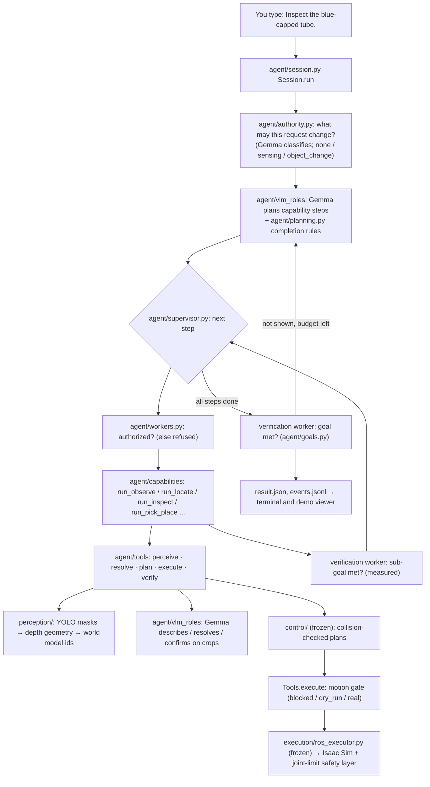

# Epson VT6L multimodal manipulation (Isaac Sim 6.1 + ROS 2 Jazzy)

## What this system does

A simulated Epson VT6L arm with a Robotiq 2F-85 gripper takes **typed instructions** and acts on what its two
RGB-D cameras measure. The cameras are a table camera on a stand and a wrist camera.

**Example instructions:**

- "Take a look at your surroundings."
- "Where is the blue-capped tube?"
- "Inspect the blue-capped tube."
- "Put the red cube on the green cube."

**How it works:**

| Concern | How |
|---|---|
| Perception | YOLO masks plus depth geometry measure every object; Gemma 4 E2B names them and reads the user's words |
| Planning and execution | a LangGraph supervisor plans with a fixed set of capabilities; every motion is collision-checked, executed by the frozen, validated manipulation core and checked by the simulator's safety layer |
| Verification | success is measured (finger contact, camera placement check, HOME joints), never assumed |
| Object knowledge | none is hard-coded: no colour lists, no object names, no simulator ground truth in the agent |

## Start here

**1. Edit `agent/settings.py`.** It is plain Python values:

| Setting | Values |
|---|---|
| scene | `SCENARIO`, `DIFFICULTY`, `SEED` |
| execution | `TARGET`, `MOTION` |
| models | `GEMMA_MODEL`, `YOLO_WEIGHTS` |
| windows | `ISAAC_WINDOW`, `DEMO_VIEWER`, `CAMERA_WINDOWS` |
| tracing | `TRACE` |
| outputs | `OUTPUT_DIR` … |

**2. Run:**

```bash
./launch/agent.sh
```

**What happens:**

1. The settings are validated and summarised.
2. Gemma and YOLO load.
3. Isaac Sim starts the configured scene; the shipped default is the laboratory, easy, seed 42.
4. ROS 2 connects, the cameras and windows open, and you get the `instruction>` prompt.

**While it runs:**

- **Motion:** planned motions are executed in Isaac Sim when `MOTION = "real"`, which is the shipped default.
- **Tracing:** every agent handoff is printed: the request's authority, each delegation and its input, each worker's
  output, the supervisor's review, failure reasons and the goal check.
- **Saved traces:** each instruction's full trace is in `out/demo/<date>/live_<time>/<nn>/events.jsonl`, with
  `task_state.json` and `result.json`.
- **Quitting:** an empty line quits and stops the simulator.

**Safety and the simulator:**

- Safety does not depend on the settings. Request authorization, collision checking, the simulator's joint-limit
  safety layer, the executor's reach checks and goal verification apply in every mode.
- `MOTION = "dry_run"` plans and logs motions without sending them; `"blocked"` sends nothing.
- `TARGET` can only be `"isaac_sim"`. Before it is ready, the agent checks that the ROS 2 graph is the simulator
  (its `vt6l_sim` command interface), so it never commands physical hardware.

**Other entry points:**

```bash
./launch/sim.sh                                # Isaac Sim only (laboratory), nothing commanded
./launch/tests.sh                              # all automated tests
./launch/evaluate.sh list                      # research experiments (Experiment 1, segmentation, planner, ...)
```

`python -m agent.run` used directly (the experiment harnesses do) keeps safe defaults: no simulator start, and motion
blocked unless `--motion real`. Commands, environments and the expected test results are in
`docs/DEVELOPER_GUIDE.md`.

## Where things are

| Question | Answer |
|---|---|
| Where do I configure a run? | `agent/settings.py` (validated at startup; `python -m agent.settings` prints the summary) |
| Where is the supervisor? | `agent/supervisor.py` (`GoalSupervisor`, a LangGraph state machine); plan rules in `agent/planning.py`; session state in `agent/session.py` |
| Where are the tools? | `agent/tools/`: one `Tools` object, the agent's only access to sensors and motion (perception, resolution, manipulation, execution, verification, held-object state) |
| Where are the capabilities the planner can choose? | `agent/capabilities/` (observe, describe, answer, locate; inspect, explore; pick, place, pick_place, return_home; decompose) |
| Where is YOLO? | `perception/detector.py` (weights path in `config/models.py`); depth geometry in `perception/geometry.py`; world model in `perception/world_model.py` |
| Where is Gemma? | `agent/vlm_roles/`: `gemma.py` (model adapter), `prompts.py`, `schemas.py`, `roles.py`; model loader `vlm/model.py`; settings `vlm/config.py` |
| What may a request do? | `agent/authority.py`, enforced in `agent/workers.py` before any capability runs |
| Where are the scenarios? | `scenarios/` (laboratory definition `scenarios/laboratory.py`, parts, Isaac builder, design checks, `scenes/*.json`) |
| Where is robot execution? | `agent/tools/execution.py` (`Tools.execute`, the motion gate) → frozen `execution/ros_executor.py` → simulator `sim/ros_control.py` with `safety/joint_limits.py` |
| Where are kinematics and grasp planning? | frozen `control/` (`kinematics.py`, `skills.py`, `collision.py`), called from `agent/tools/manipulation.py` |
| Where is the simulator? | `sim/` (`run_live.py` default scene, `run_scenario.py` test scenes, `scene.py`, ROS bridge) |
| Where is configuration? | `config/` (perception thresholds, tolerances, budgets, model paths); robot constants in frozen `control/robot.py` |
| Where are the tests? | `tests/unit/`, `tests/integration/`, shared fakes in `tests/support/` |
| Where are the experiments? | `evaluation/` (active) and `evaluation/historical/`; results under `out/` |

## How one instruction travels through the system



Every function in this path is listed in `docs/architecture/EXECUTION_FLOW.md`, with three traced examples.

## Directory guide

| Folder | Role |
|---|---|
| `agent/` | orchestration: supervisor, planning, session, authority, goals, controls, workflow, `capabilities/`, `tools/`, `vlm_roles/` |
| `perception/` | YOLO detector, RGB-D geometry, set-of-mark images, world model, wrist viewpoints (+ helpers shared with frozen / legacy code) |
| `config/` | configuration values and model paths |
| `scenarios/` | scenario library (laboratory) and JSON test scenes |
| `sim/` | Isaac Sim processes and the ROS 2 bridge |
| `control/`, `execution/`, `safety/` | **frozen** robot core: kinematics, planning, collision, executor, joint limits |
| `evaluation/` | research experiments and scoring (active); `evaluation/historical/` for earlier phases |
| `tests/` | automated tests: `unit/`, `integration/`, `support/` |
| `launch/` | `agent.sh`, `sim.sh`, `tests.sh`, `evaluate.sh`; `run.sh` and `legacy/` start the legacy stack |
| `assets/` | URDF / USD of the VT6L and the 2F-85 (frozen) |
| `docs/` | `DEVELOPER_GUIDE.md`, `architecture/`, `scenarios/`, `validation/`, `baselines/` (frozen evidence), `history/` |
| `datagen/`, `seg/` | synthetic training data and YOLO / Mask R-CNN training (offline tooling) |
| `experiments/`, `scripts/` | frozen baseline experiments and robot validation; early demos |
| `ros_nodes/`, `vlm/` | camera viewers; legacy agent nodes and planner (`vlm/model.py` is shared) |

**Not in git (hidden in the VS Code Explorer):**

| Folder | Contents |
|---|---|
| `models/` | Gemma weights |
| `data/` | YCB assets, datasets |
| `out/` | outputs and experiment evidence |
| `.venv*` | Python environments |
| `epson-robot-ros2/` | external clone |

## Environments

| Environment | Used for |
|---|---|
| `.venv-seg` | agent, Gemma, YOLO, full test suite |
| `.venv` | Isaac Sim |
| system Python + ROS 2 Jazzy | viewers, ROS tools |
| `.venv-vlm` | legacy stack only |

The launchers choose the right one.

## Documentation

| Read | For |
|---|---|
| `docs/DEVELOPER_GUIDE.md` | commands to run and test each subsystem |
| `docs/architecture/AGENT_ARCHITECTURE.md` | the multi-agent architecture: supervisor, workers, contracts, feedback loop, state |
| `docs/architecture/MODULE_GUIDE.md` | where to find X, the full tree |
| `docs/architecture/EXECUTION_FLOW.md` | the flow in detail, traced examples |
| `docs/architecture/FUNCTIONALITY_MAP.md` | every function: file, callers, status, test |
| `docs/architecture/TECHNICAL_DEBT.md` | known defects BD-1 … BD-9 (still open) |
| `docs/validation/FINAL_MAIN_READINESS.md` | the verification record and the manual acceptance checklist |
| `docs/scenarios/` | the laboratory scene |
| `docs/history/` | earlier designs, audits, demo reports and the old README (`LEGACY_SETUP.md`); historical, not current |

## Hardware model (summary)

| Part | Model |
|---|---|
| Arm | Epson VT6L from the manual (`assets/vt6l/vt6l.urdf`) |
| Gripper | Robotiq 2F-85 (Isaac asset, CC-BY 4.0) |
| Wrist camera | D435-style, on the J5 housing |
| Table camera | D435-style, on a stand at (1.5, 0.25, 1.8) m |

Details (frames, calibration, payload limits) are in `docs/history/LEGACY_SETUP.md`.
