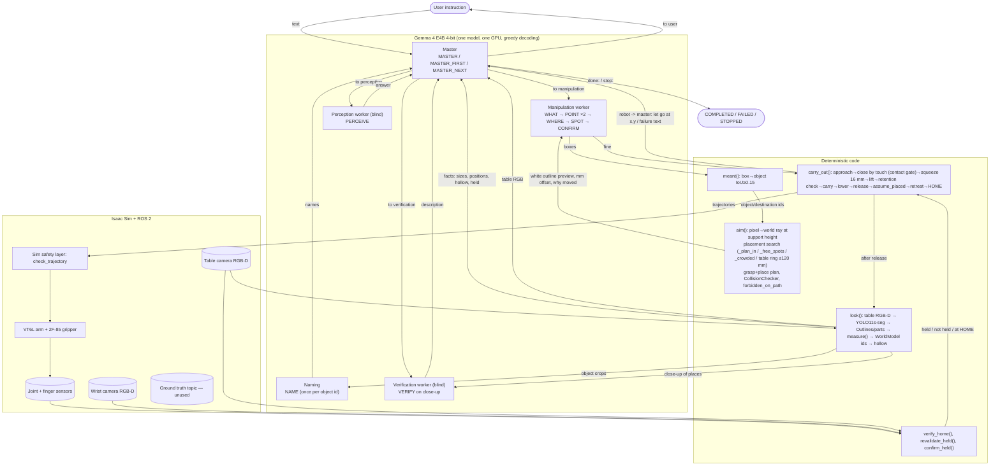

# ECE 620 — System Architecture and Failure-Analysis Audit

**Project:** Statistical Mission Reliability Modeling of Multimodal-AI-Enabled Robotic Cyber-Physical Systems
**System audited:** MAVLA-RTM `v3/dialogue` (branch `ma-vla`, commit `80eeb05`, 2026-11-18). Everything described here is what runs when `v3/dialogue/launch.sh` is started. Where the code it executes sits in a file outside the `v3/dialogue` folder, that file is cited as the reference.
**Scope:** Read-only inspection of code, prompts, tests and the logs in `v3/out/v3d/` (symlink to `6DOF-Arm/out/v3d/`). No code, prompt or configuration was changed and no robot or simulator motion was run. The only thing executed was the offline scripted test `v3/dialogue/tests/test_dialogue.py`, which uses a fake model and a fake robot.

All paths are relative to the repository root (`MAVLA-RTM/`). `file:N` means line N of that file at the audited commit.

### Status legend

| Tag | Meaning |
|---|---|
| **[IMPL]** | Implemented and on the `v3/dialogue` runtime path; confirmed in code |
| **[AVAILABLE]** | Provided by the running system (e.g. by the simulator) but not used during a request |
| **[PARTIAL]** | Implemented with a known gap (described next to it) |
| **[PROMPT]** | Behaviour asked of the model in a prompt only; no code enforces it |
| **[PLANNED]** | Listed as future/not yet done in repository docs |
| **[UNVERIFIED]** | Plausible from code or logs, not confirmed by this audit |

---

## 1. System architecture

### 1.1 Layering

`v3/dialogue` is about 1,000 lines of agent and robot-adapter code. It imports its robot, perception, planning, execution and simulator code from the files below:

| Layer | Files | Role |
|---|---|---|
| Conversation agents | `v3/dialogue/agents.py` (`Agents`), `v3/dialogue/prompts.py` | Master and three workers share one plain-language conversation; Gemma makes every semantic decision |
| Robot adapter | `v3/dialogue/arm.py` (`Robot`, a subclass of the robot module's `Robot`), `v3/dialogue/v3_config.py` | Box → measured object, pixel → world point, placement search near a pointed spot, preview outline, execution of one transfer |
| Robot module | `v3/robot.py` (`Robot`, `Outlines`, `parts`, `start`) | `look`, grasp with finger checks, HOME return, YOLO-mask correction, start-up of models and simulator |
| Perception, planning, safety, execution, model, simulator, scenes | `v2/src/agent/tools/*` (`Tools`), `perception/*`, `control/*`, `safety/*`, `execution/ros_executor.py`, `agent/gemma.py`, `vlm/*`, `sim/*`, `scenarios/*` | RGB-D perception, world model, motion and placement planning, collision checking, ROS 2 execution, simulator, scenes |
| Entry points | `v3/dialogue/run.py` (`main`, `Console`), `v3/dialogue/launch.sh`, `v3/dialogue/screen.py` | Start-up, per-request logging, live screen |

The design rule is in the module docstrings (`v3/dialogue/agents.py:1-7`, `v3/dialogue/arm.py:1-6`): Gemma decides; code only measures, checks safety, and moves.

### 1.2 AI models and their responsibilities

| Model | Where loaded | Used for | Nature |
|---|---|---|---|
| **Gemma 4 E4B-it**, 4-bit quantized, per-layer embeddings on CPU | `v2/src/agent/gemma.py` (`Gemma.ask`, line 37), `v2/src/vlm/model.py`, `v2/src/vlm/config.py` (`VLMConfig`) | **Every** agent role: master planning and decisions, object naming, manipulation worker (what/where), box pointing, spot description, spot confirmation, verification, perception Q&A | Probabilistic model with **greedy decoding** (`do_sample=False`, `gemma.py:83`). The output is a deterministic function of the exact input tokens and images. "Thinking" mode is on for some master calls. |
| **YOLO11s-seg** (class-agnostic instance masks) | `v2/src/perception/detector.py` (`YoloDetector`, line 26); weights `v2/out/seg/runs/yolo11s_seg_r1/weights/best.pt`, `imgsz=1024`, `conf=0.25` (`v2/src/config/models.py`) | Object outlines in the table-camera image (`Tools.perceive`) | Learned model, deterministic at inference [UNVERIFIED on GPU] |

No other learned model is used. The object matcher is switched off at start-up (`tools.matcher = None`, `v3/robot.py:343`).

Gemma call settings used by `v3/dialogue`:

| Call | Prompt (`v3/dialogue/prompts.py`) | Images | Max new tokens | Thinking |
|---|---|---|---|---|
| Name each new object | `NAME` | 448-px-scaled crop of that object | 24 | off |
| Master | system `MASTER` + `MASTER_FIRST` / `MASTER_NEXT` (+ `REPAIR`) | full table RGB | 400 (thinking budget capped by `V2_REASONING_TOKENS=1200`, `launch.sh`) | on at start, after a problem and after a user answer (`Agents.master`, `agents.py:81`) |
| Manipulation: what and where | `WHAT` | full table RGB | 120 | off |
| Pointing (object, destination, spot) | `POINT`, `SPOT` | table RGB or close-up | 60 | off |
| Spot description / confirmation | `WHERE`, `CONFIRM` | close-up (with white outline for `CONFIRM`) | 80 | off |
| Verification | `VERIFY` | close-up of the places worked at (whole table if none) | 200 | off; `blind=True` |
| Perception Q&A | `PERCEIVE` | full table RGB | 150 | off; `blind=True` |

`blind=True` (`Agents.ask`, `agents.py:55-63`) removes every conversation line except `user -> master` from the prompt. The measured facts (`{facts}`) are still included.

### 1.3 Agent architecture, orchestration and communication

- **One process, one thread, one model instance.** All "agents" are prompt roles played by the same `Gemma` object and called in sequence by `Agents` (`agents.py:19`). Nothing runs in parallel.
- **Shared blackboard:** `Agents.talk` is a list of `"speaker -> addressee: text"` lines. Every prompt containing `{talk}` gets the whole list, except the blind workers (see above) (`Agents.note`, `agents.py:50`).
- **Routing:** the master's answer must end in exactly one line matching `MESSAGE` (`agents.py:16`): `to manipulation|to perception|to verification|to user|done|stop`. `Agents.run` (`agents.py:209`) calls the method of the same name (`getattr(self, to)`).
- **Fixed parsing contracts** (the only rigid code-level interfaces): `pick up:` / `put down:` / `on the table by:` lines (`Agents.line`); `box: ymin, xmin, ymax, xmax` in 0–1000 units (`Agents.box`); `fine:` / `move it:`.
- **Robot as a speaker:** the robot adapter writes facts into the conversation (`robot -> master`, `robot -> manipulation`), e.g. the result of a transfer, refusals, and how far the planned spot is from the pointed spot.
- **Budgets** (`agents.py:14`): `MAX_TURNS=20` master turns, `MAX_QUESTIONS=3` user questions, `MAX_CORRECTIONS=2` spot corrections, `MAX_SAME=2` repeats of an identical failure line.

### 1.4 Cameras, sensors and perception algorithms

| Sensor | Definition | Used by `v3/dialogue` for |
|---|---|---|
| **Table camera** (fixed, eye-to-hand), RealSense-D435-like RGB-D, 1280×720 | `v2/src/sim/scene.py` (`add_table_camera`, `CAM_RESOLUTION`); pose `TABLE_CAMERA_POSITION=(1.5,0.25,1.8)`, target `(0,0.25,0)` in `v2/src/control/robot.py:66-67` | Everything the agents see; all object geometry; the "look in gripper" fallback |
| **Wrist camera** (D435-like on the J5 housing) | `v2/src/sim/scene.py` (`add_wrist_camera`) | Only the borderline-grasp check (`wrist_sees_held`, `v2/src/agent/tools/verification.py:106`) and held-state revalidation (`v2/src/agent/tools/held.py:37`); shown on the live screen (`screen.py`). **Not** used for grounding or verification by Gemma |
| **Joint encoders** (`/joint_states`) | `v2/src/agent/ros_bridge.py` (`RosBridge.q`) | HOME check (`verify_home`, tolerance 1.5°/joint), planning start state, executor goal check |
| **Gripper finger joint** (Robotiq 2F-85 `finger_joint`) | `RosBridge.finger`; calibration `v2/src/control/robot.py` | Contact and retention checks (`verify_contact`, `confirm_held`) |
| **Simulator safety events** (`/safety/events`) | `v2/src/sim/ros_control.py`, `v2/src/safety/joint_limits.py` (`check_trajectory`, `VelocityMonitor`) | Rejected or clamped commands make the execution step fail (`RosExecutor.execute`, `execution/ros_executor.py:172-185`) |
| **Simulator ground truth** (`/sim/ground_truth/objects`) | `v2/src/sim/ros_control.py:169`; `RosExecutor.ground_truth` (`ros_executor.py:92`) | **Not used** at runtime (opt-in evaluation channel only) [AVAILABLE] |

Perception pipeline for each `look()` (`v3/robot.py:134` → `v2/src/agent/tools/perception.py:111` `perceive` → `:207` `update_world`; then `v3/dialogue/arm.py:46`):
1. RGB-D snapshot of the table camera. Camera-identity, clock-reset and camera-pose checks raise `ObservationError` (`perception.py:111-130`, `_check_camera_pose`).
2. YOLO masks, then `Outlines.detect` (`v3/robot.py:59-119`): a deterministic correction that uses the depth difference since the last picture to recover outlines of objects just put down, cut tray rings, and drop "group" outlines.
3. `parts()` (`v3/robot.py:23`) joins a bottle cap to its bottle.
4. Masks that are mostly robot are excluded. `measure()` (`v2/src/perception/geometry.py:220`) back-projects the depth inside each mask: top height, centre, footprint, yaw, grasp width, support height, tilt.
5. `WorldModel.observe_frame` (`v2/src/perception/world_model.py:134`) assigns persistent IDs by mask IoU ≥ 0.30, then by proximity.
6. Depth points that no object explains become "unseen" collision boxes (`unexplained`, `perception.py:50`; used in `ManipulationTools.obstacles`, `manipulation.py:56`).
7. `arm.Robot.look` adds `hollow` (rim minus interior depth, in mm) per object (`arm.py:46-68`). An object with `hollow > 10` mm is treated as a container.
8. `Agents.look` asks Gemma to **name each new ID once per session** (`agents.py:26-35`). Names are never revised.

### 1.5 Robot, gripper, simulation and control interfaces

- **Arm:** Epson VT6L 6-DOF (`v2/src/sim/import_vt6l.py`, `v2/src/control/kinematics.py`), HOME = `[0,0,0,0,-90,0]°` (`control/robot.py`).
- **Gripper:** Robotiq 2F-85, one driven joint, 0 = open (87 mm) to 45° commanded close (`control/robot.py`).
- **Simulator:** NVIDIA Isaac Sim, started by `start_sim` (`v2/src/agent/run.py:52`) with `--scenario snack_kitchen --difficulty easy --seed 42` by default (`v3/dialogue/run.py:36-38`). One simulator per GPU (`launch.sh`).
- **Middleware:** ROS 2 Jazzy: `/joint_trajectory` in, `/joint_states`, `/safety/events` and camera topics out (`v2/src/sim/ros_control.py` header).
- **Motion planning (deterministic):** `SkillPlanner` (`v2/src/control/skills.py:105`): top-down hover → descend → close → lift; carry → lower → open → retreat; joint and straight-line trajectories (`control/motion.py`). Speeds: 45°/s on joint moves, 0.12 m/s peak on straight lines, 0.0375 m/s for the final lowering (`v3/dialogue/v3_config.py`, applied in `arm.py:22-31`).
- **Collision checking (deterministic):** `CollisionChecker` (`v2/src/control/collision.py:134`): robot as spheres, obstacles as oriented boxes, held object attached, conservative path check (`check_path`, `:368`).
- **Safety layers (deterministic):** planner-side `forbidden_on_path` (Epson J1/J2/J3 zones, `safety/joint_limits.py:69`). Simulator-side `check_trajectory` (`safety/joint_limits.py:100`, called in `sim/ros_control.py:89`) rejects out-of-range or over-speed trajectories independently of the planner.
- **Execution:** `Tools.execute` (`v2/src/agent/tools/execution.py:14`) → `RosExecutor.execute` (`v2/src/execution/ros_executor.py:120`). A step fails on safety rejection or when the goal is not reached within `timeout_factor=3` × planned duration (±1.5°). `ExecutionControls` (`agent/controls.py`) supports `real | dry_run | blocked`; `v3/robot.start` uses `real`.

### 1.6 Deterministic algorithms versus probabilistic AI components

| Deterministic (code) | Probabilistic / learned (AI) |
|---|---|
| Depth back-projection and geometry (`measure`), hollow measurement | YOLO instance masks (model output; errors are data-dependent) |
| Mask correction (`Outlines`, `parts`), world-model ID association | Gemma object naming (`NAME`) |
| Box → object association by IoU ≥ 0.15 (`Robot.meant`, `arm.py:70`) | Master plan, routing, ordering, done/stop/ask decisions |
| Pixel → world point via ray–plane intersection at the support height (`Robot.aim`, `arm.py:100-122`) | Manipulation worker: which object, which destination, relation (onto/into vs table-by) |
| Placement search: container free spots (`_free_spots`, `_plan_in`), finger-room filter (`_crowded`), table ring search ≤120 mm (`arm.py:152-167`) | Pointing boxes (object, destination, spot) |
| Grasp planning, IK, collision and joint-zone checks, trajectory generation | Spot description and acceptance (`fine` / `move it`) |
| Finger contact and retention thresholds, HOME joint check | Verification description (the **only** post-placement success evidence) |
| Budgets, parsing, routing table | Perception answers |

Gemma runs with greedy decoding, so its "probabilistic" behaviour is *epistemic*: for a fixed input it always gives the same output, and the variability comes from small input changes (scene seed, rendering, mask and ID noise, conversation history). See §5.5.

### 1.7 Runtime decision-making and feedback loops

1. **Outer loop: master turns** (`Agents.run`, `agents.py:209-232`): master → worker → robot facts / worker report → master. Up to 20 turns.
2. **Spot-negotiation loop** (`Agents.manipulation`, `agents.py:152-177`): describe → point → plan (`aim`) → preview outline → `fine` or `move it` (≤2 corrections). One automatic re-choice if the first spot is impossible.
3. **Act–look–report loop:** after every successful release, `look()` plus a blind verification description (`agents.py:180-183`). The master compares it with the request (`MASTER_NEXT`).
4. **Physical feedback inside a transfer** (`arm.py:197-253`): closing by touch, where the fingers step in 4 mm at a time until `verify_contact` passes (no contact ends the transfer), then squeeze 16 mm past the felt gap; retention after lifting (aborts the transfer); every motion step's executor result; HOME confirmation.
5. **User loop:** `to user` questions (≤3); scripted answers come from `--instructions` JSON.
6. **Repetition guard:** an identical `robot -> master` failure line repeated more than `MAX_SAME` times ends the request.

### 1.8 Architecture diagram

Solid arrows are information flow. Control flow is the master's single routed message per turn. Feedback paths: robot → master text, verification → master, `look()` after every transfer, and finger and joint checks inside a transfer.

---

## 2. Mission execution trace

### 2.1 The example instruction in this repository

The default `snack_kitchen` scenario (`v2/src/scenarios/snack_kitchen.py`) has no red cube. Its *easy* items are milk, water bottle, cracker box, fruit cup, apple and pudding box (`EASY_ITEMS`, line 50). The containers are a teal/"light blue" serving tray (360×260×25 mm) and a storage basket (`CONTAINERS`, line 38). The closest equivalent of *"Pick up the red cube and place it in the blue tray"* is therefore **"Put the apple in the blue tray."** The `ap_categories` / `ap_occlusion` fixed scenes (`v2/src/scenarios/scenes/*.json`) contain red and blue cubes, but they have not been run with `v3/dialogue` [UNVERIFIED].

### 2.2 Step-by-step sequence

| # | Stage (code) | Preconditions | Inputs → outputs | State transitions | Success criterion | Can terminate here? |
|---|---|---|---|---|---|---|
| 0 | Session start (`run.py:main`, `v3/robot.py:start`) | GPU free; no other simulator | Loads Gemma and YOLO, starts Isaac Sim, `connect()`, `revalidate_held()` | `00_start/` log | Simulator ready | Yes: `RuntimeError("the simulator did not become ready")` ends the session |
| 1 | Request intake (`Agents.run`, `agents.py:209`) | Previous request ended | User text → `user -> master` line | `talk=[...]`, `places=[]`, `moved=False` | — | — |
| 2 | `look()` (`agents.py:26`) | Arm not blocking the view (ends of actions return HOME) | Table RGB-D → objects `{id: width, length, height, x, y, hollow, crop}`; new IDs named by Gemma | World model updated; `robot.boxes` | ≥1 measured object | Exception → `ERROR` (`run.py:85-88`) |
| 3 | Master first turn (`Agents.master`, thinking) | — | facts + talk + table RGB → plan lines (`master -> all`) + one routed message | — | A parsable message line | No message after repair → `stop` → `STOPPED` |
| 4 | Manipulation "what" (`WHAT`) | Master sent `to manipulation` | Message → `pick up: apple` / `put down: blue serving tray` / `why:` | `manipulation -> robot` line | `pick up:` present | Without `pick up:` the answer goes back to the master as a report |
| 5 | Point at object (`POINT`) → `meant()` | — | Box (0–1000) → object ID with IoU | — | IoU ≥ 0.15 | No: "Nothing was moved … no single outlined and measured object" → master |
| 6 | Point at destination → `meant(skip=object)` | `put down` or `on the table by` | Box → destination ID; `hollow>10` → "inside it" | `support` set (None for table) | IoU ≥ 0.15 | Same as 5 |
| 7 | Close-up and spot description (`zoom`, `WHERE`) | — | Close-up → one-sentence spot | — | — | — |
| 8 | Point at spot (`SPOT`) → `aim()` | — | Spot box → pixel → world (x, y) at support height → `PickPlan` via `plan_pick_place` → `_plan_in` (container) or `_place` (table) | `robot.target`, `support`, `moving` | A collision-free grasp **and** place **and** home plan | First failure: worker told "choose another place" once; second failure: `robot -> master` "was not moved" |
| 9 | Preview and confirm (`preview`, `CONFIRM`) | Plan exists | White outline + "N mm from the spot you pointed at" (+ `why_moved()` if > 25 mm) → `fine` / `move it` | Up to 2 corrections; an impossible correction keeps the previous plan | `fine` (or no `move it:` line) | — |
| 10 | Ready (`_ready` → `prepare_pick`) | Nothing held; gripper open | Opens gripper, returns HOME, `verify_home` | Logs `localized` | `ready["ok"]` | **Not checked in `carry_out`**: `aim()` checks it at step 8 before the plan is made |
| 11 | Grasp (`arm.py:_grasp`, line 197) | Plan | approach (hover + descend); fingers start at max(width, length) + 4 mm (≤ 82 mm) and close 4 mm per step, waiting until they stand still (`_settle`), until `verify_contact` passes; then close 16 mm past the felt gap (`v3_config.py` `GRIP_STEP_M`, `GRIP_SQUEEZE_M`, `GRIP_OPEN_M`); `set_held`, lift, `confirm_held` | `held_object` set | Contact found **and** retention check passes | No contact down to the minimum gap: gripper opened, transfer aborted. Not retained after the lift: open, HOME. Both report "the gripper closed but did not hold the object after lifting; it was not moved" to the master |
| 12 | Carry, lower, release, retreat (`arm.py:carry_out`) | Held | Executor steps | `assume_placed` sets the object's world pose to the **planned** pose; `clear_held` | Each executor step ok | Executor or planning error: `_home(False, error)`; if still holding, the arm stays where it is |
| 13 | HOME (`_home`) | Gripper empty | `return_home` (retried once) + `verify_home` | `moved=True` | All joints within 1.5° | Not at HOME: `ok=False` with reason |
| 14 | Report (`robot -> master`) | — | "let go of at x, y mm; where it stands now has not been checked; the arm is back at HOME" | — | — | — |
| 15 | Re-look + independent verification (`look`, `describe`) | `ok` | New table picture → close-up of all places worked at → blind `VERIFY` | `places += [destination]` | — (description only) | — |
| 16 | Master next turn (`MASTER_NEXT`, thinking if the last step failed) | — | Whole talk → `done:` / another `to manipulation` / `to verification` / `to user` / `stop:` | — | `done:` | `done` → **COMPLETED**; `stop` → FAILED if the arm moved, else STOPPED; budgets → FAILED/STOPPED |

### 2.3 What "success" means

- **Request level:** `COMPLETED` means only that the master emitted `done:` (`agents.py:217-219`). No code checks the final world state against the request. The evidence the master is told to use is the verification worker's description of a close-up (`MASTER_NEXT`, `MASTER` "What the verification worker describes after the release counts") [PROMPT].
- **Transfer level:** `carry_out` returns `ok=True` when the grasp was retained after the lift, every executor step succeeded and the arm reached HOME. The report says explicitly that the final pose "has not been checked" (`arm.py:249`).
- **Possible statuses** (`agents.py:219,224,231,232`; `run.py:85-88`): `COMPLETED`, `FAILED` (arm moved), `STOPPED` (arm never moved), `ERROR` (Python exception). They are saved per request in `results.json` with seconds and the number of model calls (`run.py:89-90`).

### 2.4 Multi-object tasks

- The master plans the whole job and the placement order up front (`MASTER_FIRST`: "at most six short lines", "fill it from one side") [PROMPT], then sends **one manipulation message per object** (the arm carries one object at a time).
- Shared state across objects: `talk` (all earlier messages), `places` (destinations for the verification close-up), the world model (placed objects become obstacles and tray contents via `assume_placed` and the next `look`), and `names`.
- Room for later objects is handled by `_free_spots` plus `_crowded` (30 mm finger room, `FINGER_ROOM_M`, `arm.py:34`). Planning order and spacing are suggested only through prompts (`WHERE`, `CONFIRM`).
- Termination needs the master to judge that **all** requested objects appear in the latest descriptions (`MASTER_NEXT`) [PROMPT]. The 20-turn budget is shared by the whole request, and a four-object request used 42–51 model calls (§5).

### 2.5 Retries and recovery (summary; details in §3)

There are **no automatic code-level retries** of a grasp or placement in `v3/dialogue`. Every retry is a master decision [PROMPT]. Code-level recovery is limited to: one automatic spot re-choice (`agents.py:163-165`), a repair prompt for an unparsable master answer (`agents.py:95-101`), a second HOME planning attempt (`v3/robot.py:303-304`), the gripper opening after a missing contact or a failed retention check (`arm.py:216-218`, `arm.py:231-233`), and moving on to the next request after an exception (`run.py:85-88`).

---

## 3. Failure detection and recovery

| # | Failure mechanism | Component | Failure condition | Detection mechanism | Recovery behaviour | Logs / evidence | Status |
|---|---|---|---|---|---|---|---|
| F1 | **Wrong object name** | Gemma `NAME` (`agents.py:33-35`) | Crop named incorrectly (logs: fruit cup named "yellow fruit label", "yellow roll of tape", "yellow label roll") | **None in code.** Names are cached for the session and never re-checked | None; the master may ask the user or perception worker [PROMPT] | `say` lines `naming`; `prompt`/`model_output` events; `images/model_inputs/*.png` | [IMPL] detection absent |
| F2 | **Missed / merged / split segmentation** | YOLO + `Outlines` + `parts` + `measure` | Object missing, two objects merged, a part measured as an object, wrong size (grip experiment round 3: apple measured 48×19×65 mm instead of 65×65×70) | Partial: mostly-robot masks excluded; `measure()` returns None with a reason (`excluded` list in the `perceive` tool event); unexplained depth becomes obstacles | None for semantics; wrong geometry usually ends in a planning failure (F6) | `tool`/`perceive` event: detections, objects, excluded, unexplained; `*_numbered.jpg` | [PARTIAL] |
| F3 | **Incorrect grounding (box → wrong object)** | `POINT` + `Robot.meant` (IoU against bounding boxes) | Gemma's box overlaps the wrong object more than the right one, or IoU < 0.15 | IoU < 0.15 → refusal "Nothing was moved…" to master (`agents.py:125-128,138-141`). **A wrong but overlapping box is not detected** | The master re-plans or asks [PROMPT] | `say` `manipulation points` with the raw box; `robot -> master` refusal text | [PARTIAL] |
| F4 | **Ambiguous / absent object or destination** | `WHAT`, `MASTER` | Several candidates or none | Prompt-only: the worker is told "do not guess… write only one sentence for the master"; the master is told to ask the user (`MASTER` rules) | `to user` question (≤3) → `STOPPED` when the budget is used up (`agents.py:221-227`) | `question` / `ask_user` events; `results.json` answer | [PROMPT] + budget [IMPL] |
| F5 | **Grasp: fingers find no object** | `arm.py:_grasp` (line 197) | Fingers close down to the minimum gap (4 mm steps) without `verify_contact` passing (stopped short < 1.5°) | `verify_contact` after every step, once the fingers stand still (`_settle`, line 187) | Gripper opened; `carry_out` returns to HOME and reports to the master (same text as F6b) | `verification check=contact` per step (`gap_mm`); `say` "NO contact, the fingers closed on nothing" | [IMPL] |
| F6a | **Motion planning / reachability failure** | `plan_pick_place` → `_plan_grasp` (top-down candidates only), `_plan_in` / `_place`, `CollisionChecker`, `forbidden_on_path` | No collision-free grasp, place or home plan; target outside the 0.38–0.90 m reach ring (`config/agent.py:12`); container full; top face not visible | `PlanningError` from the planner, caught in `Robot.aim` (`arm.py:119-122`) | First failure: worker asked to choose another place; then a `robot -> master` sentence. | `grasp_candidates`, `tool placement_search` (`tried` list with reasons), `say` text | [IMPL] |
| F6b | **Object not retained after the lift** | `_grasp` → `confirm_held` (`verification.py:81`) | Fingers not stalled (`stopped_short < 0.5°`), or borderline and neither the wrist camera nor the table camera sees the object | Fingers, then the wrist camera (`wrist_sees_held`), then the table camera (`look_in_gripper`) | Gripper opened, HOME, "the gripper closed but did not hold…" to master; the master decides whether to retry [PROMPT] | `verification` event `check=retention`, `by=…`; `say` "NOTHING is held" | [IMPL] |
| F6c | **Object dropped during carry** | carry/lower steps | Object slips between the lift and the release | **No check between the lift and the release.** After the release, `assume_placed` records the planned pose | Only the next `look()` / verification description can reveal it | — | **Not implemented** |
| F7 | **Collision** | Planner (`CollisionChecker.check_path`), sim safety layer | Planned path intersects an obstacle; trajectory outside joint or speed limits | Before execution: collision and zone check (`PlanningError`). During execution: sim `check_trajectory` rejection → `RosExecutor` "safety layer rejected" | Transfer aborted → `_home(False, …)` | `tool execute` events (`ok`, `failed_step`, `reason`), `sim.log`, `/safety/events` | [IMPL] for planned motion. **Physical contact during execution (e.g. pushing a neighbour) is not sensed** (no force/contact sensing) |
| F8 | **Execution failure / controller timeout** | `RosExecutor.execute` (`ros_executor.py:120-189`) | Goal not reached within 3× the planned time (±1.5°) | Step result `ok=False` → `RuntimeError` in `_do` (`v3/robot.py:174-175`) | `_home(False, …)`. **If the object is still held, the arm stays where it is** (`v3/robot.py:298-299`), and the next `prepare_pick` refuses until the held object is "resolved" | `tool execute`, `state` events | [PARTIAL]: no recovery for a held object after an aborted transfer |
| F9 | **Incorrect placement** (wrong spot, tipped over, rolled off, outside the tray) | Place plan + physics | Object ends up away from the planned pose or not supported | **Only Gemma's verification description** (`describe`, `agents.py:197-207`) after every successful release. | The master can re-issue the transfer [PROMPT] | `verification -> master` text; close-up input image saved | [PARTIAL] |
| F10 | **Spot drift (pointed vs planned)** | `aim` + placement search | Planned spot far from the intended one (logs: 8–222 mm) | Distance reported to the worker; `why_moved()` sentence when > 25 mm | Worker can say `move it` (≤2). Logs: 29 `fine` vs 3 `move it` | `robot -> manipulation` "N mm from the spot"; `images/*_place_<id>.jpg` | [IMPL] detection, [PROMPT] judgement |
| F11 | **Verification error** (false "is there" or false "is missing") | Gemma `VERIFY` | Description disagrees with the true state | **None at runtime.** Offline experiment in `out/v3d/experiments/verify_2026-11-18/` scored descriptions against truth labels | None | `verification -> master` text; experiment `results.json` | No runtime check; offline experiment only |
| F12 | **Wrong master decision** (premature `done`, moving an object nobody asked for, asking the user instead of retrying) | Gemma master | Logs and README: an extra object was ordered after all four were placed; after a problem the master tends to report or ask | Prompt rules only (`MASTER_NEXT`: "Move only what the user asked for"); budgets | `MAX_TURNS`, `MAX_SAME`, `MAX_QUESTIONS` stop the loop | `master -> *` lines, thinking text in `model_output` | [PROMPT] + budgets [IMPL] |
| F13 | **Unparsable model output** | `Agents.master`, `Agents.box`, `Agents.line` | No message line; no box numbers | Regex parse fails | Master: plan kept and `MASTER_NEXT` asked again, or `REPAIR` once, then `stop`. Box None → refusal text | `say` "(no message line)" | [IMPL] |
| F14 | **Sensor failure / missing evidence** | `perceive`, `RosBridge.snapshot`, depth | Wrong camera, sim clock reset, camera pose mismatch, no depth at the pixels | `ObservationError` (`perception.py:111-130`); `wrist_sees_held` returns `held=None` when there is no depth | `ObservationError` is **not caught** in `Agents` → the request ends as `ERROR` (`run.py:85-88`). `held=None` → falls through to the table camera | Python exception text in `results.json`; `sensor_bundle`, `calibration` events | [PARTIAL] |
| F15 | **Not at HOME** | `_home`, `verify_home` | Any joint > 1.5° from HOME | Joint feedback (`verification.py:165`) | One re-plan of `return_home`; then `ok=False` + reason | `verification check=home` (per-joint error, TCP error mm) | [IMPL] |
| F16 | **Stale held state** | `revalidate_held` (`held.py:37`) | Remembered held object not supported by finger feedback, or an unknown object between the fingers | Finger + wrist + table checks at session start and before every pick | Claim dropped (object status `missing`), or `prepare_pick` refuses | `session_state` events | [IMPL] |
| F17 | **Process crash / exception** | any | Uncaught exception in one request | `try/except` in `run.py:85-88` | Status `ERROR`, the session continues with the next request | `results.json` | [IMPL] |
| F18 | **Budget exhaustion / livelock** | `Agents.run` | 20 turns, 3 questions, the same failure line 3 times | Counters | FAILED / STOPPED with reason | `results.json` answer | [IMPL] |

---

## 4. Dependencies between components

### 4.1 Confirmed architectural dependencies (from code)

| ID | Dependency | Mechanism (file) | Reliability implication |
|---|---|---|---|
| D1 | **One model behind every AI role** | `Agents.gemma` is the single `Gemma` instance for master, naming, manipulation, pointing, verification and perception (`run.py:63`, `agents.py:20`) | Common-cause failure: model weaknesses, quantization effects and GPU/driver faults affect all roles together. AI events cannot be treated as independent by default |
| D2 | **One camera behind perception and verification** | Every `look()` and every verification image comes from the table camera (`v3/robot.py:137`) | Occlusion, lighting or rendering problems affect grounding and verification together. Verification is not an independent sensor channel |
| D3 | **Verification sees the same measured facts** | `VERIFY` includes `{facts}`, computed by the same YOLO+depth pipeline (`agents.py:41-48`, `prompts.py:104`); `blind` removes only conversation lines | A segmentation or naming error (F1/F2) can bias the verifier toward the same mistake. The verify experiment's conditions "B/C/D" (facts included) vs "F" (no facts) are a direct probe of this |
| D4 | **Names propagate** | `Agents.names` is set once per object ID and used in every later prompt and robot sentence (`agents.py:22,34`) | A naming error persists for the whole session (all requests) |
| D5 | **Perception → planning** | Grasp and place plans use measured geometry (`_grasp_inputs`, `manipulation.py:73-88`; `_plan_in`, `_free_spots`); wrong size or yaw → planning failure or a wrong starting gap for closing by touch (start = measured max(width, length) + 4 mm, at most 82 mm; `arm.py:207`) | Segmentation errors cause planning and grasp failures (grip experiment round 3) |
| D6 | **Grounding → grasp target** | `meant()` decides which object ID is planned and grasped (`agents.py:124`) | A wrong-but-overlapping box executes a physically "successful" transfer of the wrong object |
| D7 | **Motion outcome → AI decisions** | Robot result sentences enter `talk` and switch on master thinking (`agents.py:229`) | The master's next action depends on the failure text. Errors are correlated over time |
| D8 | **Assumed pose → later planning** | `assume_placed` writes the planned pose into the world model before re-observation (`manipulation.py:536-545`); the next `look()` re-measures | If the object moved after release, there is a short window of wrong obstacle and container-contents data. The re-look corrects it unless F2 occurs |
| D9 | **Placed objects constrain later placements** | `_free_spots`, `_crowded`, `_too_close`, obstacles | Multi-object success probability falls with each placement (less free area, more collision constraints) |
| D10 | **Task history in prompts** | `MASTER_*`, `WHAT`, `WHERE`, `CONFIRM` include the whole conversation; the world model and names persist across requests (`Tools` docstring, `v2/src/agent/tools/__init__.py`) | Trials within one session are **not independent**. Each request is affected by earlier ones |
| D11 | **Shared infrastructure** | One GPU for Isaac Sim + Gemma + YOLO (`vlm/config.py` comments); one ROS 2 graph; one Python process | Resource exhaustion or a crash takes down every function at once |
| D12 | **HOME precondition** | `Outlines.detect` compares depth only for pictures taken in the same arm pose (`v3/robot.py:85`); every action ends at HOME | A HOME failure degrades the next segmentation (F15 → F2) |

### 4.2 Statistical relationships that need experimental validation

| Hypothesis | Why plausible | How to test |
|---|---|---|
| P(verification error) is higher when perception or naming was wrong | D2, D3 | Joint labels of naming correctness and verification correctness from simulator ground truth |
| P(grasp slip) depends on object shape (round > box) | README "Round objects … slip"; grip experiment cup 1/4 retained+released | Repeated grip trials per object class and seed |
| P(planning failure) rises with the number of objects already placed | D9 | Stratify transfer outcomes by placement index |
| Spot-drift magnitude predicts placement failure | F10 | Correlate the mm offset with ground-truth final pose |
| P(master mistake) rises with conversation length | D7, D10; prompt size grows | Turn index vs decision correctness |
| Seed-to-seed variance dominates within-seed variance | Greedy decoding (§5.5) | Repeat identical seeds vs different seeds |
| P(retention failure) depends on the felt gap and object shape, even when contact is found | README: the fruit cup is usually lost at its first pick although its width, centre and grip force are right | Cross-tabulate `check=contact` `gap_mm` with `check=retention` per object |

---

## 5. Existing experimental infrastructure

### 5.1 Simulation scenarios and task classes

- Procedural scenarios (`v2/src/scenarios/`): `snack_kitchen` (default for `v3/dialogue`), `workcell`, `laboratory`, `scrub_nurse`. Each is `build(difficulty, seed)` with `easy|medium|hard` (`scenarios/core.py`; e.g. snack kitchen `ITEMS`, `CONFIG` with random yaw on *hard*, `snack_kitchen.py:51-56`). Layouts come from `np.random.default_rng([seed, attempt])` (`snack_kitchen.py:208`).
- Fixed scenes (`v2/src/scenarios/scenes/`): `ap_categories`, `ap_occlusion`, `graspable_blocks` (red, blue and yellow cubes etc.).
- Uncommitted local change at the time of this audit: `v2/src/scenarios/snack_kitchen.py` lowers the fruit cup's `fill` from 0.9 to 0.62 (its effect on mass and grasping is [UNVERIFIED]).
- Ground-truth metadata per layout: `out/scenarios/live/<id>_<difficulty>_s<seed>.json` (`sim/run_scenario.py:15,64`).
- Task classes that `v3/dialogue` supports: put into/onto an object (`put down`), put on the table near an object (`on the table by`), pick and hold, question only (`to perception` / `done`). README: "Not yet run live: placing on the table beside an object, a question only, an absent object" [UNVERIFIED live]. Sample list: `v3/dialogue/tests/sample.json`.

### 5.2 Test suites

| Suite | What it covers | Status |
|---|---|---|
| `v3/dialogue/tests/test_dialogue.py` | 10 scripted checks with `FakeGemma` / `FakeRobot`: single and two-object transfers, one correction, prompt contents, blind verification, refusal on an unmeasured object, user cancel, question only, repair, table-beside, pick-and-hold | **Ran in this audit: 10/10 PASS** (README says 9; one was added) |
| `v3/dialogue/tests/gemma_only.py` | Real Gemma on a saved table picture of a finished run; no simulator; no fit check | Manual tool |

### 5.3 Execution logs and telemetry

Per request (`v3/out/v3d/<date>/run_<time>/<nn>/`):
- `events.jsonl` (`v2/src/agent/eventlog.py`): one JSON object per line with `t`, `monotonic_s`, `wall`, `kind`. Kinds seen in the logs: `instruction, say, prompt, model_images, model_output, sensor_bundle, calibration, tool, timing, verification, grasp_candidates, localized, state, world, session_state, question, ask_user`.
  - `prompt`: the full prompt text, system prompt, thinking flag.
  - `model_output`: answer, thinking text, input/generated/thinking tokens, seconds, budget (`gemma.py:92-101`).
  - `model_images`: per-image shape, **sha256** and path of the exact model input (`images/model_inputs/NNN_i.png`).
  - `tool`: perceive (detections, exclusions, unexplained), execute (ok, failed step, reason, per-step timing), placement_search (candidates tried with reasons), return_home.
  - `verification`: contact, retention (with `by=`), home (per-joint error).
  - `timing`: spans for gemma / planning / motion / settling (`agent/timing.py`).
  - `state`: arm phase (APPROACH, CLOSE, LIFT, CARRY, …) and the final goal state.
- `images/`: `*_numbered.jpg` (outlines), `*_place_<id>.jpg` (preview outline), model inputs.
- Per session: `results.json` (`request, status, answer, seconds, model_calls`), `sim.log`, `sim.process.json`, `00_start/`.
- Live screen: `v3/out/live/` (`v3/dialogue/screen.py`).

### 5.4 Success and failure labels that exist today

| Label | Source | Trustworthy as ground truth? |
|---|---|---|
| Request status COMPLETED / FAILED / STOPPED / ERROR | `results.json` | **No**: COMPLETED is the master's own claim (§2.3) |
| Transfer outcome text | `say` `robot -> master` | Partly: grasp retention and HOME are sensor-backed; the final pose is not |
| Contact / retention / HOME pass | `verification` events | Yes for those physical checks (sensor thresholds) |
| Planning failure + reason | `tool placement_search`, `grasp_candidates`, `say` | Yes (deterministic) |
| Verification correctness | `out/v3d/experiments/verify_2026-11-18/results.json` (48 judgments over 6 prompt conditions) and `results_two_pictures.json` (16) | Yes for that experiment. Where the `truth` labels come from is not recorded in the repository [UNVERIFIED: likely simulator ground truth] |
| Grip trials | `out/v3d/experiments/grip_2026-11-18_*` (11 folders: the apple and the fruit cup picked and put down without the language model, under several grip settings; `rows.json` per folder, missing in `cup_light2`) | Outcome text per pick; the final pose was not checked |

Live dialogue results on 2026-11-18 (12 run folders; 6 have `results.json`):

| Run | Request | Status | Seconds | Model calls |
|---|---|---|---|---|
| run_052500 | 4 objects → blue tray | STOPPED (3 questions) | 1050 | 45 |
| run_061843 | 4 objects | FAILED (fruit cup: no collision-free plan) | 1058 | 49 |
| run_064130 | 4 objects | FAILED (fruit cup not retained) | 863 | 42 |
| run_152905 | milk → blue tray | COMPLETED | 734 | 22 |
| run_174026 | 4 objects | COMPLETED (after one non-retained fruit-cup grasp) | 881 | 51 |
| run_190906 | 4 objects | FAILED (fruit cup, named "yellow tape roll": no safe path, reach) | 1008 | 51 |

The other six folders have no `results.json` (stopped before the request finished) [UNVERIFIED cause].

Verification experiment (count of scored items correct / wrong / unscored, from `results.json` + `results_two_pictures.json`):

| Condition | Correct | Wrong | Unscored |
|---|---|---|---|
| A: facts + whole conversation, table picture | 26 | 2 | 2 |
| B: blind, facts, table picture | 27 | 1 | 2 |
| C: blind + outlines | 27 | 1 | 2 |
| D: blind + close-up | 26 | 0 | 4 |
| E: blind + close-up with outlines | 24 | 3 | 3 |
| F: picture only (no facts) | 8 | 0 | 22 |
| G: blind + whole table and close-up | 27 | 1 | 2 |
| P: perception prompt, blind, two pictures | 29 | 1 | 0 |

"Unscored" means the answer used a name the scorer could not match (e.g. "yellow fruit label" for the fruit cup). This interacts with F1.

The README scores the same experiment per object case (30 cases): a close-up of the tray with no conversation, which is what runs now, was right in 30 of 30 (`v3/dialogue/README.md`, "The look after every release").

Grip results with closing by touch (`v3/dialogue/README.md`, "The grip: closing by touch"): the apple was held 3 of 3 (about 5 mm slide during the lift); the fruit cup was lost 2 of 2 at its first pick from its start spot and held 1 of 1 from another spot.

### 5.5 Repeatability and stochastic sampling

- **Scene layout:** controlled by `--seed` (default 42) and `--difficulty` [IMPL].
- **Model outputs:** greedy decoding is hard-coded (`do_sample=False`, `gemma.py:83`). There is **no temperature or sampling switch** in `Gemma.ask`. Identical inputs give identical outputs; variability comes only from inputs.
- **Bitwise repeatability of whole trials** depends on Isaac Sim physics and rendering determinism, CUDA kernel determinism of 4-bit inference, and ROS timing (the executor reads the sim clock while spinning) [UNVERIFIED]. The saved image sha256 values in `model_images` make it possible to check whether two trials saw identical inputs.
- **Session state carry-over** (D10): for independent trials, each request has to run in a fresh session (new process) or the state has to be reset.
- **Configurable ablations** via environment variables: `VLM_QUANTIZATION`, `VLM_THINKING`, `VLM_THINKING_TOKENS`, `VLM_IMAGE_MAX_SIDE`, `VLM_IMAGE_TOKENS` (`vlm/config.py`), `V2_REASONING_TOKENS` (`launch.sh`), `Performance.from_env` flags (`agent/performance.py`).
- **Batch execution:** `--instructions <json>` with scripted user answers (`run.py:46-74`); `HEADLESS=1`, `SCREEN=0`.

### 5.6 Reliability parameters: estimable now vs needing instrumentation

| Parameter | Estimable now? | From |
|---|---|---|
| P(planning failure per transfer), by reason | **Yes** | `tool placement_search`, `grasp_candidates`, `say` |
| P(grasp not retained per attempt) | **Yes** | `verification check=retention` |
| P(contact-check fail) and its relation to retention | **Yes** | `verification check=contact` + `retention` |
| P(HOME failure) | **Yes** | `verification check=home` |
| P(executor / safety rejection) | **Yes** | `tool execute` `ok/failed_step/reason` |
| P(unparsable master answer), P(pointing refusal) | **Yes** | `say` lines |
| Spot-drift distribution, worker acceptance rate | **Yes** | `robot -> manipulation` mm text, `fine` / `move it` |
| Latency / mission-time distributions | **Yes** | `model_output.seconds`, `timing`, `results.json` |
| P(verification error) | **Partly** (64 labelled judgments, 1 day) | verify experiment |
| P(naming error) | **No**: needs per-object truth | Simulator ground truth + ID-to-truth association |
| P(segmentation / measurement error) | **No** | Compare `measure()` output with the ground-truth pose and size |
| P(grounding error: wrong object picked) | **No** | Truth label of the picked object ID |
| P(placement error: final pose outside the goal) | **No** | Ground-truth final pose (the simulator topic exists, unused) |
| P(drop during carry) | **No** | Retention check during carry or ground-truth tracking |
| P(master false `done`) / mission reliability | **No**: COMPLETED is self-reported | Ground-truth goal check per request |
| Unintended disturbance of other objects | **No** | Ground-truth poses of all objects before and after |

---

## 6. Candidate basic failure events (preliminary)

Phases: **S** = session start, **O** = observe (look/name), **P** = master planning/decision, **G** = grounding (what/point/meant), **L** = placement selection (aim/preview/confirm), **X** = execution (grasp/carry/release/home), **V** = verification/termination.

| Event (Boolean) | Exact failure definition | Phase | Observable evidence | Recovery / mitigation in code | Potential dependencies | Measurement method |
|---|---|---|---|---|---|---|
| `E_SEG` (segmentation) | A requested object or destination has no measured object of its own, or its measured footprint/height differs from ground truth by > tolerance (to be fixed, e.g. 15 mm) | O | `perceive` tool event; `*_numbered.jpg` | None (re-look after each transfer) | Occlusion, placed objects, HOME pose (D12) | Ground-truth comparison (needs instrumentation) |
| `E_NAME` | The name Gemma gave an ID does not denote the true object class/colour | O | `naming` say lines | None; persists (D4) | D1, crop quality, E_SEG | Ground-truth label per ID (needs instrumentation; also needs a name-matching rule) |
| `E_PARSE_M` | Master answer still has no valid message line after repair | P | "(no message line)", stop "did not give a usable answer" | REPAIR prompt once | D1, prompt length (D10) | Logs (now) |
| `E_PLAN_AI` | Master's plan or order makes a later object infeasible, or it targets an object or destination not requested | P | `master -> all` plan lines; `master -> manipulation` | Prompt rules only | D1, E_NAME, history (D10) | Manual or ground-truth labelling of messages |
| `E_GROUND_REFUSE` | `meant()` IoU < 0.15 for the object or destination | G | "Nothing was moved…" | Report to the master | E_SEG, E_NAME, D1 | Logs (now) |
| `E_GROUND_WRONG` | `meant()` returns an ID that is not the requested object or destination | G | ID in `localized` event | **None** | E_NAME, E_SEG, nearby look-alikes | Ground truth for the selected ID (needs instrumentation) |
| `E_PLACE_INFEASIBLE` | `aim()` returns no plan (PlanningError) on both attempts | L | `placement_search ok=False`, `grasp_candidates`, say text | One re-choice, then the master | E_SEG geometry, D9 crowding, reach ring | Logs (now) |
| `E_SPOT_DRIFT` | Planned spot more than d mm (e.g. 50) from the pointed spot and accepted with `fine` | L | "N mm from the spot", CONFIRM answer | ≤2 corrections [PROMPT] | Pointing imprecision (README), container occupancy | Logs (now) |
| `E_CONTACT` | No `verify_contact` pass at any closing step down to the minimum gap | X | `verification check=contact pass=false` on every step; "NO contact" | Gripper opened, transfer aborted, master informed | Starting gap from E_SEG, grasp yaw, object pose | Logs (now) |
| `E_RETAIN` | `confirm_held` fails after the lift | X | `check=retention pass=false`, "NOTHING is held" | Open, HOME, master may retry | E_CONTACT, object shape, E_SEG | Logs (now) |
| `E_DROP` | Object leaves the gripper between the lift and the release | X | None at runtime | None | Shape, carry speed (`v3_config.py`), E_RETAIN borderline | Ground-truth tracking (needs instrumentation) |
| `E_EXEC` | An executor step fails (safety rejection or controller timeout) | X | `tool execute ok=false`, `sim.log` | `_home(False)`; arm stays put if holding | Planner model mismatch, speed limits | Logs (now) |
| `E_HELD_STUCK` | After E_EXEC the object is still held and the next `prepare_pick` refuses | X | `session_state`, "resolve or place the held object" | None | E_EXEC | Logs (now) |
| `E_HOME` | `verify_home` fails after an action | X | `check=home pass=false` | One re-plan | E_EXEC | Logs (now) |
| `E_PLACE_POSE` | After release, the object is not in or on the requested destination, or is tipped (> 5°) | X/V | None in code; verifier text | Master retry [PROMPT] | E_SPOT_DRIFT, shape, E_SEG of the container floor (`_container_floor`) | Ground truth or `verify_placement` (needs instrumentation) |
| `E_DISTURB` | A non-target object moves more than tolerance during the transfer | X | None | None | Clearance, crowding (D9) | Ground truth all objects (needs instrumentation) |
| `E_VERIFY_FN` | Verifier says an object is where it should be when it is not | V | `verification -> master` text | None | D1, D2, D3, E_NAME | Ground truth vs text (experiment protocol exists) |
| `E_VERIFY_FP` | Verifier reports a correctly placed object as missing or wrong | V | Same | None (can trigger needless re-moves) | Same | Same |
| `E_DONE_FALSE` | Master emits `done:` while the ground-truth goal is not met | V | `results.json` COMPLETED | None | E_VERIFY_FN, D7 | Ground-truth goal check (needs instrumentation) |
| `E_GIVEUP` | Master emits `stop:` / asks the user although a feasible retry existed | V | `results.json` FAILED/STOPPED, question events | Budgets only | D7, D10 | Expert labelling or replay with a forced retry |
| `E_BUDGET` | `MAX_TURNS`, `MAX_QUESTIONS` or `MAX_SAME` exhausted | V | `results.json` answer text | Stops | All upstream | Logs (now) |
| `E_SENSOR` | `ObservationError` or missing depth/frames | O/X | `ERROR` status, exception text | Request ends | Simulator/ROS health (D11) | Logs (now) |
| `E_INFRA` | Process, GPU or simulator crash; the run ends without `results.json` | S/any | Missing `results.json`, `sim.log` | None | D11 | Logs + process exit codes (partly; add a watchdog record) |

---

## 7. Missing information and instrumentation gaps for reliability modelling

1. **No ground-truth success label.** COMPLETED is the master's claim. A per-request ground-truth goal check is needed. `RosExecutor.ground_truth()` and `/sim/ground_truth/objects` already exist and are unused.
2. **No per-transfer pose truth.** The final pose after release, drops during carry, and disturbance of neighbours are not logged.
3. **No mapping from world-model IDs to true object identities.** This is needed to score naming (E_NAME) and grounding (E_GROUND_WRONG).
4. **Grip settings tuned on two objects.** `GRIP_SQUEEZE_M = 16 mm` and the 4 mm step were chosen in the grip experiments with the apple and the fruit cup. The fruit cup is still usually lost at its first pick from its start spot (`v3/dialogue/README.md`, "Not solved"), so grasp reliability needs an estimate per object class.
5. **Trial independence.** Session state (names, world model, held state) carries over between requests. A protocol of one request per process, or an explicit reset, is needed.
6. **Repeatability not characterised.** Same-seed repeat runs are needed to measure simulator and GPU nondeterminism. The image sha256 values in `model_images` allow input-identity checks.
7. **No sampling of model outputs.** Estimating "AI error probability" requires either (a) a scenario-seed / prompt-perturbation population, or (b) a sampling switch in `Gemma.ask` (code change; out of scope).
8. **Small sample.** One day of live runs (12 folders, 6 complete, mainly one four-object task) and one verification experiment. The scripts that produced `out/v3d/experiments/grip_*` and `verify_*` were **not found in the repository** [UNVERIFIED location], so they cannot be re-run from version control.
9. **Incomplete-run causes.** Six of the twelve run folders have no `results.json`. The reason (manual stop, crash, timeout) is not recorded.
10. **Mission time.** A four-object request takes 734–1058 s (the README says 14–18 min). For time-dependent reliability, decide whether to model a mission-time limit (none exists in code).
11. **Live coverage gaps** (README): placing on the table beside an object, question-only requests and absent objects have not run live; the fixed red/blue-cube scenes have not run with `v3/dialogue`.
12. **Hardware.** Everything is simulation-only. There is no real-robot interface on this path, and no force or contact sensing beyond finger stall, so collisions during execution are not observable.

---

## Appendix A — Key references

| Topic | Reference |
|---|---|
| Agent loop, budgets, routing | `v3/dialogue/agents.py:14-16`, `Agents.run` (`:209`), `Agents.master` (`:81`) |
| Manipulation transfer | `Agents.manipulation` (`v3/dialogue/agents.py:112-184`) |
| Blind verification | `Agents.ask` (`:55`), `Agents.describe` (`:197`) |
| Prompts | `v3/dialogue/prompts.py` (`MASTER`, `MASTER_FIRST`, `MASTER_NEXT`, `REPAIR`, `NAME`, `WHAT`, `POINT`, `WHERE`, `SPOT`, `CONFIRM`, `VERIFY`, `PERCEIVE`) |
| Robot adapter | `v3/dialogue/arm.py`: `look` 46, `meant` 70, `zoom` 83, `aim` 100, `_spots` 124, `_crowded` 133, `why_moved` 142, `_place` 152, `preview` 169, `_settle` 187, `_grasp` 197, `carry_out` 235, `start` 256; `v3/dialogue/v3_config.py` (speeds, `GRIP_*`) |
| Robot module | `v3/robot.py`: `parts` 23, `Outlines` 59, `Robot.look` 134, `_do` 169, `_ready` 195, `_home` 295, `start` 312 |
| Start-up and logging | `v3/dialogue/run.py`, `v3/dialogue/launch.sh`, `v2/src/agent/eventlog.py` |
| Model | `v2/src/agent/gemma.py` (`Gemma.ask` 37, greedy 83), `v2/src/vlm/config.py` |
| Detector | `v2/src/perception/detector.py` (`YoloDetector` 26), `v2/src/config/models.py` |
| Perception | `v2/src/agent/tools/perception.py` (`perceive` 111, `update_world` 207, `unexplained` 50), `v2/src/perception/geometry.py` (`measure` 220), `v2/src/perception/world_model.py` (`observe_frame` 134) |
| Planning | `v2/src/agent/tools/manipulation.py`: `obstacles` 56, `_plan_grasp` 99, `plan_pick_place` 150, `plan_transfer_home` 274, `prepare_pick` 285, `_free_spots` 340, `_plan_in` 378, `_plan_place` 469, `assume_placed` 536, `return_home` 618 |
| Collision and safety | `v2/src/control/collision.py` (`CollisionChecker` 134, `check_path` 368), `v2/src/safety/joint_limits.py` (`forbidden_on_path` 69, `check_trajectory` 100), `v2/src/sim/ros_control.py:89` |
| Verification | `v2/src/agent/tools/verification.py`: `verify_contact` 71, `confirm_held` 81, `wrist_sees_held` 106, `look_in_gripper` 146, `verify_home` 165; `v2/src/agent/tools/held.py` (`revalidate_held` 37) |
| Execution | `v2/src/agent/tools/execution.py` (`execute` 14), `v2/src/execution/ros_executor.py` (`execute` 120, `ground_truth` 92) |
| Tolerances / reach | `v2/src/config/agent.py` (`REACH_MIN_M, REACH_MAX_M = 0.38, 0.90`; `Tolerances`) |
| Scenarios | `v2/src/scenarios/snack_kitchen.py` (`EASY_ITEMS` 50, `ITEMS` 51, `CONFIG` 56, `_items` 203), `v2/src/scenarios/scenes/*.json` |
| Tests | `v3/dialogue/tests/test_dialogue.py`, `v3/dialogue/tests/gemma_only.py` |
| Logs | `v3/out/v3d/2026-11-18/run_*/`, `v3/out/v3d/experiments/` |
