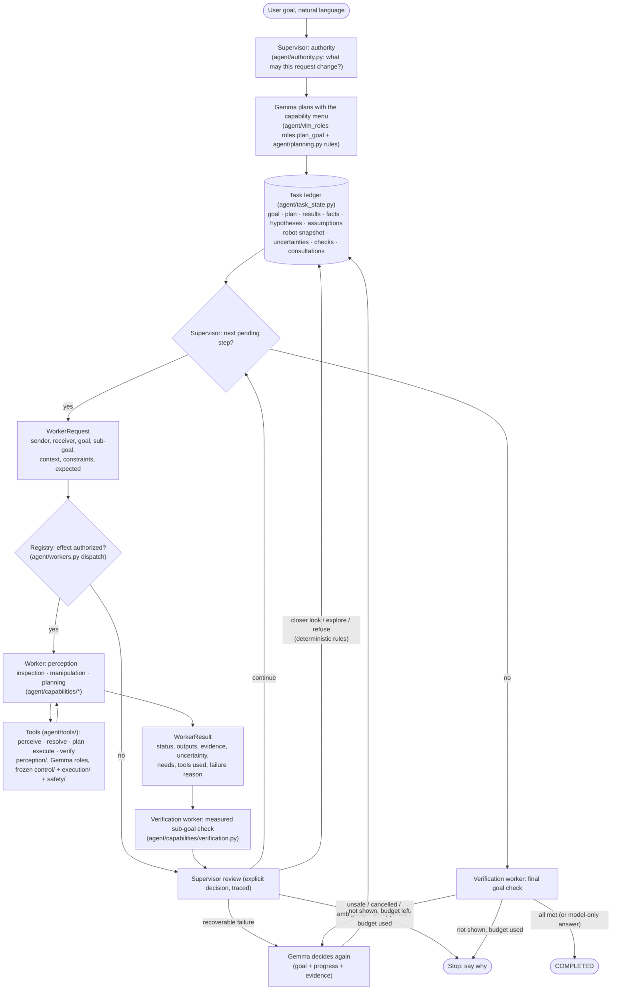

# Agent architecture: hierarchical, closed-loop, scenario-independent

One user goal, one supervisor, five workers, one set of tools. This page explains how they work together. The
step-by-step function flow is in `EXECUTION_FLOW.md`, and the files are listed in `MODULE_GUIDE.md`.

## 1. The loop



**When Gemma reasons.** Gemma is consulted only when a decision needs language or judgement, never for
routine deterministic steps:

1. classifying the request;
2. the first plan;
3. re-planning after a recoverable failure;
4. re-planning when every step ran but the goal is not shown;
5. a planned `decompose` step (multi-object goals over the measured objects);
6. the perception roles inside a worker (describe, resolve, confirm, answer).

**What doesn't need Gemma:**

- Choosing the worker: each capability belongs to one worker.
- Authorization.
- Sub-goal and goal verification.
- The two information-gathering rules: an uncertain answer leads to a closer look, and a target that isn't visible
  leads to exploring.

**Bounds:**

| Bound | Default |
|---|---|
| Gemma re-planning consultations per instruction | `ExecutionControls.max_replans`, 1 |
| Delegations per instruction | 14 |
| Closer looks per uncertain answer | 2 |

## 2. Roles

| Role | Owns | Decides | Never |
|---|---|---|---|
| **Supervisor** (`agent/supervisor.py` `GoalSupervisor`, LangGraph) | the task ledger, the plan, the loop | which step next, how to process each result, when to ask Gemma, when the goal is met or must stop | runs tools itself, accepts a worker's word for success |
| **Gemma** (`agent/vlm_roles/`) | — | the request's kind, the plan and its revisions, decompositions, descriptions / answers | moves the robot or produces joint values |
| **Perception worker**: observe, describe_scene, answer, locate | — | how to observe and ground a reference | moves objects |
| **Inspection worker**: inspect, explore | — | which wrist viewpoint helps | moves objects (moves the arm only, collision-checked) |
| **Manipulation worker**: pick, place, pick_place, return_home | — | how to execute one physical action (`PickPlaceWorkflow` with its own recovery budget) | runs unless authorized |
| **Planning worker**: decompose | — | concrete steps over the measured objects | adds effects the request did not authorize (the supervisor filters them) |
| **Verification worker**: verify (internal, not in Gemma's menu) | — | whether measured state meets conditions | declares the user's task complete |
| **Tools** (`agent/tools/`) | session state: world model, held object, description memory | — | bypass `Tools.execute` for motion |

## 3. Contracts (`agent/workers.py`)

**`WorkerRequest`:**

| Field | Contents |
|---|---|
| `sender`, `receiver` | the sender is always the supervisor; the receiver is the worker |
| `goal` | the full instruction |
| `objective` | the current sub-goal |
| `capability`, `args` | the requested operation and its inputs |
| `context` | held object, last referent, bindings, current frame, completed steps |
| `constraints` | allowed effects from the request's authority, the capability's effect and safety class, the motion mode, any location constraint |
| `expected` | the conditions the sub-goal should make true |
| `depends_on`, `state_refs` | ordering and the observation relied on |

**`WorkerResult`:**

| Field | Contents |
|---|---|
| `sender`, `receiver` | the worker; the supervisor |
| `status`, `outcome` | the 7 statuses; the 9 outcomes |
| `summary`, `data` | the outputs and observations |
| `evidence` | frames, verifications, conditions |
| `confidence` | measured / model / none |
| `uncertainty` | what is not settled |
| `needs` | advisory: observation, closer_look, explore, clarification, replan, stop |
| `tools` | the tools and Gemma roles invoked, in order |
| `failure_reason`, `metrics` | why it failed; seconds and Gemma calls |

**Processing.** The supervisor processes every result in `_reviewing`:

1. If the result claims success on a measurable sub-goal (pick, place, pick_place, return_home, locate, inspect),
   the verification worker checks it first. A "done" that the measurements contradict becomes a failure.
2. The decision is logged as a `review` event: continue, insert a subtask, refuse, re-plan or stop.

## 4. Shared state and ownership

| Information | Owner | Where it lives |
|---|---|---|
| Original goal, plan (with every step's result), conditions, bindings, attempts, consultations | supervisor | `TaskState` (`task_state.json`, one per instruction) |
| Measured objects (geometry, ids, per-camera observations) | Tools (session) | `perception/world_model.py` `WorldModel`; per-observation copy in `TaskState.facts` |
| Gemma's words (descriptions, answers, interpretations) | — | `TaskState.hypotheses`; never treated as measurement |
| Supervisor assumptions (e.g. "it" = `#4`) | supervisor | `TaskState.assumptions` |
| Held object, motion count, motion mode | Tools (`agent/tools/held.py`, `agent/controls.py`) | snapshot in `TaskState.robot` after every supervisor state |
| Sensors, available capabilities | Tools / capability registry | `TaskState.sensors`, `TaskState.capabilities` |
| Uncertainty | workers report it; the supervisor collects it | `TaskState.uncertainties` |
| Physical checks (contact, placement, HOME) and condition checks | skills; verification worker | `TaskState.verified`; `subgoal_checks`, `goal_check` |
| Execution history | supervisor | `TaskState.actions`, `events.jsonl` |

Simulator ground truth never reaches the agent; it exists only in `evaluation/`.

## 5. Scenario independence

**No scene knowledge.** The supervisor, workers and tools contain no scene, object class, colour, position or task
sequence. `tests/integration/test_agent.py` scans all agent code for object words and simulator ground truth.

**Generic composition.**

- Capabilities are generic operations; Gemma composes them from the menu and the user's words.
- Prompt examples use placeholders (`<A>`, `<B>`).
- Unsupported requests get an empty plan with a reason, reported as UNSUPPORTED.

**What a scene supplies, through interfaces:** sensor data over ROS 2, and the work-cell constants in `config/`
(fixtures to ignore, reach ring) and frozen `control/robot.py` (camera pose, HOME).

## 6. Safety boundary

Gemma decides what to attempt. The deterministic layers below it are unchanged:

1. Request authority, enforced in the registry.
2. Collision-checked planning in frozen `control/`.
3. `Tools.execute` with the motion mode (`agent/controls.py`).
4. The frozen executor.
5. The simulator's joint-limit safety layer.
6. The physical checks.

The verification worker can only make a step fail, never succeed: it cannot override a safety refusal.

## 7. Observability

With `TRACE = True` (`agent/settings.py`) the terminal shows every handoff. The full record is in each instruction's
`events.jsonl`.

| Event | Shows |
|---|---|
| `instruction`, `authority`, `goal_plan`, `goal_conditions` | the request, what it may change, Gemma's plan, the goal conditions |
| `decision` | which worker gets the next step, and why |
| `delegate` | the full `WorkerRequest` |
| `tool` / `vlm` / `exploration` / `verification` | each tool and Gemma call inside a worker |
| `worker_result` | the full `WorkerResult` |
| `review` | the supervisor's processing of the result |
| `consult`, `replan`, `plan_update` | Gemma asked again, its verdict, the plan after the change |
| `goal_check`, `report` | the final verification and the conclusion |

A real example (mocked tools, scripted Gemma: a placement the verification worker measured as wrong, followed by
Gemma re-planning) is reproduced by `tests/integration/test_feedback_loop.py::test_a_failed_subgoal_returns_to_gemma_with_the_evidence_and_progress`:

```
[SUPERVISOR]  -> MANIPULATION [t3] place: sub-goal 'place #1, c'; input {...}; expect next_to(#1, c); not_holding(); constraints ...
[SUPERVISOR]  -> VERIFICATION [t4] verify: sub-goal 'verify step 2 (place)'; input {"conditions": [...], "scope": "subgoal"}
[VERIFICATION] <- [t4] failed / failed (... confidence measured): not met: next_to(#1, c): centres 680 mm apart, on the floor: False
[SUPERVISOR]  review step 2 place (failed): sub-goal not met - not met: next_to(#1, c): centres 680 mm apart ...
[SUPERVISOR]  review step 2 place (failed): ask Gemma to re-plan - recoverable failed; re-planning budget 0/1 used
[SUPERVISOR]  -> GEMMA: decide again (step 2 (place) failed); re-planning 1/1
[SUPERVISOR]  plan updated (re-planned by Gemma (after a failure)): 1. pick [done]; 2. place [replaced]; 3. pick [pending]; 4. place [pending]
...
[VERIFICATION] <- [t9] completed / completed (... confidence measured): met: next_to(#4, c), not_holding()
[VERIFY]      goal check: next_to(#4, c)=yes [measured]; not_holding()=yes [measured]
```

## 8. Implemented vs remaining limitations

**Implemented** (offline-tested: `tests/integration/test_feedback_loop.py`, the supervisor and orchestration suites):

- the full loop above;
- structured contracts on every delegation, including the automatic "fresh observation first" step;
- measured sub-goal verification after each physical / locating step;
- the closed loop on an unmet goal;
- explicit, traced reviews;
- the shared ledger with robot state, sensors, capabilities, uncertainty, assumptions and consultations;
- the inspection worker (renamed from "exploration");
- the verification worker.

**Remaining limitations:**

- **Gemma budget.** The re-planning budget defaults to one consultation per instruction, so longer recovery chains
  stop early. That is a deliberate bound, configurable in `ExecutionControls`.
- **Gemma output quality.** The re-planning prompt is the existing planning prompt plus a progress context. Gemma's
  JSON validity limits how often it plans and re-plans successfully (**BD-1**).
- **Deterministic follow-up rules.** The rules that trigger a closer look or exploration follow specific worker
  needs. Other `needs` values (e.g. `observation` after `insufficient_info`) reach Gemma only through the failure
  re-plan.
- **What is verified.** Sub-goal verification covers measurable predicates. Answers and reports are model / text
  outputs, checked only in the final goal check (an answer counts only if Gemma was certain).
- **Capabilities are fixed.** Gemma composes the registered capabilities and cannot add new skills. A new skill is
  a new capability (spec + executor + worker), with no change to the loop.
- **Single-camera views and robot self-filtering** limit what the perception worker can report (BD-4, BD-5, BD-9).
  This is perception performance, outside this architecture.
- **Testing.** The loop is verified with mocked tools and scripted plans, not yet live (by request).
