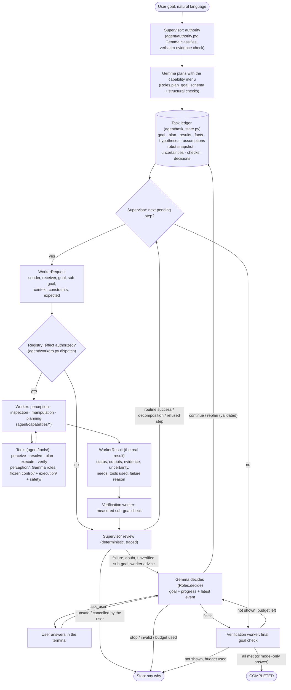

# Agent architecture: closed-loop, Gemma-driven, scenario-independent

One user goal, one supervisor, Gemma as the decision-maker, four working agents (perception, inspection,
manipulation, verification; plus the planning worker's `decompose`), one task ledger, one world model, one set of
tools. This page explains how they work together. The step-by-step function flow is in `EXECUTION_FLOW.md`, and the
files are listed in `MODULE_GUIDE.md`.

## 1. The loop



**Gemma reasons and decides:**

1. what the request may change (its kind, with the exact words as evidence);
2. the first plan;
3. **every decision a result calls for** (`Roles.decide`, prompt `DECIDE_SYSTEM`, schema `Decision`):
   - after a failed step;
   - after an uncertain answer or an unverified sub-goal;
   - after a worker suggests something (`needs`: explore, closer_look, clarification, ...);
   - when every step ran but the goal is not shown;
   - after the user answers Gemma's question;
4. multi-object decomposition (`decompose`) over the measured objects;
5. the perception roles inside the workers (describe, resolve, confirm, answer).

Gemma's five actions:

| Action | The supervisor then |
|---|---|
| `continue` | runs the remaining plan unchanged |
| `replan` | replaces the pending steps with Gemma's steps; the step that caused the decision is marked `replaced` |
| `ask_user` | asks the question in the terminal (`responder.ask`); the answer becomes the next event for Gemma; no answer → CANCELLED |
| `finish` | skips what is left and runs the measured goal check (Gemma saying "done" is not success) |
| `stop` | ends with Gemma's reason: UNSUPPORTED / CANCELLED / FAILED, from the last outcome |

**Deterministic, never overridden by Gemma:**

- Schema validation of every Gemma output, plus structural checks: steps name registry capabilities with the
  required arguments; `continue` needs pending steps; `ask_user` needs a question.
- Authorization: the request's authority, enforced in the registry before any executor runs.
- Measured verification of sub-goals and of the goal.
- The safety stops: `unsafe` ends the instruction with no new motion, and a user's cancel ends it.
- Kinematics, collision checks, reachability and joint limits, in frozen `control/`, the executor and the simulator.
- The bounds:
  - a re-plan whose first step already failed, with no motion since, is sent back to Gemma with the reason;
  - a re-plan cannot drop what the user asked to move or find: the dropped condition stays in the goal unless a
    later step pursues the same kind of objective.

**Bounds:**

| Bound | Default |
|---|---|
| Gemma decisions per instruction after the first plan | 3 (`MAX_GEMMA_DECISIONS` in `agent/settings.py`, `--max-decisions`; `ExecutionControls.max_replans`) |
| Delegations per instruction | 14 |

## 2. Roles

| Role | Owns | Decides | Never |
|---|---|---|---|
| **Supervisor** (`agent/supervisor.py` `GoalSupervisor`, LangGraph) | the task ledger, the plan, the loop | routes each step to its worker, applies the deterministic checks, executes Gemma's validated decisions | runs tools itself, accepts a worker's or Gemma's word for success, overrides Gemma with language rules |
| **Gemma** (`agent/vlm_roles/`) | — | the request's kind, the plan, every next-step decision (continue / replan / ask_user / finish / stop), decompositions, descriptions / answers | moves the robot, produces joint values, bypasses authorization or verification |
| **Perception worker**: observe, describe_scene, answer, locate | — | how to observe and ground a reference | moves objects |
| **Inspection worker**: inspect, explore | — | which wrist viewpoint helps | moves objects (moves the arm only, collision-checked) |
| **Manipulation worker**: pick, place, pick_place, return_home | — | how to execute one physical action (`PickPlaceWorkflow` with its own recovery budget) | runs unless authorized |
| **Planning worker**: decompose | — | concrete steps over the measured objects | adds effects the request did not authorize (the supervisor filters them) |
| **Verification worker**: verify (internal, not in Gemma's menu) | — | whether measured state meets conditions | declares the user's task complete |
| **Tools** (`agent/tools/`) | session state: world model, held object, description memory | — | bypass `Tools.execute` for motion |

## 3. Contracts (`agent/workers.py`)

**`WorkerRequest`:**

| Field | Contents |
|---|---|
| `sender`, `receiver` | the sender is always the supervisor; the receiver is the worker |
| `goal` | the full instruction |
| `objective` | the current sub-goal |
| `capability`, `args` | the requested operation and its inputs |
| `context` | held object, last referent, bindings, current frame, completed steps |
| `constraints` | allowed effects from the request's authority, the capability's effect and safety class, the motion mode, any location constraint |
| `expected` | the conditions the sub-goal should make true |
| `depends_on`, `state_refs` | ordering and the observation relied on |

**`WorkerResult`:**

| Field | Contents |
|---|---|
| `sender`, `receiver` | the worker; the supervisor |
| `status`, `outcome` | the 7 statuses; the 9 outcomes |
| `summary`, `data` | the outputs and observations |
| `evidence` | frames, verifications, conditions |
| `confidence` | measured / model / none |
| `uncertainty` | what is not settled |
| `needs` | advisory: observation, closer_look, explore, clarification, replan, stop |
| `tools` | the tools and Gemma roles invoked, in order |
| `failure_reason`, `metrics` | why it failed; seconds and Gemma calls |

**Processing.** The supervisor processes every result in `_reviewing`:

1. If the result claims success on a measurable sub-goal (pick, place, pick_place, return_home, locate, inspect),
   the verification worker checks it first. A "done" that the measurements contradict becomes a failure.
2. The deterministic outcomes are applied directly: continue, refuse, insert a decomposition, or stop
   (unsafe / cancelled).
3. Anything else goes to Gemma with one event text: the step, its outcome, the summary, the uncertainty and the
   worker's advice. Every decision is logged as a `review` event, then `consult` and `gemma_decision`.

## 4. Shared state and ownership

| Information | Owner | Where it lives |
|---|---|---|
| Original goal, plan (with every step's result), conditions, bindings, attempts, consultations | supervisor | `TaskState` (`task_state.json`, one per instruction) |
| Measured objects (geometry, ids, per-camera observations) | Tools (session) | `perception/world_model.py` `WorldModel`; per-observation copy in `TaskState.facts` |
| Gemma's words (descriptions, answers, interpretations) | — | `TaskState.hypotheses`; never treated as measurement |
| Supervisor assumptions (e.g. "it" = `#4`) | supervisor | `TaskState.assumptions` |
| Held object, motion count, motion mode | Tools (`agent/tools/held.py`, `agent/controls.py`) | snapshot in `TaskState.robot` after every supervisor state |
| Sensors, available capabilities | Tools / capability registry | `TaskState.sensors`, `TaskState.capabilities` |
| Uncertainty | workers report it; the supervisor collects it | `TaskState.uncertainties` |
| Physical checks (contact, placement, HOME) and condition checks | skills; verification worker | `TaskState.verified`; `subgoal_checks`, `goal_check` |
| Execution history | supervisor | `TaskState.actions`, `events.jsonl` |

Simulator ground truth never reaches the agent; it exists only in `evaluation/`.

## 5. Scenario independence

**No scene knowledge.** The supervisor, workers and tools contain no scene, object class, colour, position or task
sequence. `tests/integration/test_agent.py` scans all agent code for object words and simulator ground truth.

**Generic composition.**

- Capabilities are generic operations; Gemma composes them from the menu and the user's words.
- Prompt examples use placeholders (`<A>`, `<B>`).
- Unsupported requests get an empty plan with a reason, reported as UNSUPPORTED.

**What a scene supplies, through interfaces:** sensor data over ROS 2, and the work-cell constants in `config/`
(fixtures to ignore, reach ring) and frozen `control/robot.py` (camera pose, HOME).

## 6. Safety boundary

Gemma decides what to attempt. The deterministic layers below it are unchanged:

1. Request authority, enforced in the registry.
2. Collision-checked planning in frozen `control/`.
3. `Tools.execute` with the motion mode (`agent/controls.py`).
4. The frozen executor.
5. The simulator's joint-limit safety layer.
6. The physical checks.

The verification worker can only make a step fail, never succeed: it cannot override a safety refusal.

## 7. Observability

With `TRACE = True` (`agent/settings.py`) the terminal shows every handoff, tagged `[USER]`, `[SUPERVISOR]`,
`[GEMMA]`, `[PERCEPTION]`, `[INSPECTION]`, `[MANIPULATION]` and `[VERIFICATION]`, plus `[AUTHORITY]`, `[SAFETY]` and
`[SKILL]` for the skill's internal states. The full record is in each instruction's `events.jsonl`.

| Event | Shows |
|---|---|
| `instruction`, `authority`, `goal_plan`, `goal_conditions` | the request, what it may change, Gemma's plan, the goal conditions |
| `decision` | which worker gets the next step, and why |
| `delegate` | the full `WorkerRequest` |
| `tool` / `vlm` / `exploration` / `verification` | each tool and Gemma call inside a worker |
| `worker_result` | the full `WorkerResult` |
| `review` | the supervisor's processing of the result |
| `consult`, `gemma_decision`, `replan`, `ask_user`, `plan_update` | the event Gemma is asked about, its decision and reason, whether the supervisor accepted it, the user's answer, the plan after the change |
| `goal_check`, `report` | the final verification and the conclusion |

A real trace (mocked workers, scripted Gemma decision: a placement that the verification worker measures as wrong,
then Gemma re-plans). Shortened; the skill's internal lines are left out. Reproduce it with
`tests/integration/test_feedback_loop.py::test_a_failed_subgoal_returns_to_gemma_with_the_evidence_and_progress`:

```
[USER]          goal: 'Put a beside c.'
[AUTHORITY]     request is a action -> may: none, sensing, object_change (evidence Put a beside c.; user_request)
[GEMMA]         goal: g | plan: 1. pick 'a'; 2. place 'it' next_to 'c'
[SUPERVISOR]    goal conditions: next_to(it, c); not_holding()
[SUPERVISOR]    -> MANIPULATION [t1] pick: sub-goal 'pick a'; ... expect holding(a)
[MANIPULATION]  <- [t1] completed / completed (... confidence measured): Done (verified by the table camera)
[VERIFICATION]  <- [t2] completed / completed (... confidence measured): met: holding(a)
[SUPERVISOR]    review step 1 pick (completed): continue - sub-goal achieved (verified)
[SUPERVISOR]    'it' -> #1 (held object)
[SUPERVISOR]    -> MANIPULATION [t3] place: sub-goal 'place #1, c'; ... expect next_to(#1, c)
[MANIPULATION]  <- [t3] completed / completed (...): Done (verified by the table camera): placed 3.0 mm from the planned spot ...
[VERIFICATION]  <- [t4] failed / failed (... confidence measured): not met: next_to(#1, c): centres 680 mm apart, on the floor: False
[SUPERVISOR]    review step 2 place (failed): ask Gemma - the result needs a decision: failed
[SUPERVISOR]    state DECIDING: Gemma decides the next step
[SUPERVISOR]    -> GEMMA: what next? (step 2 (place object=#1, relation=next_to, reference=c) by the manipulation worker: failed: ...
[GEMMA]         decision: REPLAN - new steps: pick 'a'; place 'it' next_to 'c'; reason: the placement missed: pick it again and place it beside c
[SUPERVISOR]    Gemma's new plan accepted
[SUPERVISOR]    plan updated (re-planned by Gemma): 1. pick [done]; 2. place [replaced]; 3. pick [pending]; 4. place [pending]
...
[VERIFICATION]  goal check: next_to(#4, c)=yes [measured]; not_holding()=yes [measured]
[SUPERVISOR]    COMPLETED: ...
```

## 8. Behaviour changes (2026-10-18) and remaining limitations

**Removed: keyword and rule heuristics that decided instead of Gemma.**

| Removed | Was | Now |
|---|---|---|
| `agent/planning.py` `complete_plan` | appended steps by rule: an `answer` when the instruction ends with "?", a `locate` after `explore`, a `describe_scene` after an unused `observe` | Gemma's plan runs as written. A question's `answered(...)` condition still comes from the request kind; if the plan never answers, the goal check fails and Gemma adds the step |
| `achieves` / `ALTERNATIVES` | a re-plan was rejected unless it repeated the failed capability or a listed alternative | structural: the dropped objective (move / find) stays in the goal unless a later step pursues it |
| uncertain answer → inspect (≤ 2) + answer again | a fixed rule | Gemma decides, with the worker's uncertainty and its `closer_look` advice in the event |
| locate not visible → explore + locate | a fixed rule | Gemma decides, with the worker's `explore` advice |
| `HIDING_WORDS`, `LOCATION_PHRASE`, `location_anchors` in plan validation | English keyword checks that rejected Gemma's plan ("behind", "in the ...") | removed; structural checks only (`check_steps`) |
| `RECOVERABLE` and "infeasible is never re-planned" | the outcome class decided whether Gemma was asked again | every failure except unsafe / cancelled goes to Gemma; the reachability check itself is unchanged, and an identical retry is rejected |
| ambiguous / unsupported results → terminal | stopped without Gemma | Gemma decides (for example `ask_user`, or `stop` → CANCELLED / UNSUPPORTED) |
| Re-planning budget 1 | `max_replans=1` | decision budget 3 (`MAX_GEMMA_DECISIONS`). Harnesses that set `max_replans=0`, like `lab_exp1_agent`, still never ask again |

The tests that pinned the removed rules were replaced by tests of the same scenarios with scripted Gemma
decisions. `test_planner_must_keep_the_location_of_the_target`, `test_explore_at_the_end_of_a_plan_gets_a_locate`
and `test_planner_explore_needs_the_hiding_place_*` were removed with their rules.

**Implemented** (offline-tested with deterministic mocked workers and scripted Gemma decisions:
`tests/integration/test_feedback_loop.py`, plus the supervisor, orchestration, authority and session suites):

- the loop above, one subtask at a time, with the real `WorkerResult` returned to the supervisor;
- the five Gemma actions, validation and retry (`test_roles_decide_validates_and_retries_with_the_error`);
- the budget, the repeated-step guard and the objective guard;
- safety and authorization stops that never ask Gemma;
- structured contracts on every delegation;
- measured sub-goal and goal verification;
- the shared ledger, including Gemma's decisions (`consults`) and questions (`questions`);
- the labelled trace.

Mocks exist only in `tests/support/`. `agent/run.py` builds the real workers and Gemma, and the scripted responder
only when `ASK = "scripted"`.

**Remaining limitations:**

- **Not yet run live.** `DECIDE_SYSTEM` has not been run on the real Gemma 4 E2B. Its JSON validity is the main risk:
  the planning prompt is valid on 3 of 8 offline cases (**BD-1**). An invalid decision ends the instruction with
  "Gemma could not decide". Gemma is called after one retry, and each decision adds Gemma latency.
- **Language rules that remain, by instruction:**
  - inside the perception algorithms (`GENERIC_WORDS` and the lexical cross-checks in target resolution);
  - in `agent/ask.py`'s parsing of the user's answer to the skill's "which object?" question (cancel / yes / no /
    nearest words, numbers);
  - in the skill's failure classification by error text.

  These sit inside perception and manipulation, which this task left unchanged.
- **The objective guard works by capability kind.** A re-plan that moves or finds a different object than asked
  still counts as pursuing the objective. The final measured check catches it only if the original condition is
  still in the goal.
- **What is verified.** Measurable predicates (holding, relations, located, observed, at_home) are measured. Answers
  and reports are model outputs. A question is complete only if Gemma's answer is certain, and it is reported as
  "not independently verified".
- **Fixed capabilities.** Gemma composes the registered capabilities and cannot add new skills. A new skill is a new
  capability (spec, executor, worker), with no change to the loop.
- **Perception limits** (single-camera views, robot self-filtering: BD-4, BD-5, BD-9) are outside this
  architecture.
