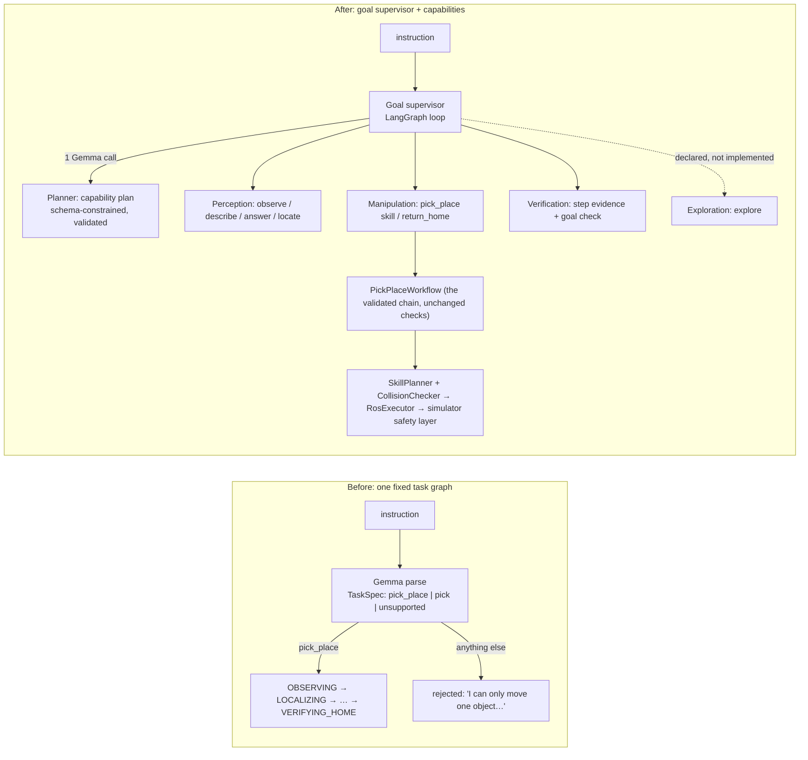

# Supervisor-centred, goal-driven agent architecture (implemented 2026-10-14)

Branch `refactor/goal-supervisor`; rollback point tag `baseline-before-goal-supervisor` (commit c140d64).
Audit of the previous structure: `docs/architecture/AUDIT.md`. Decisions: `docs/perception_redesign/DECISIONS.md`.
Measured results: §8. **Implemented** vs **proposed** is marked everywhere.

## 1. Before and after

## 2. Logical agents (one shared Gemma, one YOLO; agents are responsibilities, not model copies)

| Agent | Implemented as | Does | Does not |
|---|---|---|---|
| **Supervisor** (central) | `agent/supervisor.py` `GoalSupervisor` | interprets the goal (via planner), keeps the task state, delegates each step, checks step evidence, replans once, completes / stops with a classified reason | generate trajectories; skip verification |
| **Planning** | `Roles.plan_goal` (`agent/vlm_roles.py`) + `complete_plan` | one Gemma call → flat capability steps (enum of names), deterministic validation, generic completion rules | invent tools, code or motions (schema forbids it) |
| **Perception** | `capabilities.run_observe / run_describe_scene / run_answer / run_locate` over `Tools` (YOLO11s-seg, depth geometry, Gemma descriptions with session cache, resolution + cross-check + confirm) | fresh observations, grounded scene report, answers (marked unverified), locating a described object | claim identity as fact (descriptions are hypotheses) |
| **Manipulation** | `capabilities.run_pick_place` → `agent/pick_place.py` `PickPlaceWorkflow`; `run_return_home` | the validated pick-and-place skill (grounding, clarification, grasp, carry, place, retreat, HOME) | bypass collision checking or the executor |
| **Verification** | in the skill (contact stall, camera placement xy/z/tilt, HOME joints) + supervisor VERIFYING_STEP / VERIFYING_GOAL | evidence per step; goal = every step verified | accept the LLM's word as success |
| **Exploration** | **proposed** (`explore` is declared with `implemented=False`) | — | — |

## 3. Supervisor state machine (implemented)

```mermaid
stateDiagram-v2
  [*] --> INTERPRETING
  INTERPRETING --> DISPATCHING: plan (+ completion rules)
  INTERPRETING --> UNSUPPORTED: empty plan
  INTERPRETING --> FAILED: planner invalid after 1 retry
  DISPATCHING --> OBSERVING_SCENE: observe
  DISPATCHING --> REPORTING_SCENE: describe_scene (auto-observe if stale)
  DISPATCHING --> ANSWERING: answer (auto-observe if stale)
  DISPATCHING --> LOCATING: locate (auto-observe if stale)
  DISPATCHING --> MANIPULATING: pick_place (skill; HOME only after the last motion step)
  DISPATCHING --> RETURNING_SAFE: return_home
  DISPATCHING --> UNAVAILABLE: capability not implemented
  DISPATCHING --> VERIFYING_GOAL: no pending step
  OBSERVING_SCENE --> VERIFYING_STEP
  REPORTING_SCENE --> VERIFYING_STEP
  ANSWERING --> VERIFYING_STEP
  LOCATING --> VERIFYING_STEP
  MANIPULATING --> VERIFYING_STEP
  RETURNING_SAFE --> VERIFYING_STEP
  UNAVAILABLE --> VERIFYING_STEP
  VERIFYING_STEP --> DISPATCHING: completed
  VERIFYING_STEP --> REPLANNING: insufficient_info / infeasible / failed (max 1)
  VERIFYING_STEP --> CANCELLED: cancelled / ambiguous
  VERIFYING_STEP --> UNSUPPORTED: unsupported
  VERIFYING_STEP --> FAILED: unsafe, or budget used
  REPLANNING --> DISPATCHING: different plan
  REPLANNING --> FAILED: drops the failed objective / repeats it unchanged
  VERIFYING_GOAL --> COMPLETED: every step done + verified
  VERIFYING_GOAL --> FAILED
```

Replanning rules (deterministic): a new plan is accepted only if it still pursues the failed step's
objective (same capability or a declared alternative: locate→explore, answer↔describe_scene) and does not
repeat the identical step while the robot has not moved; at goal verification every replaced step must have
been achieved by a later successful step. Plan completion rules: an observation nobody uses is reported
(describe_scene); a question ("?") gets an answer step.
Bounds: 1 replan, 10 capability executions per instruction, LangGraph recursion limit 120; the skill keeps
its own budgets (perception 2, planning 2, grasp 1, execution 0, placement 1). A step never runs after a
failed step (remaining steps are marked `skipped`).

## 4. Shared world model / task memory (`agent/world_state.py`, saved as `<run>/task_state.json`)

| Field | Kind | Content |
|---|---|---|
| `instruction`, `goal`, `success_condition` | input / hypothesis | user text; planner's one-line goal and success statement |
| `plan[]` | planned actions | `Step(index, capability, args, status pending/running/done/failed/skipped/replaced, outcome, summary, seconds)` |
| `facts` | **observed** | frame id, camera, per object: mark, world id, measured centre / footprint / height, top visible, detector score; how many workspace points the arm hides |
| `hypotheses` | **model-generated** | Gemma descriptions per world id (`source: gemma`, frame), Gemma answers |
| `verified[]` | **verified outcomes** | contact, contact after carry, placement (xy/z/tilt), HOME (joint errors) records |
| `actions[]`, `questions[]`, `replans` | history | capability calls with outcome / time; clarification Q&A (who answered); replans used |
| `status`, `outcome`, `message` | result | `completed / unsupported / insufficient_info / ambiguous / infeasible / unsafe / cancelled / failed` |

Persistent across the instructions of one session: `WorldModel` per instruction (object ids), `DescriptionMemory`
per session (a description is reused only if position, size and mean colour are unchanged).
Observation freshness: `Tools.is_fresh` = no robot command since the frame, < 120 s old, and (for manipulation)
taken with the arm parked out of the camera's view.

## 5. Capabilities and safety boundaries (`agent/capabilities.py`)

| Capability | Safety | Preconditions | Effects | Verification | Status |
|---|---|---|---|---|---|
| observe | read_only (parks the arm only if a motion step follows) | cameras streaming | facts + descriptions | ≥ 1 object measured | implemented |
| describe_scene | read_only | fresh observation (auto) | grounded report | measured objects only; names marked Gemma's | implemented |
| answer | read_only | fresh observation (auto) | answer (hypothesis) | object ids must exist | implemented |
| locate | read_only | fresh observation (auto) | object id + measured position | resolution + cross-check + crop confirmation | implemented |
| pick_place | motion | gripper empty; references resolvable (asks if ambiguous) | object at destination; HOME after last motion step | contact, placement (10 mm / 5 mm / 5°), HOME (1.5°) | implemented (validated skill) |
| return_home | motion | nothing held; gripper open | arm at HOME | joint feedback 1.5° | implemented |
| explore | motion | — | — | — | **proposed** (reported as unsupported) |

Enforcement that does not depend on the LLM: the plan schema is an enum of these names (anything else is
invalid → one retry → failure); step arguments are validated per capability; every motion is planned by
SkillPlanner with the CollisionChecker and runs through RosExecutor and the simulator's safety layer (joint
limits); grasp contact, placement and HOME are verified from sensors; HOME is refused while holding or with
the gripper not open; failed manipulation never triggers HOME. Outcome classes: completed (safe, executed,
verified), unsupported (safe but not available), insufficient_info, ambiguous (asks / reports), infeasible
(planning refused), unsafe (safety layer rejection / no safe pose), cancelled, failed.

## 6. Files

New: `agent/supervisor.py`, `agent/capabilities.py`, `agent/world_state.py`, `agent/eventlog.py`,
`tests/test_supervisor_goal.py`, `evaluation/planner_check.py`, `docs/architecture/AUDIT.md`, this file.
Renamed: `agent/graph.py` → `agent/pick_place.py` (`Supervisor` → `PickPlaceWorkflow`; UNDERSTANDING removed;
observation reuse; `final_home`). Modified: `agent/vlm_roles.py` (planner + answer roles, flat plan schema),
`agent/tools.py` (observation freshness, motion counter, `view_blockage`), `agent/run.py` (GoalSupervisor),
`agent/events.py`, `agent/viewer.py` (goal events, plan panel), tests, `evaluation/demo_home_check.py`.
Untouched: legacy `launch/run.sh` / `ros_nodes/vlm_agent_node.py`, `vlm/model.py`, frozen baseline files.

## 7. Known limitations and next milestones

- Exploration is not implemented: one fixed table camera; the wrist camera is not used for perception; "find X"
  fails honestly when X is not visible. Next: viewpoint candidates (wrist camera poses) scored for reachability,
  collision and expected visibility.
- The 2B planner sometimes returns fewer steps than needed; two generic completion rules fill the common
  gaps. An instruction it cannot map at all ends as a failure that lists the capabilities.
- Goal verification = every step verified; conditions spanning several objects ("sort by colour") need a
  goal-condition checker over measured geometry (proposed).
- Replanning is bounded to one attempt and rejects repeats; it rarely finds a different plan with this model.
- Multi-object tasks run sequentially through the same skill; no task-level optimisation of order.

## 8. Measurements (2026-10-14, measured)

**Planner vs the old parse call** (real Gemma, offline, `out/perf/planner_check.json`): 11/12 instructions
planned as expected after the flat schema and completion rules (all 4 validated pick-and-place instructions,
the two-step instruction, observation, question, "where is", "find", return HOME); "Sing me a song" ends as a
clear failure listing the capabilities (the model's answer is invalid twice, not an empty plan). Pick-and-place
planning 4.1-5.2 s vs 3.5-3.8 s for the old parse call (quiet machine). The first, nested schema failed 3/4
pick-and-place instructions (missing brace) and was replaced.

**Live A/B regression, headless, same two-instruction session, fresh sim each, back to back** (load from the
desktop: medians 7.5 and 9.6 on 16 cores — absolute times are inflated for both):

| | Baseline c140d64 | Refactor |
|---|---|---|
| yellow cube → tan box | 455.5 s, 27 Gemma calls | 446.7 s, 28 Gemma calls (one invalid-answer retry) |
| red cube → green cube | 303.0 s, 7 calls | 257.2 s, 7 calls |
| session wall | 804 s | 750 s |
| objects / placement / HOME | correct; 1.4 / 3.9 mm; 0.016° | correct; 2.0 / 1.0 mm; 0.016° |
| GPU peak | 8.0 GB | 8.0 GB |

No regression found; the one extra Gemma call per first instruction is the planner replacing parse (equal
count) plus a random retry. Earlier quiet-machine figures for the same code path: 225.5 s / 161.5 s.

**Observation-only, live headless** (`out/perf/refactor_observation_headless2`, load median 5.7): "Take a look
at your surroundings." 83.5 s, 0 robot motions, 21 Gemma calls (20 objects described once); then in the same
session "How many cubes are on the table?" 18.2 s (3 calls), "Where is the red cube?" 11.8 s (3 calls, located
object at x +2, y +577 mm = the red cube), "Find the banana." honest failure "I do not see 'banana'…" (after the
replan fix, `refactor_observation_headless3`). The count answer is Gemma's and is marked unverified.
