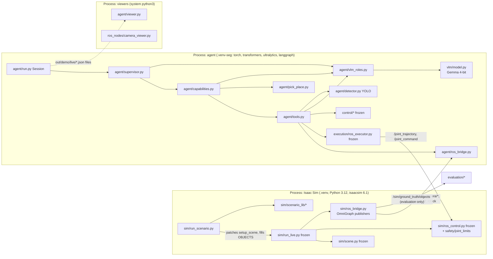

# Current architecture (as-is), 2026-10-17

> **Historical record.** This document describes the project before the 2026-10-17 restructuring; its file paths
> may refer to the old layout (e.g. `agent/tools.py`, `agent/world.py`, `sim/scenario_lib/`). Current layout:
> `docs/architecture/MODULE_GUIDE.md` (§4 maps old paths to new). Content is kept unchanged as evidence.

Audited at `experiment/lab-exp1` @ `f094d2f`. All statements come from the code and its import graph, computed
with `ast` over 128 project modules (`DEPENDENCY_ANALYSIS.md`). They are not inferred from file names.

## Companion documents

| Document | Contents |
|---|---|
| `DEPENDENCY_ANALYSIS.md` | the import graph |
| `TECHNICAL_DEBT.md` | the problems found |
| `TARGET_ARCHITECTURE.md` | the proposal |
| `REFACTOR_ROADMAP.md` | the migration plan |
| `ENGINEERING_STANDARDS.md` | conventions |

Older documents in this folder describe single phases: `ARCHITECTURE.md` (goal supervisor), `ACTIVE_PERCEPTION*.md`
and `ORCHESTRATION_AUDIT.md`. This package supersedes them as the overall picture, but does not replace them.

## 1. Size and shape

| Package | Files | Lines | Role today |
|---|---|---|---|
| `agent/` | 22 | 5,288 | the current LangGraph agent: supervisor, workers, perception pipeline, world model, VLM roles, pick-and-place workflow, ROS client, viewer |
| `control/` | 7 | 1,375 | **frozen**: robot constants, kinematics, motion, collision, skills, legacy text instructions |
| `execution/` | 2 | 165 | **frozen**: `RosExecutor` (trajectory streaming + reach check) |
| `safety/` | 2 | 124 | **frozen**: joint limits / speed monitor (used inside the simulator) |
| `sim/` | 14 | 2,226 | Isaac Sim scene (**frozen**: `scene.py`, `scene_objects.py`, `run_live.py`, `ros_control.py`), sim-side ROS bridge, scenario runner, scenario library |
| `perception/` | 4 | 675 | **legacy** stack: classical detector, box grounding, JSON world memory. `grounding.py` helpers are reused by `agent/` |
| `vlm/` | 6 | 483 | **legacy** VLM planner + the Gemma loader `vlm/model.py`, which the current agent reuses |
| `ros_nodes/` | 6 | 1,434 | **legacy** ROS nodes (`vlm_agent_node.py` = the previous agent) + camera viewers + text / microphone inputs |
| `seg/` | 7 | 617 | YOLO / Mask R-CNN training and evaluation scripts |
| `datagen/` | 9 | ~1,500 | synthetic dataset generation in Isaac Sim |
| `evaluation/` | 24 | 2,940 | experiment drivers, harnesses, scorers, validators (mixed maturity) |
| `experiments/` | 6 | 813 | manipulation experiments (3 frozen) |
| `scripts/` | 2 | 400 | validation scripts (1 frozen) |
| `tests/` | 19 | 2,903 | pytest: 214 test functions |
| `launch/` | 5 sh | 206 | process launchers (3 for the legacy stack, `start_demo.sh` for the current agent) |

**What lives outside the git-tracked code:**

| Location | Contents |
|---|---|
| `out/` | ignored: experiment outputs, logs, **and the production YOLO weights** at `out/seg/runs/yolo11s_seg_r1/weights/best.pt` |
| `models/` | Gemma, Ultralytics |
| `data/` | assets, datasets |
| repository root | stray `*.log` files |

There is **no `pyproject.toml`, `requirements*.txt` or lock file**.

## 2. Runtime topology



**Launchers:**

| Launcher | Stack |
|---|---|
| `launch/start_demo.sh` | current agent |
| `launch/run.sh` | legacy agent |
| `launch/start_live.sh` | legacy text commands |
| `launch/start_vlm_agent.sh` | legacy agent |
| `launch/tasks.sh` | legacy agent |

**Environments:**

| Environment | Used for |
|---|---|
| `.venv` | Isaac Sim |
| `.venv-seg` | current agent (torch 2.11+cu130, transformers 5.19, ultralytics 8.4, langgraph 1.2, pydantic 2.14) |
| `.venv-vlm` | legacy agent |
| `/usr/bin/python3` | default `pytest` run (numpy 1.26, opencv 4.6, no pydantic, so agent tests are skipped there) |

## 3. Subsystems

Each entry below gives responsibilities, dependencies, consumers, state, and the main problems found. Problem ids
`TD-n` refer to `TECHNICAL_DEBT.md`.

### 3.1 Agent orchestration: `agent/supervisor.py` (464), `agent/workers.py` (148), `agent/world_state.py` (88), `agent/goals.py` (173), `agent/authority.py` (74)

**Responsibilities.** `GoalSupervisor` is a LangGraph `StateGraph` with these states:

| States | |
|---|---|
| Working | INTERPRETING → DISPATCHING → DELEGATING → REVIEWING → REPLANNING → VERIFYING_GOAL |
| Terminal | COMPLETED / FAILED / CANCELLED / UNSUPPORTED |

It also owns:

- planning completion rules (`complete_plan`);
- pronoun binding (`_bind_refs`);
- robot-state adaptation (`_adapt_to_robot_state`);
- review policy: decomposition, uncertainty-driven inspection, explore-then-locate;
- replanning rules;
- goal-condition derivation and verification orchestration;
- the authority decision (`agent.authority.classify`);
- result messages.

The other modules in this group:

| Module | Provides |
|---|---|
| `workers.py` | typed `WorkerRequest`/`WorkerResult`; `WorkerRegistry.dispatch` (also the authorization choke point) |
| `world_state.py` | the per-instruction `TaskState` ledger |
| `goals.py` | condition predicates evaluated over measured state |

**Dependencies.**

- Imports (module level): `capabilities`, `vlm_roles`, `goals`, `workers`, `world_state`, `eventlog`, `config`,
  `authority`.
- Uses langgraph `StateGraph` + `SqliteSaver`.
- Reaches the robot only through `self.tools` (an `agent.tools.Tools`, untyped).

**Consumers.**

- `agent/run.py` (`Session.run` creates one `GoalSupervisor` per instruction);
- tests;
- evaluation harnesses.

**State.**

- Per-instruction: `self.ts` (`TaskState`), `self.ctx` (`caps.Context`), `self.authority`, `self.current`,
  counters.
- Per-supervisor: a `WorkerRegistry` with an `itertools.count` of task ids.
- Module-level policy constants (`MAX_REPLANS = 1`, `MAX_STEPS_EXECUTED = 14`, `RECOVERABLE`, `ALTERNATIVES`,
  `PRONOUNS`, `CONSUMERS`) are read at call time. Harnesses mutate them (`sup.MAX_REPLANS = 0` in
  `evaluation/lab_exp1_agent.py:38`) → TD-4.

**Problems.**

- One class mixes graph wiring, policy, binding, message formatting and verification orchestration (TD-3).
- Outcome / status / failure-class strings are free-form `str` across `supervisor`, `workers.STATUS_OF`,
  `capabilities._failure_outcome`, `pick_place` failure `cls` and `world_state.OUTCOMES` (TD-6).
- Each `GoalSupervisor` opens a SQLite checkpoint file per run directory (`supervisor.py:117`). It is never read
  back: resume is not used.

### 3.2 Capabilities / workers: `agent/capabilities.py` (620)

**Responsibilities.**

- `CapabilitySpec` table (`SPECS`, now with `effect`);
- `planner_menu()`;
- the per-instruction `Context`;
- one `run_<capability>` function each for observe, describe_scene, answer, locate (+ `_location_check`, `_find_in`,
  `_target_mark`), inspect (+ `_wrist_observation`), explore, pick / place / pick_place (via `_skill` →
  `PickPlaceWorkflow`), decompose and return_home;
- failure-class mapping `_failure_outcome`;
- scene-report formatting.

**Dependencies.** `vlm_roles` at module level. Function-local imports of `agent.exploration`, `agent.pick_place`,
`control.kinematics/motion/robot/skills`; the local imports keep the module importable without the robot stack.

**Consumers.** `supervisor._executors()` (lambdas look up `caps.run_*` at call time), `workers`, tests,
`evaluation/lab_exp1_agent.py`, `evaluation/planner_check.py`.

**Problems.**

- Every capability is a module-level function: they can only be replaced by monkeypatching (TD-4).
- Business logic mixes with natural-language result formatting.
- The "Worker" concept is a label (`RESPONSIBILITY` dict), not a unit of code: the perception / exploration /
  manipulation / planning workers are all functions in this file.

### 3.3 Tools facade: `agent/tools.py` (661)

**What `Tools` holds.** One class with ~40 methods and the agent's mutable session state:

| Group | Methods |
|---|---|
| Perception | `perceive`, `describe`, `shortlist`, `pool`, `update_world`, `words`, `lexical_candidates`, `resolve`, `candidate_image`, `confirm` |
| World geometry | `relation_holds`, `_direction`, `obstacles`, `_support_name` |
| Grasp / place planning | `plan_pick_place`, `plan_pick`, `plan_place_held`, `_plan_place`, `_too_close`, `deterministic` |
| Held state | `set_held`, `clear_held`, `begin_instruction`, `revalidate_held` |
| Motion | `execute`, `park_for_view`, `return_home`, `workspace_points`, `view_blockage` |
| Verification | `verify_contact`, `verify_placement`, `verify_home`, `assume_placed` |
| Freshness | `is_fresh` |

It also contains a second class, `DescriptionMemory`.

**State.** Owned and mutated in place:

- `world` (`WorldModel`);
- `held`, `held_object`, `held_geom`, `held_close_target`, `held_box`;
- `resolved_refs`, `last_referent`;
- `motion_count`, `view_cleared_at`, `_frames`;
- the bound `log` / `roles` / `run_dir`, rebound per instruction (`begin_instruction`).

**Dependencies.** `agent.geometry/somark/world/config`, `control.collision/kinematics/motion/robot/skills`.

**Consumers.** All capabilities (through `ctx.tools`), `PickPlaceWorkflow`, the supervisor (`_context`,
`_bind_refs`), `goals.GoalEvaluator`, 7 evaluation scripts.

**Problems.**

- God object (TD-1).
- No interface, so tests mirror it with a hand-written `StubTools` (23 methods, `tests/test_agent.py`) and
  `GoalTools`. Every new `Tools` method breaks or bypasses the stubs (observed in each of the last three
  milestones).

### 3.4 Pick-and-place skill: `agent/pick_place.py` (424)

**Responsibilities.** A LangGraph workflow:

```
OBSERVING → LOCALIZING → PLANNING_GRASP → APPROACHING → GRASPING → VERIFYING_GRASP → TRANSPORTING
          → PLACING → RETREATING → VERIFYING_PLACEMENT → RETURNING_HOME → VERIFYING_HOME
```

It has three modes (pick_place, pick, place), recovery budgets per failure class, and user clarification (`ask`).

**Dependencies.** `ask`, `config`, `eventlog`, `vlm_roles`, `control.motion` (+ local `control.robot/skills`); all
robot work goes through `Tools`.

**Problems.**

- It is a second LangGraph state machine nested inside a supervisor step, with its own failure classes (TD-6) and
  its own SQLite checkpointer.
- Its validated behaviour is part of the scientific baseline, so it must be kept behaviour-identical.

### 3.5 LLM integration: `agent/vlm_roles.py` (570), `vlm/model.py` (112, legacy package)

**Responsibilities of `vlm_roles.py`.**

- The `GemmaVLM` adapter (loads `vlm.model.VisionLanguageModel`, token counting);
- `RecordedVLM` for tests;
- all pydantic schemas (`PlanStep`, `GoalPlan`, `SubPlan`, `SceneAnswer`, `Resolution`, `Confirmation`,
  `RequestKind`, …);
- all prompts (`PLAN_SYSTEM`, `DECOMPOSE_PROMPT`, `ANSWER_PROMPT`, `REQUEST_SYSTEM`, …);
- deterministic validation rules (placeholders, hiding words, location anchors);
- `Roles`: one method per role, with the retry loop in `_call`.

**Problems.**

- Prompts, schemas, model adapter and validation policy live in one module (TD-3).
- Prompt edits silently change planner reliability: the live regression measured in milestone 3, 6/8 → 3/8 valid
  plans. There is no prompt-level regression test with the real model (TD-10).
- The model loader is in the legacy `vlm/` package.

### 3.6 Perception: `agent/detector.py` (51), `agent/geometry.py` (187), `agent/somark.py` (113), `Tools.perceive/describe/resolve`

**Responsibilities.**

- `YoloDetector` (ultralytics, weights path from `agent.run.DEFAULT_WEIGHTS` = `out/…/best.pt`);
- `geometry.measure`: mask + depth → `Measured` (centre, top, footprint, yaw, grasp width, tilt), robot / fixture
  exclusion via `RobotVolume`, and `snap_supports`;
- `somark`: mark drawing, crops.

**Dependencies.**

- `agent.geometry` imports `perception.grounding.footprint_yaw/grasp_pose` from the legacy package.
- `agent.config` imports `sim.scene_objects.MIC_POSITION` and `control.robot.TABLE_CAMERA_POSITION` to build
  `FIXTURES`.

**Problems.**

- Perception configuration depends on the simulator's frozen scene module (TD-5).
- The perception pipeline has no single entry point outside `Tools` (TD-1).
- Duplicated geometry helpers (TD-8).
- Segmentation quality is a known baseline defect (recall 0.29 on table views, milestone 3); it is out of scope for
  the refactor.

### 3.7 World model and session memory: `agent/world.py` (157), `agent/world_state.py`, `Tools.DescriptionMemory`, `perception/world_memory.py` (legacy)

**Responsibilities.**

| Module | Holds | Lifetime |
|---|---|---|
| `agent/world.py` `WorldModel` | persistent object ids, geometric association, per-camera observations, status | owned by `Tools` |
| `TaskState` | per-instruction ledger | per instruction |
| `DescriptionMemory` | description cache across instructions | per session |
| `perception/world_memory.py` | the legacy agent's JSON memory | legacy, unused by `agent/` |

**Problems.**

- Three overlapping memories with unclear ownership (TD-2).
- Descriptions are stored by world id (`TaskState.record_observation`), but consumers have assumed mark ids (the
  Experiment 1 scorer bug).
- Two masks of one fixture can share one world id, and one description then overwrites the other.

### 3.8 Robot kinematics, motion, manipulation, execution (frozen): `control/*`, `execution/ros_executor.py`, `safety/joint_limits.py`

| Module | Responsibilities |
|---|---|
| `control/robot.py` | robot constants: joints, HOME, speeds, gripper calibration, **table camera pose** |
| `control/kinematics.py` | URDF FK / IK |
| `control/motion.py` | joint / linear trajectories, `PlanningError` |
| `control/collision.py` | sphere robot model vs boxes |
| `control/skills.py` | `SkillPlanner` pick / place, `Held` |
| `control/instructions.py` | legacy text parser |
| `execution/ros_executor.py` | streams trajectories over ROS and checks reach |
| `safety/joint_limits.py` | limits + speed monitor, enforced in the simulator process by `sim/ros_control.py` |

**Constraint.** Every file here is in the frozen baseline manifest
(`docs/baselines/manipulation_A_2026-10-14/MANIFEST.sha256`) and must stay byte-identical. That rules out moving
these files or editing their imports.

**Problems.**

- `control.robot` is the most depended-on module (35 non-test consumers). It mixes robot constants with the camera
  rig (TD-5).

### 3.9 Isaac Sim and ROS 2 interfaces: `sim/*`, `agent/ros_bridge.py`

| Module | Responsibilities |
|---|---|
| `sim/run_live.py` (frozen) | creates `SimulationApp` **at import time**, parses argv at import time, runs the loop |
| `sim/scene.py` (frozen) | builds robot, gripper, cameras, objects |
| `sim/run_scenario.py` | fills the frozen `OBJECTS` dict before importing `run_live` (global mutation), patches `rl.setup_scene` |
| `sim/ros_bridge.py` | OmniGraph publishers |
| `agent/ros_bridge.py` | the agent's subscriber node, `snapshot()` |

**Problems.**

- Import-time side effects (8 modules create a `SimulationApp` or parse argv on import).
- Scenario injection relies on mutating a frozen module's global and monkeypatching a function (TD-5).
- The agent / sim ROS topics are hard-coded strings on both sides.

### 3.10 Safety and authorization

| Layer | Where |
|---|---|
| Physical safety | in the simulator (`safety`, `ros_control`) and in `control.collision` checks |
| Authorization | `agent/authority.py` + `WorkerRegistry.dispatch` + supervisor refusal handling (new in `91429c4`) |
| Goal verification | `agent/goals.py` |

**Problems.**

- Experiment harnesses implement extra gates (dry run, motion gate, executor blocks) by monkeypatching
  `Tools.execute`, `caps.run_*`, `caps.SPECS`, `LineReader.get` and `EventLog.__call__` (TD-4). The safety-relevant
  hooks have no supported injection point.

**Known baseline defects (not to be fixed during the refactor):**

- planner regression (`91429c4`);
- negated-command authorization ("Do not pick up the vial." → `object_change`).

### 3.11 Scenarios: `sim/scenario_lib/*`, `sim/scenarios/*.json`

**Responsibilities.**

- `core.py`: pure-data model, geometry, metadata;
- `parts.py`: builders;
- `laboratory.py`: one scene;
- `build.py`: Isaac Sim;
- `checks.py`: offline checks using `control` and `agent.exploration`.

**Problems.** The scenario package depends on the agent (`checks.py → agent.exploration.ViewpointPlanner`), a
layer inversion (TD-5). The JSON scenes and the library scenes use two different formats.

### 3.12 Evaluation, experiments, tests, configuration, utilities

**`evaluation/` (24 scripts) mixes four kinds of code:**

- reusable libraries (`lab_exp1_score.score`, `seg_diagnosis` approaches, `lab_probe`);
- one-off drivers;
- harnesses that monkeypatch the agent;
- validators.

18 of them insert into `sys.path` (32 modules in total do).

**Tests:**

- 7 of 19 test files need `.venv-seg` and are skipped by the default run (`importorskip`).
- Fixtures are shared by importing test modules (`tests.test_agent.StubTools`, `tests.test_supervisor_goal.GoalTools`).
- No markers separate unit / integration / simulator tests.
- There is no CI.

**Configuration** is spread over:

- `agent/config.py` (perception constants, tolerances, budgets, relations, fixtures);
- `control/robot.py`;
- `sim/scene.py`;
- module constants in `supervisor.py` / `exploration.py` / `geometry.py`;
- CLI arguments in `agent/run.py`;
- environment variables (`ROS_DOMAIN_ID`).

**Logging:**

- The agent writes structured JSONL (`agent/eventlog.py`).
- `sim`, `control`, `evaluation` use `print`: 38 calls in library packages.
- The legacy nodes use rclpy loggers.

**Errors:**

- `VLMFailure`, `PlanningError`, `TimeoutError`;
- 10 `except Exception` in library code;
- failures otherwise travel as strings (TD-6).
