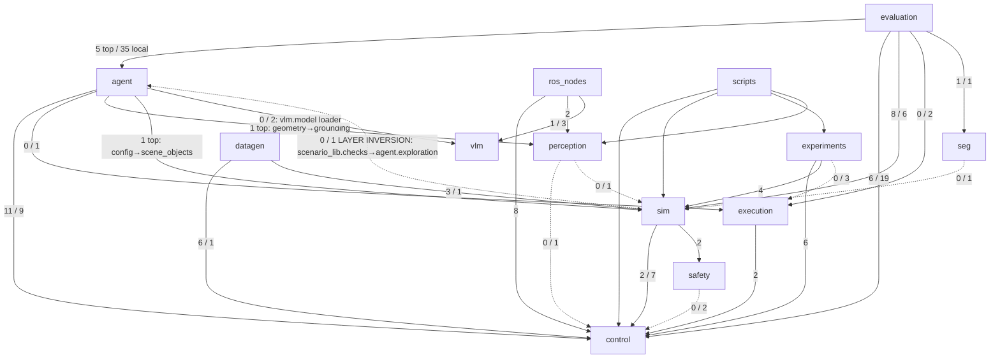

# Dependency analysis, 2026-10-17 (`f094d2f`)

> **Historical record.** This document describes the project before the 2026-10-17 restructuring; its file paths
> may refer to the old layout (e.g. `agent/tools.py`, `agent/world.py`, `sim/scenario_lib/`). Current layout:
> `docs/architecture/MODULE_GUIDE.md` (§4 maps old paths to new). Content is kept unchanged as evidence.

**Method.** An `ast` walk over 128 project modules in `agent control execution safety perception vlm seg sim
ros_nodes datagen experiments scripts evaluation tests`:

- Every `import` / `from … import` that resolves to a project module counts as an edge.
- Imports at module level ("top") are separated from imports inside functions ("local"). Local imports are the
  codebase's way of deferring heavy or optional dependencies (Isaac Sim, rclpy, torch).

The script is reproducible; it lives in the session scratchpad, and its logic is listed in
`ENGINEERING_STANDARDS.md` §10 as a proposed CI check.

## 1. Package-level graph (non-test edges)

**Cycles: none.** Neither at module level, nor when function-local imports are included (Tarjan SCC over both
graphs).

The absence of cycles is partly *engineered by local imports*. For example, `capabilities` imports `pick_place`
inside `_skill`, and `pick_place` reaches `capabilities` only through the supervisor. That keeps the graph acyclic,
but hides real coupling from the module headers.

## 2. Boundary violations

| # | Edge | Where | Why it is wrong |
|---|---|---|---|
| D1 | `agent → sim` (module level) | `agent/config.py:13` `from sim.scene_objects import MIC_POSITION` | The agent's perception exclusion volumes come from the simulator's frozen test-field module. On a real robot or another scene, the agent still imports the default sim scene. |
| D2 | `agent → perception` (legacy) | `agent/geometry.py:19` `from perception.grounding import footprint_yaw, grasp_pose` | The current pipeline depends on the legacy stack for two geometric functions. |
| D3 | `agent → vlm` (legacy) | `agent/vlm_roles.py:34-35` `vlm.config`, `vlm.model` | The model loader lives in the legacy package. |
| D4 | `sim → agent` | `sim/scenario_lib/checks.py` (`view_feasibility`) `from agent.exploration import ViewpointPlanner` | The scenario layer depends on the agent layer. Scenario checks cannot run without the agent package. |
| D5 | `agent → control.robot` for the **camera rig** | `agent/config.py:12`, `agent/tools.py`, `agent/exploration.py` | Camera extrinsics live in the robot-constants module (frozen), so the sensor rig cannot be configured. |
| D6 | `evaluation → agent` internals | `evaluation/lab_exp1_agent.py:31-78` and the milestone harnesses | Harnesses replace `Tools.execute`, `caps.run_*`, `caps.SPECS`, `supervisor.MAX_REPLANS`, `LineReader.get`, `EventLog.__call__` at runtime. |
| D7 | `tests → tests` | `tests/test_agent_ask.py`, `test_supervisor_goal.py`, `test_orchestration.py`, `test_authority.py`, `test_session.py` | Fixtures are shared by importing other test modules, so a change in `test_agent.StubTools` ripples into 5 files. |

## 3. Fan-in / fan-out (non-test)

**Highest fan-in.** These are the most expensive modules to change:

| Module | Consumers | Note |
|---|---|---|
| `control.robot` | 35 | frozen; constants + camera pose |
| `control.kinematics` | 20 | frozen |
| `sim.scene_objects` | 14 | frozen; scene data used by agent, datagen, evaluation, experiments, perception, seg |
| `control.collision` | 14 | frozen |
| `control.motion` | 13 | frozen |
| `control.skills` | 10 | frozen |
| `sim.scene` | 9 | frozen; Isaac only |
| `agent.vlm_roles` | 8 | prompts + schemas + model adapter |
| `agent.tools` | 7 | god object |
| `execution.ros_executor` | 7 | frozen |

**Highest fan-out:**

| Module | Imports | Note |
|---|---|---|
| `evaluation.inspect_check` | 12 | |
| `ros_nodes.vlm_agent_node` | 11 | legacy |
| `agent.run` | 10 | composition root: good |
| `agent.tools` | 9 | |
| `agent.supervisor` | 8 | |
| `sim.scenario_lib.checks` | 8 | incl. agent |

**Reading:** the frozen `control` package is the stable core. That suits a dependency-inversion target (the core
stays put, adapters wrap it).

## 4. Initialization and side-effect dependencies

| Side effect | Modules | Consequence |
|---|---|---|
| `SimulationApp(...)` at import | `sim/run_live.py` (frozen), `sim/import_vt6l.py`, `datagen/generate.py`, `datagen/eval_scene_capture.py`, `evaluation/validate_scenarios.py`, `evaluation/lab_capture_frames.py`, `experiments/trajectory_demo.py`, `experiments/pick_place.py` | Importing a module starts Isaac Sim, so it can't be imported in a test or a tool. `run_scenario` must set `sys.argv` before importing `run_live`. |
| argv parsing at import | the same 8 + `sim/run_scenario.py` | the same |
| Global mutable registry | `sim.scene_objects.OBJECTS` (frozen dict) cleared and refilled by `sim/run_scenario.py` and `sim/scenario_lib/build.install` | Scene selection works by mutating another module's global before a third module reads it. Order matters. |
| Singleton | `agent.ask.LineReader._instance` (stdin pump thread) | One stdin reader per process; harnesses patch its `get`. |
| GPU load order | `agent/run.py`: Gemma → YOLO → simulator (12 GB rule) | It is implicit in `main()`; nothing enforces it. Evaluation harnesses re-implement it. |
| Two ROS nodes | `agent/ros_bridge.RosBridge` (MultiThreadedExecutor) + `execution.RosExecutor` (own node, spun during `execute`) | Deliberate (documented in `agent/ros_bridge.py`), but the lifecycle lives in `agent/run.py`. |
| `sys.path` insertion | 32 modules | Works only from the repo root; the package is not installable. |

## 5. Duplicated logic

| Logic | Copies |
|---|---|
| Segment / ray vs oriented box | `agent/exploration.py:112` `_segment_hits_box`; `sim/scenario_lib/checks.py:22` `_ray_hits`; `evaluation/scenario_design.py:33` `hits` |
| Rotation about z | `control/collision.py:121` `_rot_z` (frozen); `sim/scenario_lib/core.py:172` `rot_z`; `scripts/validate_robot_m1.py:72` `rot_z` (frozen) |
| Depth back-projection | `agent/geometry.py:92` `back_project`; `perception/classical_detector.py:67` `world_points`; `evaluation/seg_diagnosis.py:42` `world_points` |
| World memory | `agent/world.py` `WorldModel` vs `perception/world_memory.py` `WorldMemory` |
| VLM planning | `agent/vlm_roles.py` (`PlanStep`, `GoalPlan`, `Roles.plan_goal`) vs `vlm/plan.py` + `vlm/planner.py` (legacy) |
| JSON from model text | `agent/vlm_roles._json` vs `vlm/plan.py` parsing |
| Process start / stop helpers | `agent/run.py` `start_sim`/`stop_sim`; `evaluation/demo_rehearsal.py`; `evaluation/lab_exp1.py` `kill`; milestone harnesses |
| "Models first, then simulator, then wait for ROS" bring-up | `agent/run.py:main`; `evaluation/lab_exp1.py`; `out/lab_exp1/*/scripts/*.py` |
| Fixture / footprint containment test | `evaluation/lab_exp1_score.fixture_at`; `sim/scenario_lib/core` geometry; `Tools.relation_holds("in")` |

## 6. Shared mutable state: who owns it?

| State | Owner today | Writers | Readers | Issue |
|---|---|---|---|---|
| World objects, ids, observations | `Tools.world` | `Tools.perceive/update_world/assume_placed/verify_placement/revalidate_held`, `pick_place` via Tools | capabilities, goals, supervisor | no single writer API; status set from 5 places |
| Held object | `Tools.held*` + `world.holding` | `set_held`, `clear_held`, `assume_placed`, `verify_placement`, `revalidate_held` | supervisor, capabilities, goals | two representations (`Tools.held_object`, `world.holding`) kept in sync by hand |
| Task ledger | `TaskState` | supervisor, capabilities (`ctx.state`), `record_observation` | goals, report | fine (per instruction) |
| Description cache | `DescriptionMemory` (in `agent/tools.py`) | `Tools.describe` | `Tools.describe` | OK, but misplaced |
| Capability table | `caps.SPECS` (module global) | harnesses at runtime | planner menu, registry, supervisor | global, patched |
| Scene object table | `sim.scene_objects.OBJECTS` (module global, frozen file) | `run_scenario`, `scenario_lib.build.install` | `sim.scene`, `run_live` (ground truth) | global mutation across modules |
