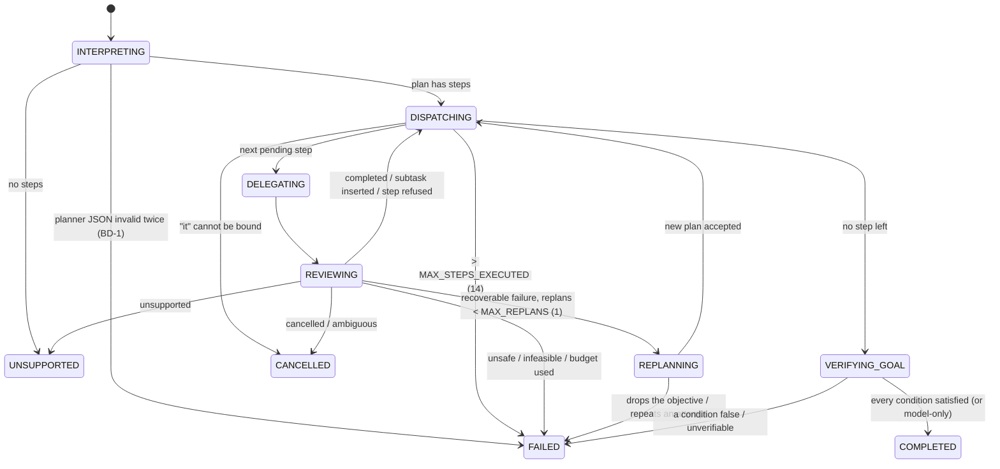
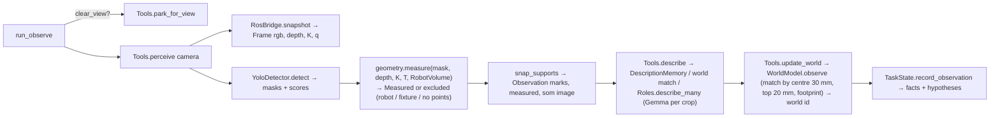
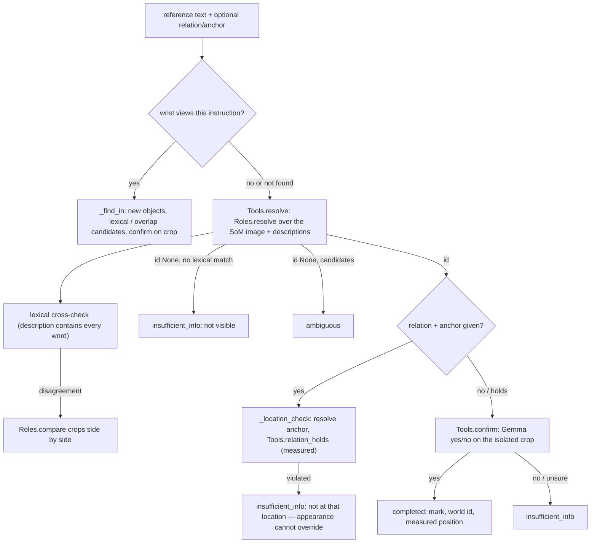
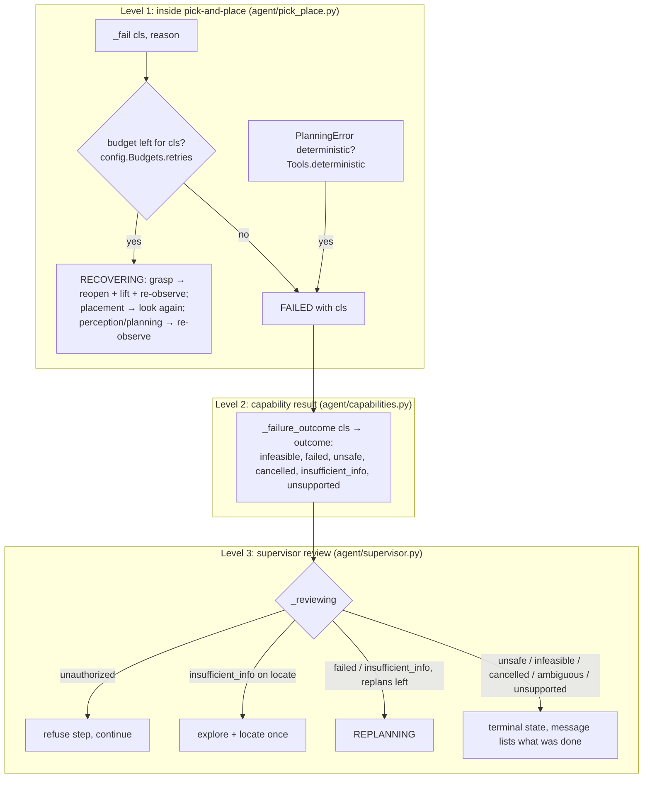

# Execution flow: what happens when you type an instruction

Every step below names the real function that runs it. Where a step currently fails or is untested live, the text
says so, using the status words of `FUNCTIONALITY_MAP.md`. Known defects are BD-n (`TECHNICAL_DEBT.md` §2).

## 1. The whole path in one picture

```mermaid
sequenceDiagram
  participant U as User (stdin)
  participant S as Session.run<br/>agent/run.py
  participant G as GoalSupervisor<br/>agent/supervisor.py
  participant A as authority.classify<br/>agent/authority.py
  participant L as Roles (Gemma)<br/>agent/vlm_roles.py
  participant R as WorkerRegistry.dispatch<br/>agent/workers.py
  participant C as run_<capability><br/>agent/capabilities.py
  participant T as Tools<br/>agent/tools.py
  participant X as RosExecutor (frozen)<br/>+ simulator safety layer
  participant V as GoalEvaluator<br/>agent/goals.py

  U->>S: instruction text
  S->>T: begin_instruction() / revalidate_held()  (finger check of a remembered held object)
  S->>G: run(instruction)
  G->>A: classify(instruction)  → kind + allowed effects
  A->>L: classify_request (sees only the request)
  G->>L: plan_goal(instruction, capability menu, context)  → steps
  loop each step
    G->>G: _dispatching: bind "it", adapt to held object, auto-observe if stale
    G->>R: dispatch(request, ctx, authority)
    R-->>G: refused ("unauthorized") if the effect is not allowed — before C runs
    R->>C: run_<capability>(ctx, args)
    C->>T: perceive / resolve / plan / execute / verify
    T->>X: execute(steps)  (only motion path)
    C-->>G: StepResult(outcome, summary, data)
    G->>G: _reviewing: accept, insert subtasks, refuse, replan or stop
  end
  G->>V: evaluate(conditions)  → satisfied True / False / unknown
  G-->>S: report (COMPLETED / FAILED / CANCELLED / UNSUPPORTED)
  S-->>U: message; files in the run directory
```

**Where the results go.** Each instruction writes to its own run directory (`out/demo/<date>/live_<time>/NN/` by
default):

| File | Contents |
|---|---|
| `events.jsonl` | every event |
| `task_state.json` | ledger: plan, facts, hypotheses, verifications, authority |
| `result.json` | the report |
| `checkpoints.sqlite` | LangGraph checkpoints |
| `images/` | marks, crops, questions |

## 2. Supervisor state machine (`agent/supervisor.py`)



| State | Function | What it does |
|---|---|---|
| INTERPRETING | `_interpreting` | `authority.classify` → `Roles.plan_goal` (Gemma, `PLAN_SYSTEM`) → `complete_plan` → `_add_steps`. Questions get the condition `answered(<instruction>)`; other conditions are derived from the steps (`goals.derive_conditions`). |
| DISPATCHING | `_dispatching` | picks `TaskState.current()`, `_bind_refs` ("it" → `#id`), `_adapt_to_robot_state` (pick_place of the held object → place), auto-observe (`capabilities.run_observe`) if the step needs a fresh view (`NEEDS_OBSERVATION`, `Tools.is_fresh`) |
| DELEGATING | `_delegating` | `WorkerRegistry.request` → `dispatch(req, ctx, authority)`; records the result in the ledger |
| REVIEWING | `_reviewing` | the policy: decomposition insert (refusing out-of-authority steps), uncertain answer → inspect (≤ 2) + answer again, locate not visible → explore + locate, `unauthorized` → refuse and continue, otherwise stop or replan |
| REPLANNING | `_replanning` | Gemma again with the attempts listed; rejects plans that drop the failed objective (`achieves`) or repeat an attempt unchanged |
| VERIFYING_GOAL | `_verifying_goal` | all steps done? replaced steps achieved later? then `GoalEvaluator.evaluate` per condition |

## 3. How a tool (capability) is selected and executed

1. **Gemma names capabilities.**
   - The capability menu comes from `capabilities.planner_menu()`.
   - The plan schema (`vlm_roles.PlanStep.do`) is a closed enum, so Gemma can only name these capabilities.
   - Deterministic validation in `Roles.plan_goal.check` rejects missing arguments, placeholders such as "null",
     missing hiding places and lost location phrases. Gemma gets one retry with the error message.
2. **The supervisor turns each step into a typed request.** `WorkerRegistry.request` builds it, with the
   worker name and safety class taken from `capabilities.SPECS`.
3. **Authorization.** `WorkerRegistry.dispatch` compares `SPECS[cap].effect` (none / sensing / object_change)
   with the instruction's `RequestAuthority.grants`. If the effect isn't granted, the executor is never called.
4. **The executor runs.** `GoalSupervisor._executors()` maps the name to a lambda, which calls
   `caps.run_<name>(ctx, args, …)`.
5. **The result is wrapped.** The capability returns `StepResult(outcome, summary, data)`; the registry wraps it as
   a `WorkerResult` (status, evidence, world changes, Gemma calls, seconds).

## 4. How perception creates and updates world objects



**Status.** This path is live-verified. In the laboratory, YOLO merges containers with their racks and trays
(BD-4), so most containers become part of a "fixture" object. Wrist views go through `_wrist_observation` with
`WorldModel.add_observation`, which applies the cross-camera fusion rule.

## 5. How a target is resolved (`run_locate` → `Tools.resolve` → `confirm`)



**Status:**

| Part | Status |
|---|---|
| Resolve + confirm | live-verified in the default scene |
| Location check | offline-tested only: live planning currently drops or rejects the location (BD-1, BD-2) |

Inside pick-and-place, `PickPlaceWorkflow._resolve_one` uses the same `Tools.resolve` / `confirm`, plus `#id`
references, remembered clarifications (`Tools.resolved_refs`) and user questions (`agent/ask.py`).

## 6. How motion is planned and authorized

| Layer | Where | What it guarantees |
|---|---|---|
| Request authority | `agent/authority.py`, `WorkerRegistry.dispatch` | no object-changing capability unless the user's request is an action (BD-3: negated commands slip through) |
| Viewpoint planning | `exploration.ViewpointPlanner.plan` (inspect / explore) | camera look-at IK, line of sight, pose and path collision-checked against measured obstacles (`Tools.obstacles`) |
| Grasp / place planning | `Tools.plan_pick_place` / `plan_pick` / `plan_place_held` → frozen `control.skills.SkillPlanner` with `control.collision.CollisionChecker` | collision-checked approach, grasp, lift, carry, place, retreat; deterministic infeasibility (out of reach, too wide) is not retried |
| Execution | `Tools.execute` → frozen `execution/ros_executor.RosExecutor.execute` | trajectories streamed over ROS; reach checked |
| Physical safety | frozen `sim/ros_control.JointCommandInterface` + `safety/joint_limits.JointLimits` | every command checked against joint limits and speeds in the simulator process, independent of the agent |
| Verification | `Tools.verify_contact`, `verify_placement`, `verify_home`; `goals.py` | measured success, never assumed |

## 7. How goal completion is verified

1. **Conditions** come from the request (questions: `answered`), from the plan (`goals.derive_conditions`: pick →
   `holding`, pick_place → the relation, place → relation + `not_holding`, locate → `located`, inspect →
   `observed` by the wrist camera, describe → `reported`, return_home → `at_home`), or from a decomposition.
2. **Bindings** connect the words to world objects: worker results return `bindings`, and `#id` references bind
   directly (`GoalEvaluator._id`).
3. **Each predicate is evaluated over measured state:**
   - finger feedback for `holding` / `not_holding`;
   - measured geometry for `on` and the relations;
   - wrist observations for `observed`;
   - the HOME joint check for `at_home`.
4. **Gemma-only evidence** (answers) counts as confidence `model`. It is reported as "not independently verified",
   never as measured.
5. **The verdict:**
   - any condition false → FAILED ("the goal is not met");
   - unverifiable physical conditions → FAILED (insufficient_info);
   - otherwise COMPLETED.

## 8. How failures and recovery are handled (three levels)



**Rules:**

- An exception inside a capability is a failure, never a success (`WorkerRegistry.dispatch`).
- A failed motion is reported with what was completed before it (`_done_so_far`).
- HOME failures after a manipulation are `unsafe`, so no new motion is planned.

## 9. Traced examples

### Example 1: a question about the scene, "Which objects are tubes and which are vials?"

| Step | Function | What happens | Evidence |
|---|---|---|---|
| 1 | `Session.run` → `Tools.begin_instruction` | new run directory, held state re-checked (nothing held) | — |
| 2 | `authority.classify` → `Roles.classify_request` | kind **question**, evidence = the whole sentence; grants none + sensing (no object_change) | live, `out/lab_exp1/milestone3/trackA/results.json` request 1 |
| 3 | `Roles.plan_goal` | **currently FAILS**: Gemma's JSON is invalid on both attempts → FAILED "I could not turn the instruction into steps" (BD-1) | same file, request 1; offline A/B: `trackA/planner_ab/results.json` |
| 3′ | (when planning succeeds) | e.g. observe + decompose. `complete_plan` adds an `answer` step (a report is not an answer); condition `answered(question)` | tests: `tests/test_authority.py::test_question_decomposed_into_pick_and_place_moves_nothing` |
| 4′ | `run_observe` → perception (§4) | measured objects + Gemma descriptions | live (other instructions) |
| 5′ | `run_decompose` → `Roles.decompose` | in the live current-system test, Gemma proposed pick #17 + place on #8. Now the supervisor refuses both before execution (`authorization` event, `refused` in the report) | `out/lab_exp1/current_system_test/step4/04/events.jsonl`; test above |
| 6′ | `run_answer` → `Roles.answer` | answer from the measured object list (no image) | — |
| 7′ | `GoalEvaluator._answered` | satisfied only by a certain, non-empty answer → COMPLETED "(answer from Gemma, not independently verified)" + "I did not pick, place: your request did not ask me to change any objects." | test |

**Limitations:**

- Gemma did not name containers as tubes or vials (0/8 on oracle crops), so a correct live answer is unlikely even
  when planning works.
- Label reading is unsupported (BD-6).

### Example 2: an inspection request, "Inspect the white-capped tube at the front of the incoming rack."

| Step | Function | What happens | Evidence |
|---|---|---|---|
| 1 | `authority.classify` | kind **description**; grants none + sensing (inspection allowed, no object changes) | live, milestone3 request 3 |
| 2 | `Roles.plan_goal` | **currently FAILS** (BD-1). Before `91429c4` it produced `inspect "white-capped tube"`, without the location (now BD-2: rejected by validation) | `out/lab_exp1/current_system_test/step4/03/` |
| 3 | `run_inspect` → `_target_mark` → `run_locate` | resolve the target (§5). In the current-system test the resolver chose a shelf bottle 1.3 m away and `confirm` said **yes** | same folder |
| 3′ | `_location_check` (since `91429c4`) | would reject that candidate ("not in 'incoming rack'") before viewpoint planning: offline-tested only | `test_wrong_location_target_is_rejected_even_if_it_looks_right` |
| 4 | `ViewpointPlanner.plan(target, q, Tools.obstacles())` | camera on 0.35 / 0.45 m spheres around the target; IK, line of sight, collision-checked path. For the shelf bottle: "no safe viewpoint: unreachable" → FAILED infeasible, no motion | current-system test |
| 5 | `Tools.execute([MoveStep])` → `RosExecutor` | move the wrist camera; `bridge.wait_still`; `ViewpointPlanner.reached` (≤ 1.5° per joint) | live in the active-perception phase (default scene): Test B, wrist position 0.7 mm vs table 3.6 mm (`docs/architecture/ACTIVE_PERCEPTION.md` §5) |
| 6 | `_wrist_observation` → `Tools.perceive("wrist")`, `WorldModel.add_observation` | close-up measurement, association (matched / partial / new), Gemma description of the wrist crop | same |
| 7 | `run_return_home` → `Tools.return_home`, `verify_home` | arm back to HOME, joint check | same |
| 8 | `GoalEvaluator._observed` | condition `observed(target, wrist)`: at least one wrist observation of the bound object | — |

**Status.** Live-verified in the default scene. In the laboratory it has never been reached, because of planning
(BD-1 / BD-2) and segmentation (BD-4).

### Example 3: pick-and-place, "Put the red cube on the green cube."

| Step | Function | What happens | Evidence |
|---|---|---|---|
| 1 | `authority.classify` | kind **action** with verbatim evidence → grants include object_change | design; live probe of "Pick up the vial." |
| 2 | `Roles.plan_goal` | `pick_place(object="red cube", relation="on", target="green cube")`. **Currently fails offline with the HEAD prompt (BD-1)**; valid with the earlier prompt | `trackA/planner_ab/results.json` |
| 3 | `run_pick_place` → `_skill("pick_place")` → `PickPlaceWorkflow.run` | a nested LangGraph workflow: | regression F, live, default scene (`ACTIVE_PERCEPTION.md` §5: 187.8 s, 7 Gemma calls, placement 3.9 mm, HOME 0.016°) |
| 3a | `_observing` | `park_for_view` (arm out of the camera's view), `perceive`, `describe`, `update_world` | |
| 3b | `_localizing` → `_resolve_one` (×2) | object and destination resolved + confirmed; asks the user if ambiguous | |
| 3c | `_planning_grasp` → `Tools.plan_pick_place` | `SkillPlanner` with `CollisionChecker(Tools.obstacles())`: hover, approach, close, lift, carry, lower, release, retreat; `PickPlan` | |
| 3d | `_approaching`, `_grasping` → `Tools.execute` | motion through the frozen executor; the simulator checks limits | |
| 3e | `_verifying_grasp` → `verify_contact` | finger stall ≥ 1.5° = contact; `Tools.set_held` | |
| 3f | `_transporting`, `_placing`, `_retreating` | carry (contact re-checked), lower, open, retreat | |
| 3g | `_verifying_placement` → `assume_placed`, `park_for_view`, `verify_placement` | re-observe the table; xy ≤ 10 mm, z ≤ 5 mm, tilt ≤ 5°; `clear_held` | |
| 3h | `_returning_home`, `_verifying_home` | HOME + joint check ≤ 1.5° | |
| 4 | `GoalEvaluator._on` | measured: support ≤ 10 mm from the green cube's top, centre within its footprint → COMPLETED | |

**Recovery inside the workflow:**

- **Grasp failure:** reopen, lift, re-observe (`_recovering`).
- **Placement out of tolerance:** look once more.
- **Deterministic planning error** (out of reach, too wide): FAILED without retry, mapped to `infeasible`, and not
  replanned by the supervisor.

**Status:**

| Where | Status |
|---|---|
| Default scene | live-verified (at commits before `91429c4`) |
| Laboratory | not run (no grasping in the lab yet) |
| Today | planning of this instruction fails offline (BD-1) |
