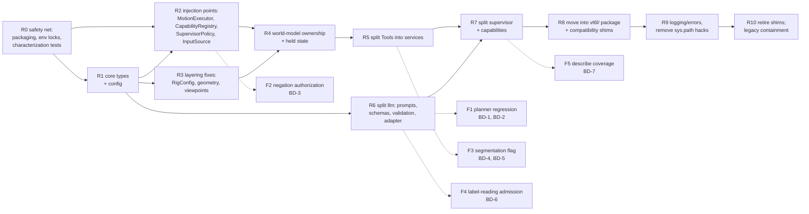

# Refactor roadmap (proposal for review), 2026-10-17

> **Historical record.** This document describes the project before the 2026-10-17 restructuring; its file paths
> may refer to the old layout (e.g. `agent/tools.py`, `agent/world.py`, `sim/scenario_lib/`). Current layout:
> `docs/architecture/MODULE_GUIDE.md` (§4 maps old paths to new). Content is kept unchanged as evidence.

**Two kinds of change, never mixed in one commit:**

| Kind | Prefix | Rule |
|---|---|---|
| Behaviour-preserving restructuring | `R0` … `R10` | Each increment ends with the same observable behaviour, including the known baseline defects BD-1 … BD-8 (`TECHNICAL_DEBT.md` §2), which act as characterization tests. |
| Functional fixes | `F1` … `F5` | Separate, labelled commits, scheduled *after* the increment that makes each one easy and testable. |

**Invariants for every increment:**

- The frozen manifest check passes:
  `grep -v '^#' docs/baselines/manipulation_A_2026-10-14/MANIFEST.sha256 | sha256sum -c`.
- The scenario baseline `lab-env-baseline-v2.0` geometry is unchanged.
- Artifact formats are unchanged: `events.jsonl`, `task_state.json`, `result.json`, `out/demo/live/*` (the viewer
  and scorers depend on them).
- Git history is preserved: work on `refactor/Rn-<name>` branches, merged with `--no-ff`, tag `refactor-Rn-done`.
- No live robot experiments are needed for acceptance. Simulator smoke tests are opt-in (`-m sim`).

## 1. Stage dependencies

## 2. Increments

### R0: Safety net (no production code change)

**Scope:**

- **Packaging:** `pyproject.toml` declaring the *existing* packages as-is (`agent`, `sim`, `evaluation`, …; no
  moves), with optional dependency groups `agent`, `sim`, `legacy`, `dev`. Lock files per environment
  (`requirements/agent.lock`, `sim.lock`, `legacy.lock`, from today's venvs).
- **Single test interpreter:** pytest runs agent tests in the agent environment (or a new `dev` env).
  `pytest.ini` gains markers: `unit`, `integration`, `model` (needs Gemma), `gpu`, `sim` (needs Isaac), `slow`.
- **Fixtures:** `tests/conftest.py` + `tests/fakes/` take over `StubTools`/`GoalTools`. They are copied verbatim
  first, and the old modules re-export them, so the test bodies don't change.
- **Characterization ("golden") tests:**
  - **G1:** supervisor event-kind sequences + final reports for the 60+ scripted supervisor / session / authority
    tests (fakes, CPU).
  - **G2:** rendered prompt snapshots: SHA-256 of `PLAN_SYSTEM`, `DECOMPOSE_PROMPT`, `ANSWER_PROMPT`,
    `REQUEST_SYSTEM` and `planner_menu()` output.
  - **G3:** perception geometry on saved frames. Save YOLO raw masks for the 27 `out/lab_seg_frames` views once
    (`-m gpu` to regenerate), then assert `geometry.measure` + `snap_supports` outputs within 0.1 mm (CPU).
  - **G4:** recorded-model fixtures reproducing BD-1 / BD-3 (planner A/B answers, the "Do not pick up the vial."
    classification), as `xfail(strict=True)` tests named after the defect. A fix flips them, so it can't happen
    silently.
  - **G5:** the frozen-manifest check as a test.
- **CI script:** `tools/ci.sh` runs the lint + unit + integration + golden tests (CPU), skipping `model`/`gpu`/`sim`.

**Acceptance:**

- All 214 existing tests pass under one interpreter, with 0 skips outside the `model`/`gpu`/`sim` markers.
- The golden suites pass on the unchanged code.
- `pip install -e .[agent]` works in a fresh venv from the lock file.

**Rollback:** delete the added files (no production change).

**Benefit:** every later increment has a mechanical behaviour check.

### R1: Core types and configuration (additive)

**Scope.** `vt6l/core/`:

- `types.py`: `StrEnum` `Outcome`, `StepStatus`, `FailureClass`, `Effect`, `RequestKind`, with **identical string
  values**;
- `errors.py`;
- `config.py`: `PlatformConfig` dataclasses + a TOML loader; defaults equal today's constants from
  `agent/config.py`, `supervisor.py`, `exploration.py`, `control/robot.py` (read, not copied);
- `config/platform.default.toml`.

Production modules start *reading* constants from a default `PlatformConfig` instance. Values are unchanged.

**Acceptance:**

- A test asserts every config default equals the legacy constant.
- G1 and G2 are unchanged.
- The enums compare equal to the old strings in logs.

**Rollback:** revert the merge. Old constants are still in place until R8.

### R2: Injection points for safety-relevant behaviour (**recommended first structural increment**)

**Scope:**

- **`MotionExecutor` protocol** (`vt6l/io/motion.py`) with `RosMotionExecutor` (wraps the frozen `RosExecutor`),
  `DryRunExecutor` and `GatedExecutor`. `Tools.execute` delegates to an injected executor; the default reproduces
  today's call sequence exactly.
- **`CapabilityRegistry`** built from config (enabled set, effect table). `WorkerRegistry` keeps its API; `caps.SPECS`
  becomes the default config.
- **`SupervisorPolicy`** dataclass (max replans, step bounds, inspections per answer), injected into
  `GoalSupervisor` (default = today's constants).
- **`InputSource`** for the instruction prompt, injected into `Session`; `LineReader` stays the default.
- **`EventSink` injection** (today's `EventLog`); harnesses observe through a tee sink, not by patching `__call__`.
- **Migrate harnesses:** `evaluation/lab_exp1_agent.py` and the milestone harnesses use these injection points.
  No monkeypatching of production symbols remains in `evaluation/` (a grep check in CI).

**Acceptance:**

- G1 is unchanged.
- The Experiment 1 protocol, replayed offline with fakes, produces the same `harness_gates.jsonl` decisions.
- New tests:
  - a `DryRunExecutor` never calls ROS;
  - a `GatedExecutor` refuses outside an open gate;
  - a disabled capability is refused by the registry before execution.
- The authorization tests (`tests/test_authority.py`) pass unchanged.

**Risk:** an executor wiring mistake could bypass the safety layer. *Mitigation:* the default path is a pass-through
to the same frozen `RosExecutor` object, verified by a call-sequence test. `GatedExecutor` fails closed.

**Rollback:** revert. Harnesses keep working through the old monkeypatch path until this merge.

### R3: Layering fixes

**Scope:**

- **`RigConfig`** (camera poses / intrinsics, static fixtures, robot base exclusion) with defaults read from the
  frozen `control.robot` / `sim.scene_objects`. Only `vt6l.robot.rig` imports them. `agent/config.py` stops
  importing `sim.scene_objects` (D1). Camera users take the pose from `RigConfig` (D5).
- **`vt6l.core.geometry`:** `footprint_yaw`, `grasp_pose` (copied from `perception/grounding.py`, D2), `rot_z`,
  `segment_hits_box`, `back_project`.
- **`ViewpointPlanner`** moves to `vt6l/skills/viewpoints.py`, with a shim at `agent/exploration.py`.
  `sim/scenario_lib/checks.py` imports it from skills (D4).

**Acceptance:**

- Import-linter contracts pass for the touched modules.
- Numerical equality tests (old vs new functions on 10k random inputs, exact or ≤ 1e-12).
- G1 and G3 are unchanged.

**Rollback:** revert. Shims keep the old import paths.

### R4: World-model ownership

**Scope:**

- `WorldModel` gains `held` (`HeldState`) and the write API (`set_held`, `clear_held`, `mark_missing`).
  `Tools.held_object/held/held_geom/held_close_target/held_box` and `world.holding` become read-only properties
  over it (one source of truth).
- `DescriptionCache` moves out of `agent/tools.py`.
- `TaskState` is aliased as `TaskLedger`.

**Acceptance:**

- G1 unchanged; session / authority / orchestration tests unchanged.
- An invariant test: after every capability in the scripted suites, `world.held` and the legacy accessors agree.

**Rollback:** revert.

### R5: Split `Tools` into services

**Scope.** These services move out of `Tools`, with method bodies moved verbatim:

| Service | Takes over |
|---|---|
| `Perceiver` | `perceive`, `describe`, `update_world`, `is_fresh` |
| `Resolver` | `resolve`, `confirm`, `shortlist`, `pool`, `words`, `lexical_candidates`, `candidate_image`, location check |
| `ManipulationPlanner` | `plan_*`, `relation_holds`, `obstacles`, `deterministic` |
| `Verifier` | `verify_*`, `assume_placed` |
| `MotionService` | `execute`, `park_for_view`, `return_home`, `view_blockage`, `workspace_points` |

`Tools` remains a facade composing them, so callers keep working. Protocol-checked fakes replace `StubTools`.

**Acceptance:** G1 and G3 unchanged; every fake passes `isinstance(fake, Protocol)` structural checks; no test body
edits except imports.

**Rollback:** revert.

### R6: Split the LLM layer

**Scope:**

- Prompts into `vt6l/llm/prompts/*.txt`, loaded **byte-identically** (G2 hash test);
- schemas into `vt6l/llm/schemas.py`;
- deterministic validation into `vt6l/llm/validation.py`;
- a Gemma adapter in `vt6l/llm/gemma.py` that wraps `vlm.model.VisionLanguageModel` (the legacy loader is not
  edited);
- `Roles` in `vt6l/llm/roles.py`.

**Acceptance:**

- G2 identical.
- Recorded-model tests identical.
- `-m model` planner A/B reproduces the BD-1 numbers (3/8 valid) exactly (greedy decoding).

**Rollback:** revert.

### R7: Split supervisor and capabilities

**Scope:**

- **Supervisor modules:** `policy.py` (completion rules, alternatives, recoverability), `binding.py` (pronouns,
  robot-state adaptation), `messages.py` (NL texts), `supervisor.py` (graph + node functions only).
- **Capabilities:** one module per family, as objects implementing `Capability` and registered from config.
  `_failure_outcome` becomes a typed table with an exhaustive test.

**Acceptance:** G1 identical (event sequences and messages byte-equal); BD-* characterization tests unchanged.

**Rollback:** revert.

### R8: Move into the `vt6l` package with compatibility shims

**Scope:**

- **Moves:** `agent/*` → `vt6l/{agent,perception,world,llm,skills,safety,io}`;
  `sim/scenario_lib` → `vt6l/scenarios` (+ `isaac/`); evaluation libraries → `vt6l/evaluation`;
  `agent/run.py` main → `vt6l/apps/agent_cli.py`; `sim/run_scenario.py` → `vt6l/apps/sim_scenario.py`.
- **Shims:** old module paths become re-export shims with `DeprecationWarning`.
- **Experiments:** drivers move to `experiments/<name>/` (each with a README and a config TOML).
- **Not moved:** the frozen files, `ros_nodes/vlm_agent_node.py` and `launch/run.sh` (protected).

**Compatibility, all of which must keep working:**

- `python -m agent.run …` (all flags);
- `./launch/start_demo.sh` (incl. `--scenario`);
- `python -m sim.run_scenario --scenario … --difficulty … --seed …`;
- `.venv/bin/python evaluation/validate_scenarios.py …`;
- `evaluation/lab_exp1*.py`;
- the legacy launchers (`launch/run.sh`, `start_live.sh`, `start_vlm_agent.sh`, `tasks.sh`), unchanged.

**Acceptance:**

- A smoke test imports every old path.
- `-m sim` smoke runs `validate_scenarios --no-design --difficulty easy` and the scenario runner for 10 s.
- The manifest check passes.

**Rollback:** revert the move commit. The shims make partial rollback unnecessary.

### R9: Logging, errors, imports

**Scope:**

- Stdlib `logging` with a JSON formatter in libraries; `print` only in `apps/` and `experiments/`.
- The `VT6LError` hierarchy, with one broad `except` at the registry boundary.
- `sys.path` insertion removed from all non-frozen modules (the package is installed).
- `main()` guards on all non-frozen entry points (TD-13).

**Acceptance:** the lint rules (ENGINEERING_STANDARDS §3, §5) pass; G1 unchanged; the log files of a scripted run
are parseable.

### R10: Retire shims; contain the legacy stack

**Scope:**

- Remove the R8 shims after one milestone of warnings.
- `legacy/README.md` documents the legacy stack in place, with launchers labelled.
- Decide (separately) whether to archive it on a branch.

**Acceptance:** no import of shim paths remains (`grep`); docs updated.

## 3. Functional fixes (after the enabling increments; each its own commit, tests first)

| Fix | Defect | After | Acceptance |
|---|---|---|---|
| F1 | BD-1 planner regression, BD-2 location constraints | R6 | remove the added prompt example; attach `location_anchors` deterministically; repair the two observed JSON shapes. `-m model` planner A/B ≥ 6/8 (target 8/8); G2 updated deliberately; authorization tests pass |
| F2 | BD-3 negated commands | R2 (+R6) | negation can only remove `object_change`; recorded fixtures of 20 paraphrases; live classification probe |
| F3 | BD-4 / BD-5 segmentation | R5 | B2 behind `perception.split_protrusions=false`; split instances carry `height_known=False`; placement refuses them until measured; the 27-frame benchmark as a gate |
| F4 | BD-6 label-reading claims | R6 | planner prompt / validation: capabilities the menu does not list cannot appear in plans or reasons; honest "cannot read labels" answer |
| F5 | BD-7 describe coverage | R7 | `reported()` checks coverage of measured objects; a negative test |

## 4. Recommended first increment

**Increment 1 = R0 (safety net), then R2 (injection points).**

**Why first:**

- R0 changes no production code and creates the golden tests every later step needs.
- R2 removes the highest operational risk found in the audit: safety-relevant experiment behaviour (dry runs, motion
  gates, capability blocks) implemented by monkeypatching production code (TD-4). A rename during any later
  refactor would silently disable those gates.
- R2 touches few files: `agent/tools.py` `execute`; the `supervisor`, `capabilities.SPECS`, `run.Session` and
  `ask` constructors; `evaluation/lab_exp1_agent.py`.
- It is fully covered by the existing 142 agent tests plus the new gate tests.

**Estimated size:**

| Increment | Size |
|---|---|
| R0 | ~1–2 days (most effort: golden fixtures and frame masks) |
| R2 | ~1–2 days |

## 5. Risks

| Risk | Where | Mitigation |
|---|---|---|
| Hidden behaviour change in prompts (whitespace, ordering) | R6 | byte-identical prompt hash (G2) + recorded-model tests |
| Numeric drift from consolidating interpreters (numpy 1.26 → 2.x) | R0 | golden tolerances (0.1 mm); run the G3 comparison on both interpreters once and record the result |
| LangGraph checkpoint / state schema changes | R7 | checkpoints are written but never resumed: keep the schema; G1 compares event streams, not checkpoints |
| Import side effects of Isaac / rclpy surfacing in tests | R8 | adapters import them lazily; CI imports every non-sim module under the plain interpreter |
| Safety-gate regression | R2 | fail-closed defaults; call-sequence tests; the authorization suite as a required check |
| Scope creep into fixes | all | the R/F separation; BD-* `xfail(strict=True)` tests fail loudly if a refactor changes a defect |
| Frozen-file edits by tooling (formatters) | all | exclude the frozen paths in the formatter / linter config; the manifest test in CI |
