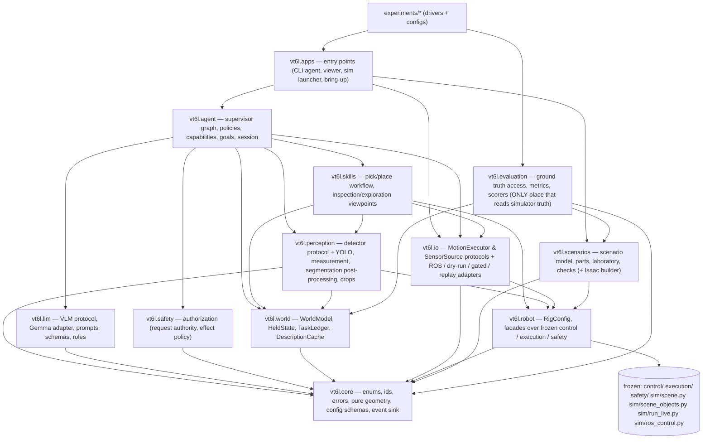

# Target architecture (proposal for review), 2026-10-17

**Goals:**

- a long-lived research platform for multimodal agents and manipulation;
- behaviour preserved;
- frozen baseline files untouched;
- runnable on Isaac Sim + ROS 2 + a 12 GB GPU;
- room for RL;
- no rewrite and no microservices.

Each new boundary below names the debt item it removes (`TD-n`, see `TECHNICAL_DEBT.md`).

## 1. Principles applied (and where)

| Principle | Concrete use here | Solves |
|---|---|---|
| Dependency inversion | orchestration depends on `MotionExecutor`, `SensorSource`, `Detector`, `VLM` protocols; adapters wrap ROS / Isaac / frozen code | TD-4, TD-5 |
| Single owner of mutable state | `WorldModel` owns objects + held state; `TaskLedger` per instruction; nothing else writes them | TD-1, TD-2 |
| Typed contracts | `StrEnum`s for outcomes / effects / failure classes; pydantic / dataclass schemas at module boundaries | TD-6 |
| Centralized configuration | one `PlatformConfig` (TOML → dataclasses) with today's constants as defaults | TD-5, TD-9 |
| Composition root | one bring-up module builds the object graph (models → detector → sim → ROS) | TD-4, TD-8 |
| Frozen code is wrapped, never moved | `vt6l.robot` re-exports and adapts `control/`, `execution/`, `safety/`, `sim/scene*.py` | manifest constraint |

## 2. Layers and dependency rule



**Rules.** These are enforced by an import-linter check (ENGINEERING_STANDARDS §10):

1. Arrows point inward only. `core` imports nothing from the project.
2. Only `vt6l.robot` imports the frozen packages. Everything else uses `vt6l.robot`.
3. Only `vt6l.evaluation` (and `experiments/`) may read simulator ground truth (`/sim/ground_truth/*`, scenario
   metadata). `vt6l.agent` must never import `vt6l.evaluation` or `vt6l.scenarios`.
4. `vt6l.scenarios` must not import `vt6l.agent`. Fixes D4: the viewpoint geometry it needs moves to `vt6l.skills`.
   `skills` doesn't depend on `agent`, so the scenarios layer may use it, or better, a pure function in
   `vt6l.core.geometry`.
5. Heavy or optional dependencies (`isaacsim`, `rclpy`, `torch`, `ultralytics`, `transformers`) are imported only
   inside adapter modules (`vt6l.io.ros_*`, `vt6l.llm.gemma`, `vt6l.perception.yolo`, `vt6l.scenarios.isaac`).
   The rest imports cleanly under the plain test interpreter. That fixes the silent skips (TD-9, TD-10).

## 3. Proposed package layout

The package is `vt6l` (the name is open for review). It is installed in editable mode
(`pip install -e .[agent]`) and sits beside the frozen packages, which stay where they are.

```
6DOF-Arm/
├── pyproject.toml                # one project; optional groups: agent, sim, legacy, dev
├── config/
│   ├── platform.default.toml     # rig, perception, supervisor policy, authorization, budgets, tolerances (today's values)
│   └── models.toml               # model registry: gemma path/quantisation, yolo weights path (moved out of out/)
├── vt6l/
│   ├── core/          types.py (Outcome, StepStatus, FailureClass, Effect, ObjectId), errors.py, geometry.py,
│   │                  config.py (PlatformConfig dataclasses + TOML loader), events.py (EventSink protocol + JSONL sink)
│   ├── robot/         rig.py (RigConfig: base, cameras, static fixtures), model.py (facade: kinematics, collision,
│   │                  skills, constants from frozen control/*)
│   ├── io/            motion.py (MotionExecutor protocol, ExecutionResult), sensors.py (SensorSource protocol, Frame),
│   │                  ros_motion.py (wraps frozen RosExecutor), ros_sensors.py (today's agent/ros_bridge.py),
│   │                  dryrun.py, gated.py, replay.py (saved frames → SensorSource, for offline tests / RL)
│   ├── world/         model.py (WorldModel + HeldState), ledger.py (TaskLedger = today's TaskState),
│   │                  description_cache.py
│   ├── perception/    detector.py (Detector protocol), yolo.py, measure.py (today's agent/geometry.py),
│   │                  marks.py (somark), pipeline.py (Perceiver: frame → Observation; today's Tools.perceive/describe),
│   │                  grounding.py (Resolver: resolve / confirm / location check; today's Tools.resolve/confirm/...)
│   ├── llm/           vlm.py (VLM protocol, RecordedVLM), gemma.py (loader + adapter; replaces vlm/model.py use),
│   │                  schemas.py, prompts/*.txt, validation.py, roles.py (Roles: plan, decompose, answer, resolve,
│   │                  confirm, describe, classify_request)
│   ├── skills/        pick_place.py (workflow, unchanged logic), planning.py (today's Tools.plan_* + relation
│   │                  geometry), viewpoints.py (today's agent/exploration.py), verification.py (contact / placement / home)
│   ├── safety/        authority.py (today's agent/authority.py), policy.py (effect table per capability)
│   ├── agent/         supervisor.py (graph only), policy.py (SupervisorPolicy: replans, bounds, completion rules),
│   │                  binding.py (pronouns, robot-state adaptation), registry.py (CapabilityRegistry, today's
│   │                  workers.py), capabilities/{observe,describe,answer,locate,inspect,explore,manipulate,decompose,
│   │                  home}.py, goals.py, session.py, messages.py (NL result text)
│   ├── scenarios/     core.py, parts.py, laboratory.py, checks.py, isaac/build.py (today's sim/scenario_lib/*)
│   ├── evaluation/    truth.py (only ground-truth reader), metrics.py, scorers/ (lab_exp1, segmentation), harness.py
│   └── apps/          agent_cli.py (today's agent/run.py main), bringup.py (GPU-order bring-up), viewer.py,
│                      sim_scenario.py (today's sim/run_scenario.py)
├── agent/ sim/ evaluation/ …   # transition: thin re-export shims, then removed after the deprecation window
├── control/ execution/ safety/ sim/scene.py sim/scene_objects.py sim/run_live.py sim/ros_control.py   # FROZEN, unchanged
├── legacy/README.md              # documents the legacy stack in place (ros_nodes/vlm_agent_node.py, vlm/, perception/ …)
├── experiments/<name>/           # drivers + config + README per experiment (today's evaluation/lab_exp1*.py, …)
├── tests/{unit,integration,model,sim}/ + conftest.py + fakes/
└── docs/
```

## 4. Key interfaces (each solves a recorded problem)

```python
# vt6l/io/motion.py  - TD-4: dry run / motion gate / capability blocks become configuration, not monkeypatches
class MotionExecutor(Protocol):
    def execute(self, steps: Sequence[Step], label: str) -> ExecutionResult: ...
#   RosMotionExecutor(frozen RosExecutor) | DryRunExecutor | GatedExecutor(inner, gate: Callable[[Request], Decision])

# vt6l/io/sensors.py - TD-1/TD-10: perception testable on saved frames (out/lab_seg_frames) and live ROS alike
class SensorSource(Protocol):
    def snapshot(self, camera: CameraId) -> Frame: ...
    def joints(self) -> JointState: ...
    def wait_still(self) -> None: ...

# vt6l/world/model.py - TD-2: one owner, one write API, typed ids
class WorldModel:
    def observe(self, measured: Measured, description: Description | None, camera: CameraId) -> Association: ...
    def set_held(self, obj: ObjectId, grasp: GraspRecord) -> None: ...
    def clear_held(self, reason: str) -> None: ...
    def mark_missing(self, obj: ObjectId, reason: str) -> None: ...
    @property
    def held(self) -> HeldState | None: ...        # replaces Tools.held_object AND world.holding

# vt6l/agent/registry.py - TD-4/TD-6: capabilities are objects registered from config; effect + enablement explicit
class Capability(Protocol):
    name: str
    effect: Effect                                  # none | sensing | object_change
    def run(self, ctx: Context, args: Mapping[str, Any]) -> StepResult: ...
```

### What is deliberately not abstracted

- **Kinematics, collision, skills.** These are frozen and already have a stable API. `vt6l.robot.model` only
  re-exports and centralises their construction.
- **The LangGraph graph.** Kept as is; it is split out of the policy code, not hidden behind an interface.
- **The two ROS nodes.** The documented single-spin design is kept inside `vt6l.io`.
- **No plugin system, no service bus, no generic "Agent" base class.**

## 5. State ownership (target)

| State | Owner | Lifetime | Writers | Readers |
|---|---|---|---|---|
| Objects, ids, observations, held object | `WorldModel` | session (one process + simulator connection) | perception pipeline, skills (via `WorldModel` methods) | everyone (read-only views) |
| Instruction ledger: plan, facts snapshot, hypotheses, verifications, authority, refusals | `TaskLedger` | one instruction | supervisor, capabilities through `Context` | goals, report |
| Description cache | `DescriptionCache` | session | perception pipeline | perception pipeline |
| Capability table | `CapabilityRegistry` | built per session from config | bring-up only | supervisor, planner menu |
| Configuration | `PlatformConfig` (frozen dataclasses) | process | loader only | everyone |
| Simulator scene selection | `vt6l.scenarios` → explicit object list passed to the Isaac builder; the frozen `OBJECTS` dict is filled only inside `apps/sim_scenario.py`, as today | sim process | sim app | sim |

## 6. Error handling and logging

**Exceptions.** `vt6l.core.errors`:

```
VT6LError
├── ConfigError
├── PerceptionError
├── ModelError        (wraps VLMFailure)
├── PlanningError     (re-export of the frozen control.motion.PlanningError)
├── ExecutionError
├── AuthorizationError
└── ScenarioError
```

**Rules.**

- Capabilities convert exceptions to typed `StepResult(outcome, failure_class, message)` at one place: the registry.
  This is the only remaining broad `except`.
- Logging is two streams:
  - **Diagnostic:** stdlib `logging` with a JSON formatter, one logger per package.
  - **Experiment record:** today's `EventLog` JSONL, kept with the same file format, behind the `EventSink`
    protocol. The viewer and the scorers keep working.

## 7. Configuration

`PlatformConfig` sections, each defaulting to today's values so behaviour is identical:

| Section | Contents | Source today |
|---|---|---|
| `rig` | robot base; cameras (pose, intrinsics); static fixtures | `control/robot.py`, `sim/scene.py`, `agent/config.FIXTURES` |
| `perception` | measurement thresholds; detector confidence / imgsz; `split_protrusions=false` | `agent/config.py`, `agent/run.py` |
| `supervisor` | replans; step bounds; inspections per answer | `supervisor.py` constants |
| `authorization` | effect table; classifier on/off | `capabilities.EFFECT`, `authority.py` |
| `budgets` | budgets | `agent/config.Budgets` |
| `tolerances` | tolerances | `agent/config.Tolerances` |
| `relations` | relations | `agent/config.Relations` |
| `models` | model paths and quantisation | `config/models.toml` |
| `runtime` | GPU order, ROS domain, live dir | `agent/run.py`, environment |

Loading order: defaults → `config/platform.default.toml` → an experiment's TOML → CLI overrides. The resolved
config is written into every run directory (`run_dir/config.resolved.toml`) for reproducibility.

## 8. Fit with Isaac Sim, ROS 2, GPU, and RL

- **Isaac Sim.** It stays a separate process (`apps/sim_scenario.py` wrapping the frozen `run_live`). Isaac-only
  code sits under `vt6l.scenarios.isaac`, imported only by the sim app.
- **ROS 2.** It is confined to `vt6l.io.ros_*`. Topic names move to `rig` config, with today's names as defaults.
- **GPU.** `apps/bringup.py` is the single implementation of "VLM → detector → simulator", used by the CLI and by
  experiment drivers, which today each re-implement it.
- **RL (future).** An environment wrapper can be built from `SensorSource` + `MotionExecutor` + `vt6l.scenarios`
  (reset by scenario/seed) + `vt6l.evaluation.truth` (reward), with no change to agent code. `ReplaySensorSource`
  supports offline policy evaluation on saved frames.

## 9. Expected benefits

- **Experiment gates become tested features.** Dry runs, motion gates and capability enablement become config,
  covered by tests instead of hidden monkeypatches.
- **Stub drift is eliminated.** Fakes are checked against `Protocol`s.
- **State ownership is clear:** one world model, one held-object representation.
- **Prompt and validation changes become isolated, testable diffs** (prevents a repeat of BD-1-style regressions).
- **Reproducible environments and model paths;** agent tests run under the default interpreter.
- **The frozen baseline stays byte-identical** throughout.
