# Scenario 1: biomedical laboratory sample handling (`laboratory`, v2.0)

Status: scenario construction complete and validated on 2026-10-15, at seed 42 for all three levels. No
autonomous manipulation has been run in this scene yet.

```bash
.venv/bin/python -m sim.run_scenario --scenario laboratory --difficulty {easy|medium|hard} --seed 42 [--headless]
.venv/bin/python evaluation/validate_scenarios.py --scenario laboratory --seed 42 --reload --drop-mm 10 [--resume]
.venv/bin/python -m sim.scenario_lib.checks --scenario laboratory --difficulty hard --seed 42 --out design.json
```

Library conventions, loading and the validator are described in [README.md](README.md).

| Item | File |
|---|---|
| Scene definition | `sim/scenario_lib/laboratory.py` |
| Builders | `sim/scenario_lib/parts.py` |
| Isaac builder | `sim/scenario_lib/build.py` |
| Offline checks | `sim/scenario_lib/checks.py` |

## 1. Purpose

This is a sample-processing workstation for later studies of:

- **Identification under ambiguity.** Cap colours repeat, so identity needs the printed label, which only
  close inspection can read.
- **Multimodal perception.** The table camera gives the global view; the wrist camera gives close-ups.
- **Long-horizon rearrangement.** Samples move between six functional zones.
- **Uncertainty and recovery.** The scene contains occupied destinations, a hidden sample and an unreachable
  sample.

The geometry is fixed per level and seed. Experiments change the task, not the scene.

## 2. Workstation layout and functional zones

Positions are design values in the robot base frame (metres). The seed adds ±4–6 mm of jitter.

| Zone id | Fixture | Position (x, y) | Regions (labels) | Accepts |
|---|---|---|---|---|
| `incoming` | blue 2 × 4 rack, 36 mm holes, 55 mm tall | (−0.02, 0.66) | A1–A4 (front row), B1–B4 | pick only |
| `processing` | orange 1 × 4 receiving rack, 56 mm holes, rotated 90° | (−0.62, 0.32) | P1–P4 | tube |
| `storage` | green 1 × 4 receiving rack, 56 mm holes, rotated 90° | (0.60, 0.30) | S1–S4 | tube |
| `inspection` | white 140 × 140 × 12 mm pad with a black target ring | (0.22, 0.42) | INSPECT | any |
| `quarantine` | tray with a hazard-striped rim (200 × 220 mm, rim 35 mm) | (0.45, 0.64) | Q1, Q2 | any |
| `buffer` | shallow tray (300 × 190 mm, rim 18 mm) | (0.64, −0.10) | T1–T3, in one row | vial |

**Optional instruments** (static, by level):

- a centrifuge at (0.25, 0.82), 170 × 180 × 190 mm (medium and hard);
- a sample cooler at (−0.30, 0.56), 100 × 180 × 240 mm (hard).

**Visual elements.** Each zone has a taped outline and a floor text label. The bench is dark epoxy; the
lighting is the dome light plus one 1.2 × 0.6 m rect light. Visual-only decor stands ≥ 1.15 m from the base:
walls, a reagent shelf, a fume hood with a glass sash, and a "BSL-2 LAB 4" sign.

**How the positions were chosen:**

- **Reach.** Every receiving region lies 0.45–0.90 m from the base.
- **Camera visibility, including the robot.** With the robot at HOME, the table camera cannot see the band
  x −0.9…−0.5 m, y 0…0.1 m. v1 put its processing tray there, and the earlier "all visible" result had missed
  it. The visibility check now includes the robot's collision spheres.
- **Gripper spacing.** The open 2F-85 pads reach about 75 mm from the object centre along the closing
  direction. Rack rows along that direction are therefore 100 mm apart, and buffer spots 90 mm.
- **Placement clearance.** Receiving holes are 56 mm so that a held 34 mm cap keeps the planner's 10 mm
  obstacle clearance while it is lowered. That is the reason for the wide holes, not realism.
- **Frozen props.** The default scene's microphone and camera stand are kept clear.

## 3. Samples and containers

| Type | Body | Cap | Mass | Labels |
|---|---|---|---|---|
| Tube (self-standing, 50 mL proportions) | 30 × 100 mm, frosted plastic | 34 × 14 mm, coloured | 0.043 kg | sample ID on the cap top and on a side label |
| Vial | 24 × 48 mm, amber glass (opaque, glossy) | 26 × 12 mm, coloured | 0.023 kg | sample ID on the cap top and on a side label |

- **Mass.** A 1.2 mm wall plus contents at 40 % fill and water density. Everything is a rigid body; there are
  no liquids.
- **Grip width.** Every container is ≤ 34 mm across, well within the gripper's 80 mm limit.
- **Sample IDs.** A letter from H K M N R X plus 3 digits, e.g. `M548`. They are unique per scene and never
  use the slot letters A B P S Q T.
- **Cap colours.** Drawn from red, blue, green, yellow, purple and white. In every level and seed each colour
  appears at least twice, so colour never identifies a sample; this is tested for seeds 0, 42 and 1234.
- **Label orientation.** Labels face the table camera in easy. In medium and hard the container yaw is random,
  so side labels may face away and the cap-top ID needs the wrist camera.

## 4. Difficulty configurations (seed 42)

| | easy | medium | hard |
|---|---|---|---|
| Containers | 8 (6 tubes, 2 vials) | 10 (8 tubes, 2 vials) | 12 (8 tubes, 4 vials) |
| Other objects | none | pipette-tip box (distractor) | pipette-tip box |
| Cap colours | 4, each used twice | 3, used 3–4 times each | 3, each used 4 times |
| Container yaw | 0° (labels toward the table camera) | random | random |
| Occupied receiving regions | none | P3, S1 | P4, S1, S2, Q1, one buffer spot |
| Static instruments | none | centrifuge | centrifuge, sample cooler |
| Intentional exceptions | none | none | `vial_hidden` (behind the cooler); `vial_far` (0.99 m, beyond reach) |

The same table holds for every seed; only the slot assignment, IDs, colours and jitter change.

## 5. Ground-truth metadata (evaluation only)

`Scenario.metadata()` stores the scene's ground truth. The validator writes it to
`out/scenarios/laboratory/<level>_s<seed>/metadata.json`, alongside the settled poses.

| Group | Fields |
|---|---|
| Scenario | scenario id, version 2.0, seed, difficulty, intended difficulty features |
| Zones | id, title, fixture, centre, size, purpose |
| Regions | id, label, zone, kind, surface height, `accepts`, `occupied_by`, `validated_placement` (feasible grip yaws from the planner) |
| Objects | `sample_id`, `cap_colour`, `label_text`, container type, zone and slot, `look_alikes` (same type and cap colour), role, spawn pose, footprint and height, mass, friction, colliders and labels, `validated_grasp_yaws`, table-camera top visibility |
| Fixtures and decor | geometry |

Nothing here is given to the agent.

## 6. Validation results (seed 42, measured)

### Physics and reproducibility (GPU physics, as the live simulator runs)

| | easy | medium | hard |
|---|---|---|---|
| Robot and gripper present | 12 DOF | 12 DOF | 12 DOF |
| HOME error | 0.016° | 0.016° | 0.016° |
| After 3 s settling: rest error / tilt | 0.0 mm / 0.0° | 0.0 mm / 0.0° | 0.0 mm / 0.0° |
| Drift over 1 more simulated second | 0.003 mm | 0.003 mm | 0.003 mm |
| Interpenetration after settling (> 1.5 mm) | none | none | none |
| Same seed rebuilt on a new stage: max pose difference | 0.0 mm | 0.0 mm | 0.0 mm |
| Metadata regenerated identically | yes | yes | yes |
| CPU-physics cross-check (camera build): rest error | 0.0 mm | 0.0 mm | 0.0 mm |

Stability is judged by measured drift. PhysX reports a resting-contact velocity of a few mm/s for objects
that do not move. An earlier validator treated that as motion; it no longer does.

### 10 mm drop test

Every object is spawned 10 mm above its support. All objects ended on their design rest pose: rest error
0.0 mm and tilt ≤ 0.02° at every level.

**Caveat:** the first pose is read after physics has already started. The smallest fall actually observed
was 1.82 mm, not 10 mm. The test therefore shows that objects land back on their supports and stay upright.
It does not show the whole fall.

### Grasp and receiving-slot feasibility

**This is planning feasibility only.** The project's unchanged `SkillPlanner` and `CollisionChecker` found a
collision-checked top-down pick from HOME, or a placement of a held probe container (tube 34 × 114 mm, vial
26 × 60 mm). Planning includes every fixture and object as an obstacle. No grasp or placement was executed in
the simulator, so physical success (grip, slip, release, rack insertion) is untested.

| | easy | medium | hard |
|---|---|---|---|
| Objects with ≥ 1 planned grasp | 8 / 8 | 11 / 11 | 12 / 13 |
| Free receiving regions accepting a held container | 12 / 12 | 10 / 10 | 9 / 9 |
| Table camera sees part of every object's top | yes | yes | all but `vial_hidden` (0 / 9 points) |
| Wrist viewpoint for the inspection pad | yes | yes | yes |
| Wrist viewpoint for `vial_hidden` | n/a | n/a | yes |

- **The single hard failure** is `vial_far`: "move above object: [−260, 955, 180] mm is out of reach". It is
  intentional.
- **Pick-only incoming rack.** With 36 mm holes, the planner's clearance does not allow lowering a held tube
  into the incoming rack.
- **Grip yaws.** Tubes in the incoming rack plan at grip yaws 0°/45°/135°, with the fingers closing across
  the 100 mm row gap. Buffer vials plan at 0°.
- **Intent rules (problems if violated):**
  - a table-camera-invisible object must be marked `occluded`;
  - an object without a planned grasp must be marked `unreachable`;
  - every free receiving region must accept its container type.

  Before release these rules caught three accidental exceptions, which were then fixed:
  - the wrist-camera housing hit the centrifuge when grasping two tubes (the centrifuge was moved);
  - Q1 placement was blocked by the centrifuge;
  - the tip box sat at 0.36 m, inside the arm's near limit.

  All 9 combinations of seeds 0, 42 and 1234 with easy, medium and hard pass these rules.

### Cameras

| | easy | medium | hard |
|---|---|---|---|
| Table camera: RGB std / valid depth | 35.1 / 100 % | 35.0 / 100 % | 35.6 / 100 % |
| Wrist camera at HOME: RGB std / valid depth | 74.0 / 100 % | 73.9 / 100 % | 75.5 / 100 % |
| Wrist viewpoint above the incoming rack | camera at (158, 659, 408) mm, 60° elevation | same | same |
| Wrist viewpoint above the inspection pad | camera at (490, 422, 288) mm, 40° elevation | same | same |
| Rendered camera vs the arm's FK (rack / pad view) | 0.03 / 0.01 mm | 0.03 / 0.01 mm | 0.03 / 0.01 mm |

Wrist viewpoints come from the existing `ViewpointPlanner`: camera look-at IK, line of sight clear of every
collider, and a collision-checked path. In the validator the joint state is set; no motion is commanded and no
agent runs.

### Wrist-camera synchronization issue and workaround

**Measured symptom:** in the headless, ROS-free validator with GPU physics, the arm's joints reached the
planned viewpoint (FK error < 1 mm), but the wrist camera prim's USD pose stayed at the all-zero joint pose,
(0.089, 0.586, 0.832) m. Consequences:

- every wrist image saved before this fix was wrong, including the v1 screenshots;
- the "HOME" view showed the zero-joint pose: the back shelf, with 71 % valid depth;
- the "inspection" views showed the HOME pose.

**Fixes:**

1. **CPU physics for images.** Screenshots come from a separate build with CPU physics, where PhysX writes poses
   back to USD. Physics validation stays on GPU physics.
2. **Camera builds first.** All CPU camera builds run before any GPU build in the process. Measured: a CPU build
   that follows a GPU build in the same process left the wrist render 436 mm (rack view) and 696 mm (pad view)
   away from the arm's FK.
3. **Resume the timeline.** Replicator captures pause the timeline, which stops physics steps and with them the
   USD writes. The validator now resumes the timeline before letting the arm settle at a viewpoint.
4. **Guard.** No wrist image is saved if the rendered camera is more than 5 mm from the arm's FK. This guard
   caught fix 2's problem before any wrong image was saved.

**Not affected:** the ROS-based live simulator (`run_live`, `run_scenario`). Its wrist-camera geometry was
validated against ground truth in the active-perception work. The issue is specific to this headless capture
path.

## 7. Screenshots (seed 42)

The overview is a documentation camera. The table and wrist cameras are the robot's sensors.

| | easy | medium | hard |
|---|---|---|---|
| Overview | 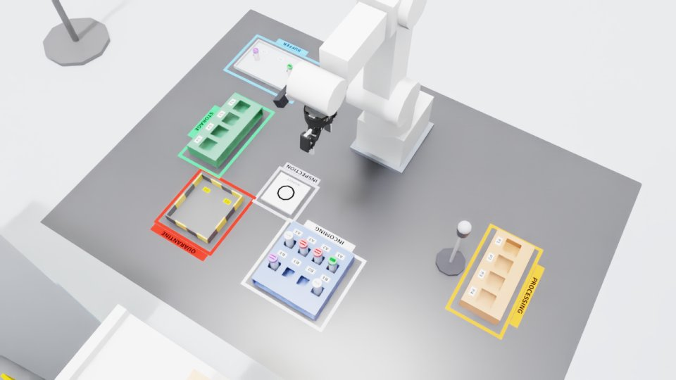 | 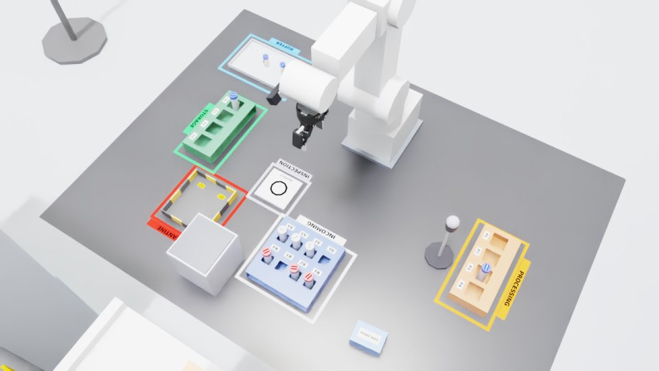 | 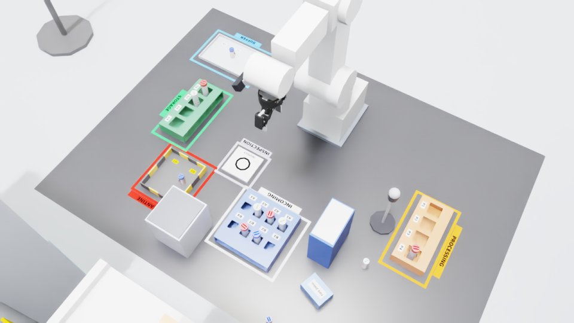 |
| Table camera | 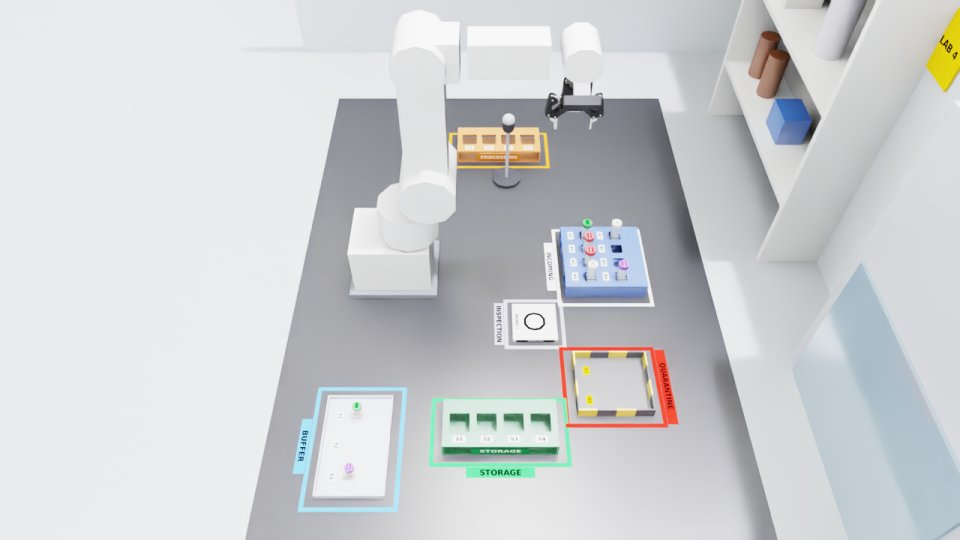 | 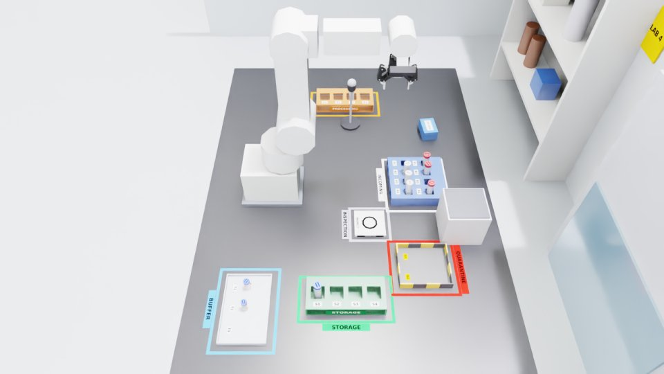 | 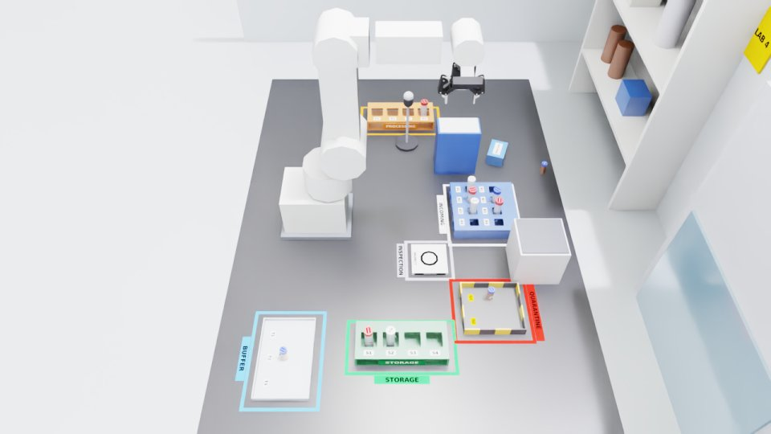 |
| Wrist at HOME | 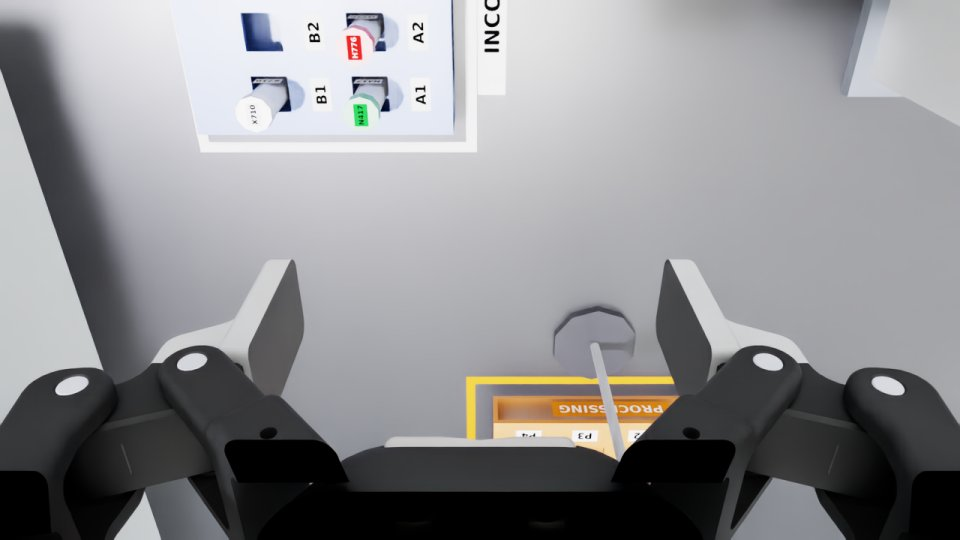 | 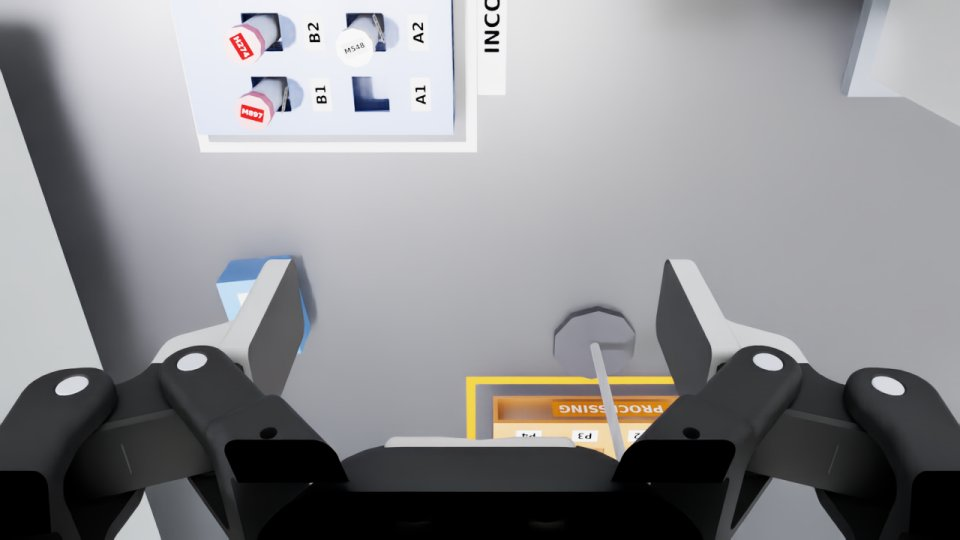 | 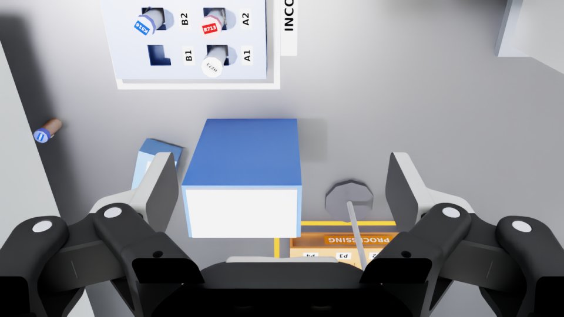 |
| Wrist above the incoming rack | 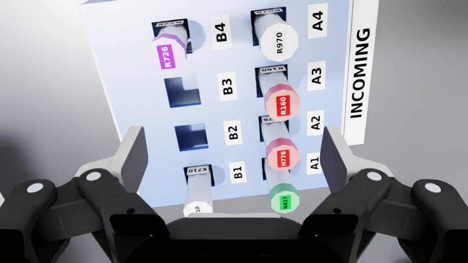 | 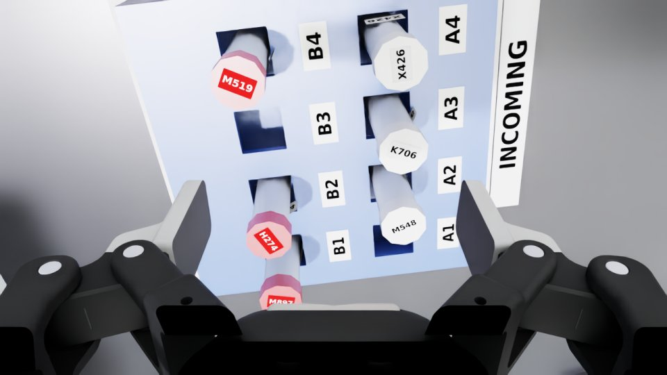 | 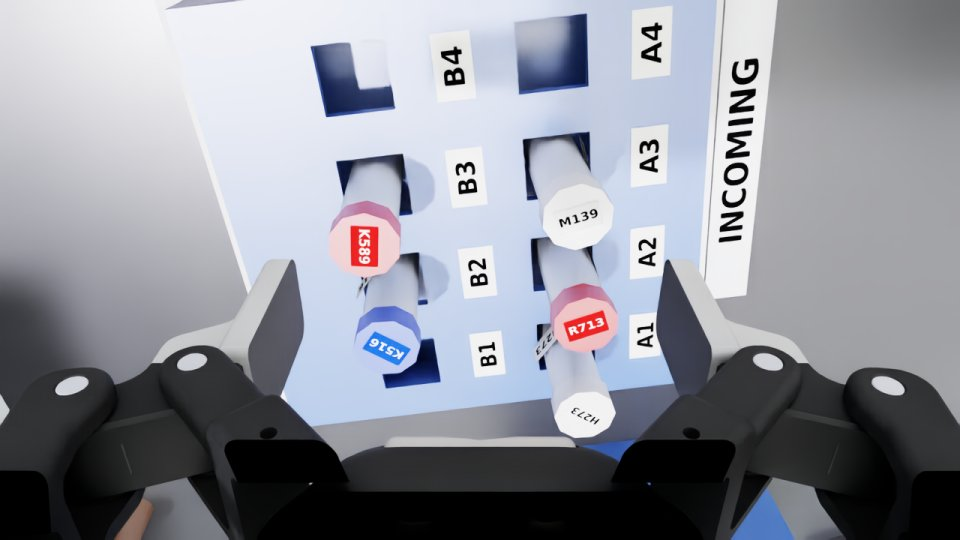 |
| Wrist above the inspection pad | 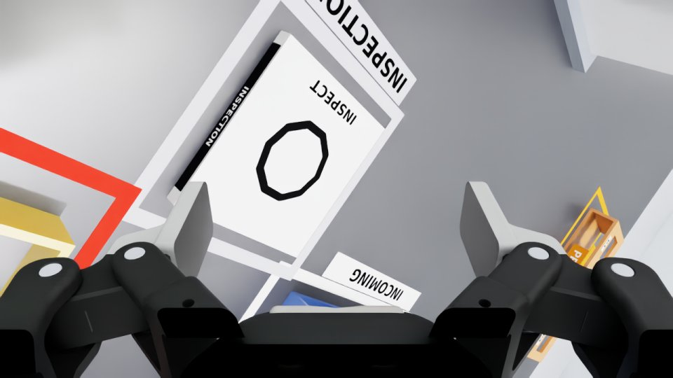 |  | 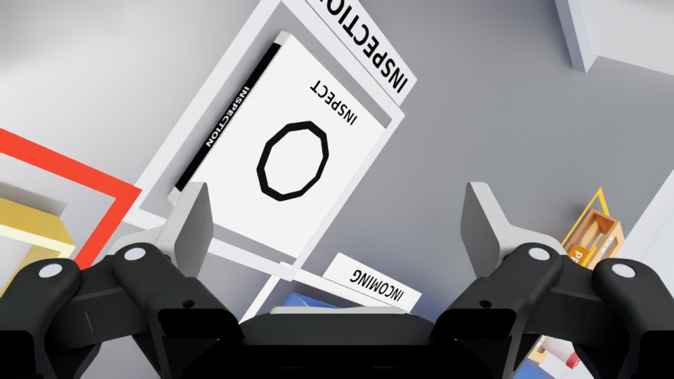 |

The wrist close-up of the incoming rack reads slot labels (A1–B4) and cap-top IDs. From the table camera a
30 mm label covers about 14 px, which is not readable.

## 8. Validation performance

**What happened.** The first full v2 run looked stalled: no output for about 40 min. It was not stuck.

- Its main thread used 100 % of one core, and the Kit log showed it had moved on to the next level.
- It was running the offline design checks inside the Isaac process. Those took 4.5 min for easy and 7.8 min
  for hard, but **41.5 min** for medium. Standalone, the same medium check takes about 6 min.
- The run finished on its own with 0 problems.

**Bottleneck.** In medium, `grasp_feasibility` made 66 pick plans, which ran 22,369
`CollisionChecker.evaluate` calls: 327 of its 361 s. Two scenario-side causes inflated this (`control/` is
unchanged):

- **Wasted grasp yaws.** Extra face-aligned grip yaws were tried for randomly rotated cylinders, where they test
  nothing new.
- **Decorative colliders.** The quarantine rim's hazard stripes were 16 collider boxes. They are now visual-only
  segments over 4 invisible collider walls with the same envelope. Medium went from 77 to 65 collider boxes.

**Measured effect** (medium, standalone, before → after):

| Check | Before | After |
|---|---|---|
| `grasp_feasibility` | 268 s | 145 s |
| `placement_feasibility` | 88 s | 69 s |
| `top_visibility` | 0.1 s | 0.07 s |
| `view_feasibility` | 3.3 s | 2.6 s |
| **Total** | **359 s** | **216 s** |

The feasibility answers are identical on every fixed grip yaw, every placement, visibility and the wrist
views.

**Validator changes:**

- Per-stage progress lines with elapsed time.
- A heartbeat every 60 s.
- A 600 s limit per scene stage; past it, `faulthandler` dumps every thread's Python stack and exits. This
  works even though ptrace is restricted on this machine.
- Design checks run in a separate plain-Python process, in parallel with the scene builds, with a 30-min limit
  and per-check timings.
- `--resume` reuses saved stages.

**Validator timings now:** scene stages take 6–8 s each. A whole level takes 242–271 s, set by the design
subprocess.

## 9. Known limitations

- **Physical manipulation is untested.** Grasp and placement results are planning feasibility only.
- **The in-Isaac slowdown is unexplained.** Its cause (41.5 min in-process vs about 6 min standalone, for
  medium only) was not identified, because the Python stack could not be read. The validator no longer runs
  that path, so it cannot recur there. Any future in-process use of the planner should be timed.
- **Screenshots and stability use different physics.** Screenshots use CPU physics; stability and reload use GPU
  physics. Both were cross-checked: 0.0 mm rest error on both.
- **The drop test misses the start of the fall** (see §6): the smallest observed fall is 1.82 mm.
- **Spacing is wider than a real lab.** 100 mm rack rows and 56 mm receiving holes follow the gripper's fully
  open stroke and the planner's margins.
- **Simplified containers.** Tubes have flat bases (no conical bottom). Glass is rendered opaque so depth stays
  valid.
- **Labels are small.** They are readable in wrist close-ups (about 0.35 m) but not from the table camera.
- **Perception on this scene is unmeasured.**
  - Fixtures and decor are new to YOLO and Gemma, which may report racks, trays or instruments as objects.
  - Medium's ambiguity comes from look-alike caps, random label yaw and clutter. No sample in medium is
    occluded from the table camera.
- **Limited samples.** One seed (42) was validated in the simulator. Offline checks cover seeds 0, 42 and 1234.
- **Restart to change the scene.** Changing level or seed means restarting the sim process; the agent is
  unchanged. `agent.run --start-sim` passes only the scene name (default `easy`, seed 0).

## 10. Experiments the scene supports (no geometry changes needed)

| Category | Example task | Ground truth used for scoring |
|---|---|---|
| Identification | "Move sample M548 to storage." | `sample_id`, `look_alikes` |
| Sorting / rearrangement | Incoming → processing → storage; free an occupied slot through the buffer | regions, `occupied_by`, `validated_placement` |
| Inspection | Bring a sample to the inspection pad and read its ID with the wrist camera | `label_text`, inspection region |
| Exploration | Find the hidden vial (hard); report that `vial_far` is unreachable | `role` |
| Fault recovery | Destination occupied; similar cap colour; label facing away | per-level features in `notes.difficulty_features` |
| Isolation | Move a named sample to quarantine Q2 while Q1 is occupied | quarantine regions |
