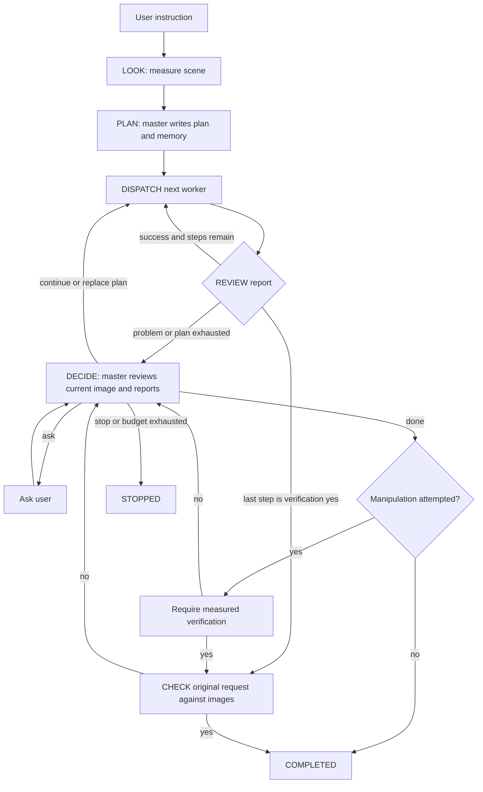
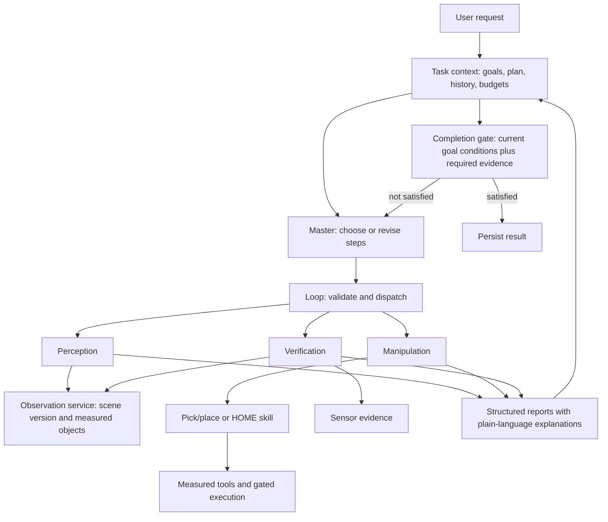

# VT6L v2: architecture review and simplification proposal

Reviewed: 2026-11-11. This review records the implementation before the pipeline refactor. Scope: `v2`, its callers,
tools, and master/worker tests. Findings distinguish code inspection from scripted model/stub-motion checks.
See [PIPELINE.md](PIPELINE.md) for implemented changes and remaining work. No simulator, GPU Gemma inference, or
physical robot was run for the refactor.

## 1. Main assessment

The master/worker split is a useful foundation. Keep the master responsible for task reasoning, workers responsible for capabilities, and the robot core responsible for measured motion. The main complexity comes from responsibilities crossing these boundaries:

- Python converts control information into sentences, then parses those sentences to recover control information.
- Verification takes its requirements from mutable manipulation-worker history.
- Observation caching, scene formatting, and image saving share one class.
- A supposedly deterministic skill calls back into Gemma and removes collision records based on its verdict.

Removing small functions alone will not solve these issues. Remove redundant conversions and duplicate ownership first. Keep functions that enforce execution, observation freshness, sensor checks, and recovery.

## 2. Current structure

| Component | Actual responsibility |
|---|---|
| [`run.py`](src/agent/run.py) | Loads one Gemma model and YOLO, optionally starts Isaac Sim, connects ROS, creates session tools, runs successive instructions. |
| [`master.py`](src/agent/master.py) | Builds planning/review prompts, calls Gemma, parses plain-text plans, decisions, and memory; retries malformed answers once. |
| [`loop.py`](src/agent/loop.py) | Owns an instruction's plan queue, reports, memory, step/decision budgets, dispatch, user questions, and completion gates. |
| [`workers.py`](src/agent/workers.py): `Scene` | Obtains/caches observations, updates world IDs, builds numbered images, saves images, describes objects/regions, renders model context. |
| `Perception` | Uses Gemma with the current table image to answer a worker request. It does not produce a structured object binding for manipulation. |
| `Manipulation` | Uses Gemma to translate a sentence into object IDs and an action, validates it, invokes `PickPlace` or HOME, formats reports, records expected outcomes, adjudicates collisions. |
| `Verification` | Checks manipulation's recorded expectations using tools/world geometry; separately asks Gemma whether images satisfy the original user request. Its `run(message)` currently ignores `message`. |
| [`pick_place.py`](src/agent/pick_place.py) | Runs grasp/place/recovery states, invokes tools, collects sensor checks, formats a result; optionally consults Gemma through a callback. |
| [`tools/`](src/agent/tools/__init__.py) | One session object composed through five mixin base classes: perception, manipulation planning, execution, held state, and verification. |
| `control/`, `execution/`, `safety/`, `sim/` | Kinematics, collision checking, robot trajectories, ROS execution, simulator safety, and simulated world. |

These are sequential roles sharing one loaded model, not independently running model services. There are two useful state-machine levels: task orchestration and the detailed pick/place skill. They address different concerns and should remain separate.

### Current instruction flow



The master does **not** receive a decision call after every successful step. The loop automatically advances successful steps when more remain (`loop.py`, lines 102–107). This saves model calls but is a policy choice that should be explicit.

### State ownership today

- Across instructions: `Tools.world`, held-object fields, object descriptions, unexplained obstacles, motion counter, and last referent.
- Within one instruction: `Scene.obs`; loop variables including plan, reports, memory, `verified`; manipulation's `expected` and `moved`.
- Within one skill: `PickPlace` plan, retry counts, observations, state, and verification evidence.

The problematic coupling is `Verification -> Manipulation.expected`, rather than a shared, explicit task contract.

## 3. Findings that should drive the refactor

### A. Loop routing reads report prose instead of its status — high priority

`Report` already has `word` and `text`, but dispatch converts it into a string. REVIEW then uses `re.search(r"-> (ok|done|yes): ", reports[-1])` to decide whether to advance (`loop.py`, lines 94–107).

Reproduction: perception reports `UNSURE: two candidates; earlier report -> done: found one`. Its actual status is `unsure`, but the loop runs the next manipulation step because the success marker occurs inside the description. A stubbed end-to-end check executed one pick after that uncertain report.

**Change:** retain the `Report` object with its worker and step metadata. Route using its validated status; render text only for the master, terminal, and event log. This change does not require changing Gemma's output format.

Also, `_status()` in `workers.py`, lines 312–317, defaults unrecognized answers to `ok`. A direct check returned `ok: unparseable answer`. Unknown output should cause an explicit invalid/uncertain result or one bounded repair attempt.

### B. HOME is supported by manipulation but missing from completion verification — high priority

The HOME branch verifies joint feedback and sets `moved=True` (`workers.py`, lines 173–178). It adds no expectation. `Verification.run()` rejects an empty expectation list (`workers.py`, lines 286–289), and FINISH requires this verification after manipulation.

Reproduction: successful stubbed `return_home()` and `verify_home()` followed by master `done` was refused with “the arm has not picked or placed anything.” The scripted master then stopped; result was `STOPPED` despite the successful HOME check.

**Change:** represent HOME as an explicit verifiable outcome with joint evidence. Completion must be based on the requested outcome, including HOME, rather than whether an object was picked or placed. The current image-only final check cannot establish joint HOME by itself.

### C. Expected outcomes accumulate historical placements — high priority

Manipulation appends every successful placement and only removes the matching holding expectation (`workers.py`, lines 211–216). Verification requires all accumulated expectations to hold simultaneously (`workers.py`, lines 290–309).

Reproduction: “put this cube on A, then move it onto B” leaves both `placed(cube, on, A)` and `placed(cube, on, B)` in `expected`. With the second relation true and first false, verification reports `no`.

**Change:** separate action history, completed milestones, and currently required goal conditions. Supersede a temporary placement when the task intentionally moves the object again; preserve constraints that the final goal actually requires. A blanket “keep only the latest placement” rule would also be wrong for tasks requiring multiple simultaneous relations.

### D. Placement verification reads remembered geometry — freshness gap

`Verification.run()` checks `world.objects` without acquiring or checking an observation and without requiring current visibility/status (`workers.py`, lines 286–309). Holding verification does obtain sensor evidence. Skill-level placement verification also does a fresh measurement, but a later task-level verification does not establish that its cached geometry is still evidence.

A direct check counted zero `Scene.current()` calls during placement verification. This demonstrates missing refresh, not a measured simulator failure. The later visual final check offers another check, but does not make the earlier numerical evidence fresh.

**Change:** attach frame ID, observation time, motion version, and evidence source to verification results. Refresh when those requirements are not met. Predicted/planned geometry should remain distinguishable from measured geometry, especially after `assume_placed()` or failed placement verification.

### E. Collision recovery can remove measured obstacles on Gemma's say-so — architectural priority

`Manipulation.consult()` classifies an outlined image. `PickPlace._planning_grasp()` then calls `records.pop(key)` when the model says “not an obstacle” (`workers.py`, lines 223–257; `pick_place.py`, lines 126–169). Those records are the persistent world objects or unexplained depth obstacles used by planning. Existing tests explicitly expect this behavior.

The planner still checks remaining obstacles. The issue is that the model can remove one of its collision constraints and mutate shared world memory. Therefore the skill is not fully deterministic when the callback is supplied, despite parts of its documentation describing it that way.

**Change:** return a structured collision result to the task layer. Let the master request a fresh observation, another view, or a different action. Remove a suspected self/held-object detection only after geometric evidence supports it, with an explicit scope and expiry; retain object history. Gemma's classification may guide that investigation. This is a behavior change requiring collision regressions and simulator validation before adoption.

### F. Perception reports do not bind manipulation to the same object

Perception answers in prose; manipulation independently grounds the next sentence. If successful steps remain, the master is not called between them. Manipulation receives the queued step's words, not the perception report or a verified referent (`loop.py`, lines 88–107; `workers.py`, lines 119–124 and 155–187).

**Change:** optionally carry a grounded referent and its observation version as worker evidence, while keeping natural-language messages for the master. Validate the binding before motion and ask/re-ground if ambiguous or stale. Alternatively, require master review for a perception result that changes the action's referent. Avoid making every descriptive question require grounding.

### G. Failure reporting is split across layers

`run_instruction()` catches `VLMFailure` on selected paths, but verification/final-check errors and unexpected tool failures can escape. `run.py`, lines 153–159, logs/prints the error without writing the normal `result.json`.

**Change:** finalize every started instruction through one result-writing path that records status, failure stage, and partial effects, then releases resources. Preserve the distinction between task failure, budget stop, model-output failure, and execution failure.

## 4. Helper-by-helper recommendation

“Remove” below means remove an unnecessary responsibility or conversion, not merely paste its body into a larger function.

| Current helper or mechanism | Recommendation | Replacement or reason |
|---|---|---|
| `master.parse_steps()` | Keep initially; replace only with the protocol | A text plan needs validation. If model output moves to a small validated envelope, parse steps there once. Preserve natural-language step messages. |
| `master.memory_of()` | Keep with the current protocol; remove if memory becomes an explicit field | Memory extraction disappears only when the response contract changes. |
| Duplicated call/repair loops in `plan()` and `decide()` | Consolidate narrowly | One model-boundary routine can call, validate, log, and repair once. Keep the two prompt purposes understandable. Avoid a general agent framework. |
| `plan()` versus `decide()` | Optional later unification | One `Master.next(context)` response can carry a new plan, continue, ask, finish, or stop. Initial planning uses empty history. Measure model reliability before replacing the current prompts. |
| `workers._status()` | Replace | Use one strict worker-status parser at the model boundary; never assume malformed output succeeded. |
| Loop success regex and verification-prefix parsing | Remove now | Read the worker and `Report.word` directly, retaining typed history internally. |
| `workers._words()` | Replace progressively | Skill failures should expose a reason code, object references, measurements, and a human explanation separately. Render words from fields instead of deleting numbers from prose. |
| `loop.to_user()` | Consolidate presentation, then assess removal | A common output renderer can handle object references consistently. Model text may still contain IDs; retain a small defensive formatter until the output contract and tests justify deletion. |
| `Scene.current()` | Keep responsibility; move to observation ownership | Freshness, world association, and observation reuse are needed. Move image persistence to logging/visualization; do not duplicate caches. |
| `Scene.text(numbers=...)` | Replace boolean mode with explicit views | Semantic context for master/perception; measured grounding context for manipulation. Keep them built from the same observation. |
| `Scene.name()` / `where()` | Keep as presentation utilities | Object naming and location rendering are useful; remove fragile `name(...)[4:]` slicing by rendering noun phrase and article separately. |
| `Manipulation._act()` | Keep, with a validated action input | This is an appropriate boundary for preconditions and skill dispatch. Combining it into the model-call method would mix concerns. |
| Grounding regex and `names:` extraction | Keep in one boundary adapter initially | Code must still translate words into an executable action and validate membership, relation, held state, and visibility. A structured envelope may simplify the grammar later. |
| `Manipulation.consult()` + `PickPlace._blocker()` | Replace the recovery mechanism | Structured planner errors identify the blocker; task-level recovery gathers evidence. Do not remove collision checking. |
| `workers._outline()` | Move if still useful | It is an image-annotation utility. Keep it for debugging/re-observation, outside worker orchestration. |
| `pick_place.geometry_of()` | Remove if obstacle records are normalized | Currently it bridges object records and geometry dicts. One obstacle representation can eliminate the adapter. |
| `pick_place.message()` | Move toward shared result rendering | Keep measured fields and status authoritative; formatting should not feed back into decisions. |
| `PickPlace._fail()`, `_stop()`, `_run()`, `_held()` | Keep | They centralize bounded recovery, execution-result handling, and sensor evidence. Inlining them duplicates important behavior. |
| Loop `say()`, `finish()`, `budget()` closures | Keep or give their ownership to logger/result/context | These are small, cohesive helpers. They are not the main source of architectural complexity. |
| `Tools.gemma` and its constructor argument | Remove after updating callers/tests | Current `tools/` code stores the model but never reads it. Deterministic tool APIs need no model dependency. |
| `ManipulationTools.deterministic(reason)` and `_unreachable(error)` text matching | Replace gradually | Use planner failure categories and retryability. A wording change should not change recovery policy. |

A structured envelope does not eliminate parsing or validation: it replaces several unrelated text grammars with one explicit contract. Keep the current text protocol if that works better for the local Gemma model. The first improvements above need no JSON, tool-calling support, new dependency, or model migration.

## 5. Recommended target structure

Use explicit ownership with a few small contracts. Avoid creating a framework or splitting every function into its own file.

```text
agent/
  run.py             startup and persistent session lifecycle
  master.py          task reasoning and model response validation
  loop.py            dispatch, budgets, user interaction, completion policy
  contracts.py       Step, Decision, Report, Outcome, Evidence
  context.py         instruction plan/history/goals and observation access
  workers.py         perception, manipulation, verification roles
  pick_place.py      measured skill sequence and local recovery
  gemma.py           model adapter
  tools/             robot-facing measured operations
```

Contracts can start as standard-library dataclasses. `Report` needs a validated status, worker/step identity, explanation, outcomes, and evidence references. Keep geometry and IDs in evidence; render a semantic summary for the master. Task context owns required goals and execution history; verification consumes those requirements, rather than receiving the manipulation worker object.



Keep skill checks and task verification distinct: the skill establishes that an action executed as planned; task verification establishes that the user's requested result holds. Reuse recent evidence when it is still applicable, rather than blindly rerunning every check or deleting the final check. HOME requires joint evidence; object identity/relation may also need semantic image review.

Keep the success-continuation policy explicit: advance automatically only when a validated report leaves subsequent preconditions and references valid. Ask the master after failure, ambiguity, changed scene assumptions, or plan exhaustion. Requiring a model call after every success is an optional latency/reasoning tradeoff, not a prerequisite for this cleanup.

The `Tools` mixins currently rely on many shared mutable fields. Retain their public facade during the first refactor. Move toward composed observation/planning/execution/verification services only when the shared state contract is explicit; replacing inheritance immediately would make this review's smaller changes harder to validate.

## 6. Suggested implementation order

1. **Correct control and completion behavior:** retain structured reports, reject malformed statuses, support HOME outcomes, separate historical actions from active goals, establish verification freshness, and guarantee result persistence on failure.
2. **Clarify ownership:** introduce minimal contracts and task context; remove verification's dependency on the manipulation object; separate scene acquisition from rendering/persistence; remove the unused tool-model dependency.
3. **Replace collision adjudication:** return structured blockers, gather geometric evidence before changing obstacles, preserve persistent object records, and validate recovery in simulation.
4. **Reduce protocol helpers:** centralize model validation/repair and result rendering; evaluate one master interface or a small structured response envelope using representative captured requests. Preserve words in master/worker messages.
5. **Update documentation and diagrams:** the shared README mostly describes v1. The existing `docs/figures/v2_control_flow.dot` also differs from code: it describes LOOK naming every object, perception with thinking off, and completion without the current visual CHECK. Keep a version-specific description beside v2.

## 7. Validation performed and needed

Existing targeted suite:

```bash
cd v2
PYTHONDONTWRITEBYTECODE=1 PYTHONPATH=src .venv-seg/bin/python -m pytest \
  -q -p no:cacheprovider tests/unit/test_master_workers.py
```

Result: **24 passed**. Additional temporary scripted checks reproduced HOME completion rejection, report-text routing despite `unsure`, malformed-status default success, accumulation of superseded placement expectations, and absence of an observation request in task-level placement verification. These checks reused the existing test fakes and did not modify runtime code or the test suite.

Before implementation is accepted, add behavior regressions for those paths, plus missing/occluded objects, HOME with and without a held object, failed final-check inference, partial motion followed by failure, ambiguous referents, and budgets on repeated unchanged failures. Collision changes need tests for genuine blockers and false self/held-object detections, followed by simulator validation. Model-protocol changes need actual local-model measurements of valid-response rate, grounding accuracy, task completion, call count, and latency; scripted tests cannot establish those properties.
