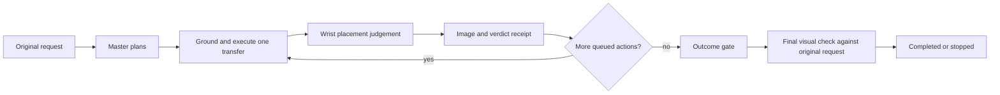

# Pipeline performance and evaluation

Normal sessions now default to `V2_REUSE_PLACEMENT=0` and `V2_FINISH_PLAN=0`. They reacquire placement evidence
and retain the master's completion decision until live comparisons justify changing those defaults. The
`deduplicated` and `headless` benchmark profiles explicitly enable both shortcuts. The final visual check against
the original request remains in every completed run, including single-object requests and user clarifications.
No live speedup or unchanged accuracy has been demonstrated.

The diagram shows the optional deduplicated path, not the normal-session default:



A receipt binds object, destination, relation, saved wrist image, verdict, simulator epoch and scene revision.
Manipulation, observed object disturbance, execution failure and simulator reset invalidate reuse. Successful,
collision-checked empty-gripper camera/HOME moves preserve it. If a receipt is stale, verification obtains a new
wrist view. Master-written memory never certifies completion. `result.json` includes every planned action and its
execution status, physical outcomes and the selected performance configuration.

Camera snapshots already wait for stillness; redundant immediate `wait_still()` calls were removed. The camera's
settling and synchronization requirements remain active. Destination SigLIP checking is retained; this work does
not remove identity, contact, retention, collision or joint-limit checks.

## Timing

`events.jsonl` now records monotonic interval boundaries, so nested operations and overlapping inference/motion
can be counted without adding the same wall time twice:

- Every move and gripper command: planned duration, simulated elapsed time, wall elapsed time, simulation-clock
  endpoints and effective real-time factor. Moves also split trajectory execution from tracking/settling waits.
  Rejected and timed-out moves retain timing records. A stalled simulation clock has bounded wall timeouts.
- Every skill state: total elapsed time and nested planning, perception, camera capture, settling, execution and
  Gemma spans. Failed spans are logged too.
- Every Gemma call: text characters, total input tokens, image count and processed image hashes, generated tokens,
  reasoning characters and retokenized reasoning length, preprocessing/generation seconds, budget exhaustion and
  prefix-cache status. Input-token totals include image representations. Retokenized thinking length is an estimate.

Summarize a run from the `v2` folder:

```bash
.venv-seg/bin/python scripts/eval_pipeline.py --summarize out/demo/<date>/<session>/01/events.jsonl
```

Historical logs use labelled estimates from existing `model_input`/`model_output` and `execute` intervals. They
cannot reconstruct simulated time or separate capture/planning from unmeasured overhead.
The saved apple run at `out/demo/2026-11-13/live_054817/01` took 615.208 seconds: about 300.92 seconds in model
intervals, 264.82 seconds in execute intervals and 49.47 seconds elsewhere. Carrying was planned for 13.13 seconds
and took 61.75 wall seconds; lowering was planned for 9.00 seconds and took 43.02 wall seconds. Those ratios alone
are not measurements of simulator real-time factor. See `out/performance_review/apple_baseline_timing.json`.

## Fixed live suite

`evaluation/pipeline_cases.json` specifies 71 cases: 63 core cases (easy/medium/hard, seeds 7/42/123, seven requests each)
and eight additional regression cases (easy and medium, seed 42). The default run remains the 63-case core suite;
use `--suite regressions`, `--suite all`, or explicit `--case` IDs to select the additions.
Requests cover apple, water, `cheezit`, `milk bottle`, two-item transfers with an exclusion, a different destination,
and a missing banana. Every case starts a fresh simulator and agent. Startup/catalogue time is reported separately
from instruction time; per-requested-object time is reported for nonempty requests.

The evaluation process alone subscribes to ground truth and constructs scenario geometry for scoring. The normal
agent executor does not subscribe to ground truth. Its legacy evaluation API subscribes only on explicit opt-in.
The evaluator checks complete footprint containment, supported height and final stability, plus unintended object
displacement anywhere in the recorded execution (including objects later returned to their original position). It reports task success, wrong object, wrong destination, false acceptance and false rejection.
A crash does not count as a successful refusal. Missing/unstable ground truth stays unscored. Scoring uses the
scenario's rigid collision bounds, not visual mesh detail or an independent contact-force measurement.

The runner also exports `placement_labels.json`: wrist-image labels from contemporaneous ground truth with unique
position association and stability evidence. Ambiguous cases remain unlabelled. Successful live runs may supply
mostly positive pictures; include independently labelled wrong-tray, outside-tray and held-object pictures before
using replay to justify a lower false-accept risk. Agreement with Gemma's old answer is not an accuracy score.

## Required smoke test, then the small subset

From the repository root, run one command on the GPU machine:

```bash
./v2/launch/pipeline_check.sh smoke
```

This runs `easy_s42_apple` with `baseline` and `deduplicated` and prints the output folder. There is a **900-second
execution budget including startup**, not a promise that two runs will finish in 15 minutes. Cleanup can add time.
Given the earlier ten-minute baseline and catalogue/model startup, both profiles may need longer. If the budget
expires, the result is INCOMPLETE, never a pass. Use `--budget 1800` for a longer paired smoke if needed.

Check the terminal output and `smoke-report.json`:

1. Both profiles finish `COMPLETED`, independently score successful placement, and report `timing=PASS`.
2. Every move prints planned, simulated, wall and settling time. Gripper commands print planned/simulated/wall time;
   their wall time includes finger settling. No missing or negative durations.
3. No execution/simulation-clock/settling timeout or rejected trajectory. A harness budget expiry is an incomplete
   test, not evidence of a new controller timeout.
4. Open every `REVIEW WRIST` picture: object and tray edges are clear, the gripper has retreated, and the view is
   not taken mid-motion. Successful stillness-wait spans are checked automatically; image sharpness and actual
   stopped-arm appearance require visual review.
5. Compare both final results. The report's automatic pass remains pending this visual review.

Only after those checks pass, run:

```bash
./v2/launch/pipeline_check.sh subset \
  --smoke-report /absolute/path/to/smoke/smoke-report.json --images-reviewed
```

The subset is 5 cases × 3 profiles: `easy_s42_apple`, `easy_s42_two_items`, `easy_s42_impossible`,
`easy_s42_on_the_tray`, and `easy_s42_occupied_tray`, with baseline/deduplicated/headless. It writes `table.md` with
success, wrong object, wrong destination, false accept, false reject and mean wall seconds in Gemma, motion,
settling and other (including camera/planning). Unscored runs stay visible. It refuses to start without a completed
automatic smoke pass and an explicit `--images-reviewed` acknowledgement. Do not run the experimental profiles
until this table has been produced and reviewed.

## Regression cases

Each new case exists for easy and medium at seed 42:

| Case suffix | Test |
|---|---|
| `on_the_tray` | Exact request: "Put the apple on the tray." Both containers are present. If asked, the scripted user answers "the blue serving tray". Supported containment inside that tray is success for "on". |
| `occupied_tray` | Exact request: "Put the cheezit in the blue serving tray." The evaluator's simulator fixture starts with an apple already supported in the tray. It must remain there. |
| `milk_session` | First: "Put the milk bottle on the tray." Second, in the same process and Tools session: "Put the cheezit on that same tray. Leave the milk bottle where you placed it." Tray clarifications receive the same blue-tray answer. Both instruction results are required for episode completion. |
| `cheezit_back` | The cracker box is rotated 180 degrees before the simulator starts. Source SigLIP results and crop paths are retained in `evaluation.json`. Confirm the crop shows the back face before using this as rear-view evidence; rotation alone cannot guarantee the wrist approach. False source-identity rejections require reviewing the crop, so their label remains null until reviewed. |

Initial scene variations are applied only by the simulator and the evaluator. The agent gets normal RGB-D; it does
not read the setup file, ground-truth positions, labels or expected outcomes. Scripted requests and answers are
ordinary user inputs, not hidden model hints. All requests in `milk_session` use one catalogue/world model; the
harness does not change memory, grounding, identity or grasping policy. A failed first instruction stops the session
case rather than silently starting a fresh session for the second.

The core suite can take roughly ten hours per profile at ten minutes per case, plus startup. Start with the smoke
and small subset, not the full matrix. No stacked-source or densely crowded-source scene is claimed by these
additions; the occupied destination is the specific clutter regression requested here.

The default evaluation domain is 88; interactive sessions normally use 42. The runner rejects an occupied domain
and never overwrites an experiment directory. Each folder holds console output, agent events/results, truth
samples, labels, scoring and timing. A missing NVIDIA driver stops before model loading.

```bash
.venv-seg/bin/python scripts/eval_pipeline.py --summarize out/pipeline_benchmark_initial
```

Compare `deduplicated` with `baseline` and `headless` with `deduplicated`. Defer later experiment comparisons until
the small subset table has been reviewed.
Reports expose pairing coverage, missing scores, error counts and paired time savings. No observed regression on a
finite set is not a guarantee of equivalent accuracy, and profiles are never promoted automatically.

## Selectable experiments

The following settings are inherited by the agent process. Default behavior retains normal inference budgets,
GUI settings, carrying speed, HOME between transfers and sequential judgement/motion.

| Setting | Default | Effect |
|---|---|---|
| `V2_BASELINE=1` | off | Disable performance experiments and verdict reuse/plan-finish shortcuts; retain instrumentation and safety fixes. |
| `V2_REUSE_PLACEMENT=1` | off | Opt in to reuse of a valid release receipt. |
| `V2_FINISH_PLAN=1` | off | Opt in to bypassing the master's post-plan completion decision after confirmed execution. |
| `V2_PLACEMENT_THINKING=0` | thinking on | Disable reasoning only for the local wrist placement question. Final-request reasoning remains on. |
| `V2_WRIST_IMAGE_TOKENS=560` | 1120 | Reduce visual detail only for local placement questions. Table grounding and final-request images retain their detail. |
| `V2_REASONING_TOKENS=1024` | model default | Cap total generation budget for master calls using a system prompt. Grounding and final-check budgets remain unchanged. |
| `V2_PREFIX_CACHE=1` | off | Reuse an exact system-only KV prefix; clone before generation. User text, images and generated answers are not cached. |
| `V2_OVERLAP_HOME=1` | off | Run the validated empty-gripper HOME return while Gemma judges an already captured placement image; join and check the motion result. |
| `V2_CHAIN_TRANSFERS=1` | off | Defer HOME between queued manipulation steps; plan the next pick from actual joints after verified placement and held-state checks. |
| `V2_CARRY_SPEED_SCALE=1.25` | 1.0 | Speed only the joint-space carry via its existing waypoint, bounded by joint velocity limits. Keep slow descent/lowering and full payload collision checks. |

Headless evaluation is the `headless` profile (`--gui` omitted); baseline/deduplicated show the Isaac window.
All benchmark profiles disable the dashboard equally. Camera publishing and physics timestep are unchanged.
For an interactive headless session, set `ISAAC_WINDOW = False` in `src/agent/settings.py`; this is not enabled by
default because camera availability and live accuracy still need checking on the GPU machine.

Previously built `no_thinking`, `wrist_560`, `reasoning_1024`, `prefix_cache`, `overlap_home`, `chain` and
`carry_125` profiles are deferred. They have not been tuned or run in this review round. The baseline is instrumented
current code with optimizations disabled, not a byte-for-byte copy of an earlier frozen manipulation release.

Replay saved model inputs without moving the robot:

```bash
.venv-seg/bin/python scripts/eval_inference.py \
  --events out/pipeline_benchmark_initial/headless/easy_s42_apple_r1/agent/01/events.jsonl \
  --labels out/pipeline_benchmark_initial/headless/easy_s42_apple_r1/placement_labels.json \
  --out out/inference_benchmark_initial
```

`--manifest-only` checks saved inputs without loading the model. Replay preserves the original prompt, system
prompt, images and requested generation budget; labelled local-placement questions are scored separately from
unlabelled original-request checks. Cold/warm passes expose cache warmup. Require exact cached/uncached output
agreement before using prefix caching, and evaluate both positive and negative pictures for cheaper vision.
The local CPU cache test uses a tiny Gemma model, not the quantized production weights or full image pathway.

## Validation scope

Offline tests cover receipt reuse/invalidation, original-request checking after a shortened plan, negative physical
outcomes, overlap failure propagation, carrying-waypoint preservation, evaluator negatives, and executor timing
with synthetic clocks. CPU processor tests established that visual-token overrides work and that the system text
is an exact prefix; a tiny CPU Gemma cache test matched uncached outputs across a sliding-window boundary.

Initial restricted-runtime attempts could not access NVIDIA devices. On 2026-11-16, authorized execution outside
the sandbox reached the host GPU and completed two successful apple smoke runs. The broader paired accuracy
subset and experimental profiles remain pending. Both shortcut defaults remain off; the pilot is not evidence
of general accuracy equivalence or a causal speedup of the reported magnitude.

## Scope of this follow-up

Only the two shortcut defaults, evaluation fixtures/cases, scripted-session launching and run/review tooling were
changed. The executor's earlier wall-clock bounds remain; the instrumented baseline is not a byte-identical frozen
controller. The earlier snapshot-level settling enforcement and removed duplicate waits are unchanged in this
round and must be checked in the live smoke. Grasping, collision, source/destination identity and placement judgement
behaviour were not altered in this round.

## Live smoke pilot — 2026-11-16

Offline rerun: **367 passed, 3 skipped**. Launcher regressions after fixes: **11 passed**. No grasping, collision,
identity, placement judgement, executor or camera-control code was changed during this testing round.

| Profile | Instruction time | Gemma calls | Local placement judgements | Independent physical score |
|---|---:|---:|---:|---|
| baseline | 802.6 s (13m 23s) | 5 | 2 | success |
| deduplicated retry | 285.9 s (4m 46s) | 4 | 1 | success |

Both completed runs have all required motion timing records, successful stillness-capture spans, no motion
timeouts, positive final original-request checks, and no wrong-object/destination or false accept/reject in this
single positive case. Saved wrist images are clear and show the released apple in the tray. User image review
is still required before the five-case subset. The saved review report deliberately leaves images_reviewed=false.

Placement-verdict reuse eliminated one model call. The master-done shortcut was not exercised: both plans already
ended with an explicit verification step. Motion rates and inference throughput also varied substantially, so the
large total difference cannot be attributed entirely to deduplication. No default is promoted from this pilot.

Launch failures are preserved: the first attempt dropped the sourced ROS Python paths in the agent subprocess;
that was fixed and regression-tested. A later second simulator exited during startup. The successful baseline
was retained and deduplicated was retried in a fresh collector/domain (baseline 88, retry 89). DDS shared-memory
warnings occurred even in the successful retry; their causal role in the earlier exit is unproven. Collectors now
run in separate processes, preserve ROS paths and tolerate an already-shut-down ROS context during cancellation.

Artifacts: 
- [Smoke review report](../out/review_followups/testing_2026-11-16_98v8whqd/completed_smoke/smoke-report.json)
- Timing table and raw runs: /home/fmahnoor1/Documents/PhD-CE/Research-LF/6DOF-Arm/out/review_followups/testing_2026-11-16_98v8whqd/completed_smoke/
