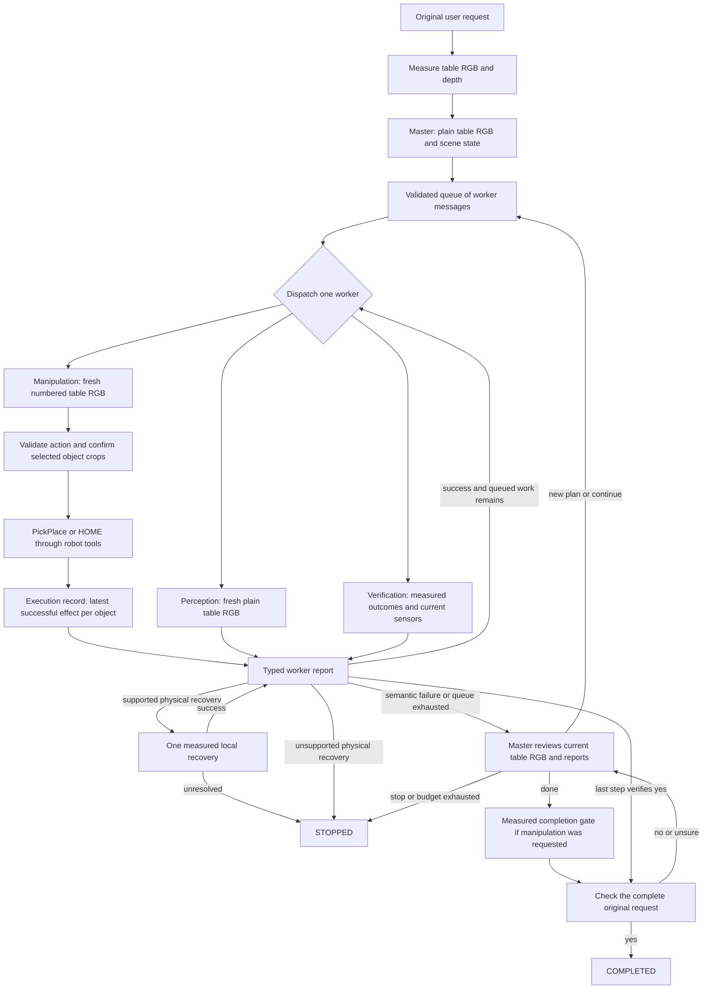

# V2 instruction pipeline

Implemented 2026-11-11. The master and the same three workers share one loaded Gemma model and execute sequentially.
The current recovery controller is documented in [RECOVERY_HANDOFFS.md](RECOVERY_HANDOFFS.md).
The current transfer policy is in [src/agent/prompts.py](src/agent/prompts.py). See [PROMPT_AND_TRANSFER_POLICY.md](PROMPT_AND_TRANSFER_POLICY.md) for the prompt revision, motion stages, validation and rollout steps.
Control status, execution evidence, and images have explicit owners.
The 2026-11-17 source/placement follow-up is documented in
[Source evidence and complete transfers](docs/validation/SOURCE_EVIDENCE_PIPELINE.md), including exact
Gemma inputs, source-reference scope, regression evidence and remaining live validation.

Unusable model responses and other instruction exceptions produce a saved `FAILED` result. Asking the user returns
their reply to the master for another decision. Neither a failed gate nor a model-written memory counts as completion.

## Ownership

| Component | Owns |
|---|---|
| `master.py` | Task planning and semantic decisions; plain-language worker messages and advisory memory. Validates the whole plan/decision, repairs once, then fails explicitly. |
| `loop.py` | Queue, dispatch, status routing, step/decision budgets, repeat guard, completion gates, and persisted instruction result. |
| `contracts.py` | `Report` (status separate from explanation), `Outcome` (successful physical effect), and instruction-scoped `TaskContext`. |
| `workers.py` / `Scene` | Table observations, their image/ID context, and source-image metadata. |
| Perception worker | Visible descriptions and ambiguity; cannot certify collision safety, execution, or wrist contents. |
| Manipulation worker | Sentence-to-action grounding, reference/freshness validation, skill invocation, and recording successful effects. |
| Verification worker | Reads shared execution evidence independently of the manipulation worker object. Checks current sensors/geometry and the original goal. |
| `pick_place.py`, `tools/`, `control/` | Detailed grasp/place states, recovery, kinematics, collision checks, execution and sensor checks. |

Keep the task loop and the pick/place state machine: their responsibilities differ. Removing small helper functions
does not remove those responsibilities. The redundant conversions removed here are status-to-prose-to-regex routing,
successful actions represented only as mutable model memory, and verification's dependency on manipulation's private
expectation list. No additional worker, model service, or JSON generation protocol is needed.

## Images and call frequency

| Consumer | Image or measurement | When acquired |
|---|---|---|
| Master PLAN | Plain table RGB, marked-region names, actual recorded gripper state, execution summary | Initial table observation. |
| Master DECIDE | Plain table RGB plus state, latest four reports, remaining queue, advisory memory and budget | On a failed/uncertain step or exhausted queue; uses the latest observation while fresh, otherwise refreshes. |
| Perception | Plain table RGB | A new table observation for every dispatch. |
| Manipulation grounding | Numbered table RGB and only the objects measured in that same observation; the held object is listed separately | New observation for every grounding attempt, at most two attempts per dispatch. Rechecks freshness after inference and passes that observation into the skill. |
| Grasp inspection tools | Wrist RGB-D, calibrated capture pose and current selected-object geometry | After reaching the pre-grasp pose, before any descent; no language-model description call. |
| Measured verification | Finger feedback/held checks, joint feedback for HOME, current table geometry for placements | On dispatch or completion gate. Placement checks force a new table observation. Tools may also use wrist/table depth during held checks. |
| Final original-goal check | New plain table RGB; wrist RGB added when an object is recorded as held | Before every `COMPLETED` result, including observation-only plans. HOME joint feedback is supplied when relevant. |

Wrist RGB is not sent to the master, perception, or action grounding. Wrist RGB-D is used by grasp inspection, lower-level held checks and the
conditional final visual check. If the final wrist capture fails, the event log records that it was unavailable.

The master is **not called between every pair of successful queued steps**. A successful worker advances the queue.
Failure/uncertainty returns to the master immediately; queue exhaustion normally returns to the master. A final
successful verification step goes directly to the original-goal check. The three worker roles are not talking to
one another in parallel. PickPlace can perform several internal tool/recovery steps within one worker dispatch.

The existing freshness rule also invalidates observations after robot/gripper motion or 120 seconds. Forced worker
refreshes do not eliminate the need to check that rule after a slow model call. External object motion is not
continuously monitored; this remains a limitation of this tabletop pipeline.

## Action and completion contracts

- Every control response is consumed in full. Multi-line master plans retain all worker steps. Echoed reports,
  leaked model control tokens, mixed decisions, and unexpected extra action lines are rejected.
- `pick #n` followed by `place relation target` is normalized into one compound action. Other extra actions are
  rejected, never silently discarded. Malformed/stale grounding gets one repair before a failed report.
- Executable object references must appear in the supplied observation, with an explicit held-object exception.
  Remembered invisible objects are not offered as selectable numbered targets. Calibrated `Rn` places use their
  separate namespace; object names cannot rename a calibrated place.
- Reports carry status separately from text. A phrase such as `-> done:` inside an unsure explanation cannot
  change dispatch routing.
- A successful effect replaces that object's earlier effect in `TaskContext.outcomes`; execution history remains.
  A pick is recorded as holding, not placed. HOME is recorded and checked with joint feedback.
- Failed pre-grasp attempts close without leaving a pending payload. Interrupted grasp/transport state requires
  sensor reconciliation. Verified holding, release and placement are recorded as they occur; a failed placement
  check preserves released/empty state. Unknown pose and released-but-unverified placement cannot pass completion.
- Placement verification requires current measured source/reference geometry. A remembered/planned pose alone
  cannot pass. The final model check separately compares the full original request with current evidence, so a
  successful low-level action is not enough to establish that it was the action the user requested.
- At most two perception calls are allowed between physical progress/user clarification. Further visual requests
  receive a budget report without another model call; repeated refusal stops the instruction. A retention/grasp/blocked
  action cannot be reissued against identical measured surroundings merely by rewording its message.
- Two identical failed dispatches with the same normalized message, failure code/text, robot motion count and
  quantized scene geometry stop the instruction. Different wording/evidence can bypass that repeat guard, but the
  existing limits of 40 dispatches and 20 master decisions still apply.

## Evidence to inspect in the next run

`events.jsonl` joins each call by `call_id`:

- `model_input`: role/phase, prompt, optional system prompt, camera, table frame ID, image variant, source path,
  dimensions/hash, age/motion count, visible IDs and mark-to-object mapping where available.
- `model_images`: exact prepared PIL images handed to the model processor, their dimensions/hashes/PNG paths,
  thinking setting and generation token budget. The adapter now applies the shared configured image-size limit
  (`VLM_IMAGE_MAX_SIDE`, default 960) before this record. Processor tensor normalization/patching happens later.
- `model_output`: parsed answer and thinking before control validation. Role-specific answer events remain.
- `grounded_action`, `handoff_result`: accepted frame-bound action and typed dispatch result.
- `prompt_policy` plus `prompts.json`: loaded revision, hashes, and exact prompt text.
- `binding_check`, `inspect_grasp`: selected-crop verdicts and wrist geometry/depth evidence.
- `park_for_view`: each candidate's collision sample, up to three contacts, forbidden-joint reason and view blockage.

`result.json` includes status, reports, typed worker reports, execution history, latest successful outcomes,
unresolved actions, and whether manipulation was requested/attempted.
Exceptions during the instruction also persist a `FAILED` result.

## Validation and remaining work

The latest controller/recovery pass has 99 passing targeted tests, including real CPU collision/kinematics transfer planning,
scripted model responses, stubbed execution, held-state checks and saved simulator-frame perception. See
[RECOVERY_HANDOFFS.md](RECOVERY_HANDOFFS.md) and [PROMPT_AND_TRANSFER_POLICY.md](PROMPT_AND_TRANSFER_POLICY.md) for what these checks establish and the required live evaluation.
GPU Gemma inference and live Isaac manipulation were not run for these changes.

World IDs use the existing whole-frame, one-to-one association. Failed lifts now invalidate the held object's status
so it can be associated again. Partial segmentation, unknown objects and ambiguous wrist views remain possible;
the new gates fail explicitly rather than assuming success. Collision obstacles are no longer deleted by VLM verdicts.
Robot self-exclusion now includes analytic URDF boxes/cylinders, in addition to spheres and visual-only parts.

The identity and final-goal checks remain model-based. A matching crop check does not prove semantic correctness.
Grasp region selection, wrist camera visibility, collision-model fidelity, friction, grip force and placement contact
still require live validation. A collision-free path under the measured model is not a physical grasp-success result.
