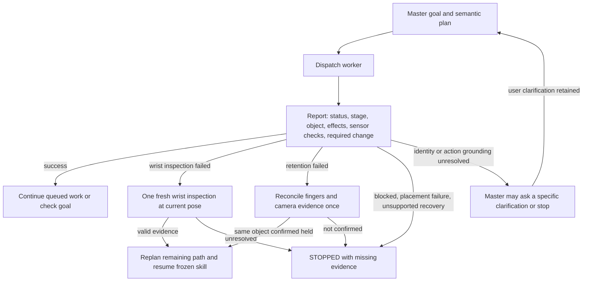

# Measured recovery handoffs

Policy revision: `transfer-2026-11-12-v3`.

The tuna-can run showed that returning a failure sentence to the master did not establish a useful next action.
The master repeated picks, repeated completion claims, and requested placing an object after it had been released.
The controller now handles physical failure transitions explicitly. No extra worker or model was added.

## What the controller enforces

- A wrist retry stays at the current pre-grasp pose. It does not repeat HOME, re-ground a different object, or ask
  the master for the same pick again. A successful measurement causes the full remaining path to be replanned.
- A retention retry checks actual held state. If the same object is confirmed held, pick-only can finish or the
  frozen transfer resumes carrying/placing. It never closes the fingers on the object again as part of this recovery.
- There is at most one such local recovery for a failed skill invocation. Another physical failure stops with a
  specific cause/required correction. No arbitrary VLM recovery motion is introduced.
- Identity/action-grounding failures allow a specific user clarification or a stop. Another worker request without
  clarification is rejected. There are at most two user questions per instruction.
- A failed measured completion gate stops immediately. The master cannot keep declaring completion against it.
- A failed visual goal check allows semantic replanning, but another completion claim against the same physical/task
  revision stops before repeating verification. Actual progress or a user goal update changes that revision.

## Current physical state and partial outcomes

Skill results include the last stage and explicit effects: whether a grasp was attempted, retention was verified,
release occurred, placement was verified, and what object is currently recorded as held.

Release is a separate execution stage. On a successful release command, the tools clear held state and the task
record immediately becomes `released`, with placement still unverified. Placement verification can later promote it
to `placed`. An exception or failed check after release cannot restore the earlier `holding` outcome.

Verified holding, release and verified placement are journaled when they occur, rather than only when the entire
skill succeeds. The master's execution summary describes current effects; the historical event list remains separate.

A failed pre-grasp inspection/planning attempt did not acquire an object and is closed without leaving a permanently
pending payload. An interrupted grasp/transport whose state is unknown remains unresolved until sensor reconciliation.
Unknown source pose and released-but-unverified placement are explicit outcomes that cannot pass measured completion.

User answers are retained in the effective request for all later master calls and the final goal check. They can
clarify identity or update the goal, but do not bypass wrist, contact or collision checks.

## Review evidence

`handoff_result` includes `details`: stage, selected object/reference IDs, current held object, partial effects,
recent sensor checks, available recovery, required change and recovery count. `recovery_dispatch` records the
controller's decision; `recovery_evidence` records held-state reconciliation. `physical_effect` records stage effects.
Wrist failures now include candidate associations or measured top/centre/footprint differences, not just a generic error.

`result.json` retains the original request, effective request with clarifications, current outcomes, history and
unresolved actions. Each instruction saves loaded prompts and prints its policy revision/hash.

## Validation and limits

99 targeted tests pass: controller/worker contracts, new recovery regressions, perception, saved frames, held checks,
and real CPU kinematics/collision transfer planning. Regressions cover wrong failed-object latches, release followed
by failed verification or an exception, local recovery success/failure, sensor-based retention recovery, repeated
completion claims and persistent user clarification.

No live Gemma/Isaac manipulation was run for this change. Object misclassification, overlapping masks, cross-view
association quality, geometry accuracy and grasp physics remain separate issues. Stopping an unsupported recovery
is intentional; it does not establish that a different grasp/view would be infeasible. A new supported recovery
tool or a physical/perception correction is needed before those cases can make further progress.

Restart the agent to load this revision. Existing running sessions were not changed.
